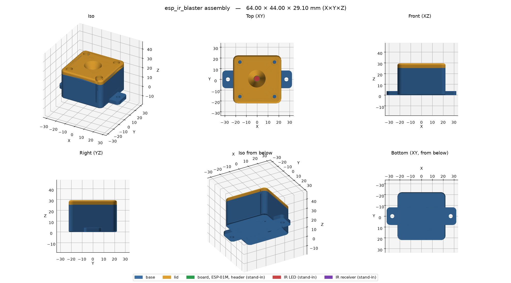
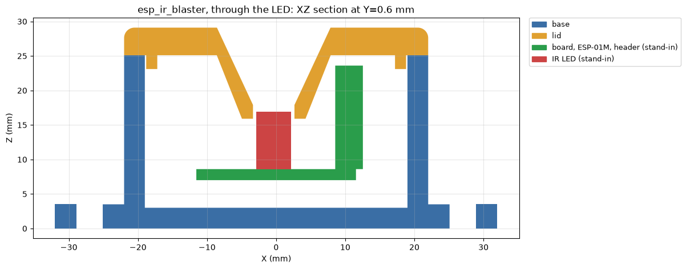
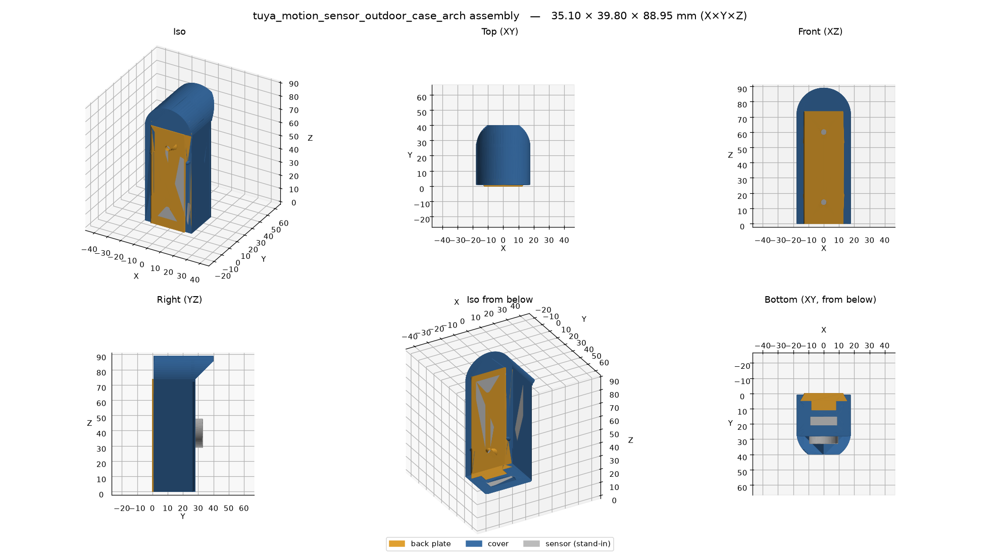
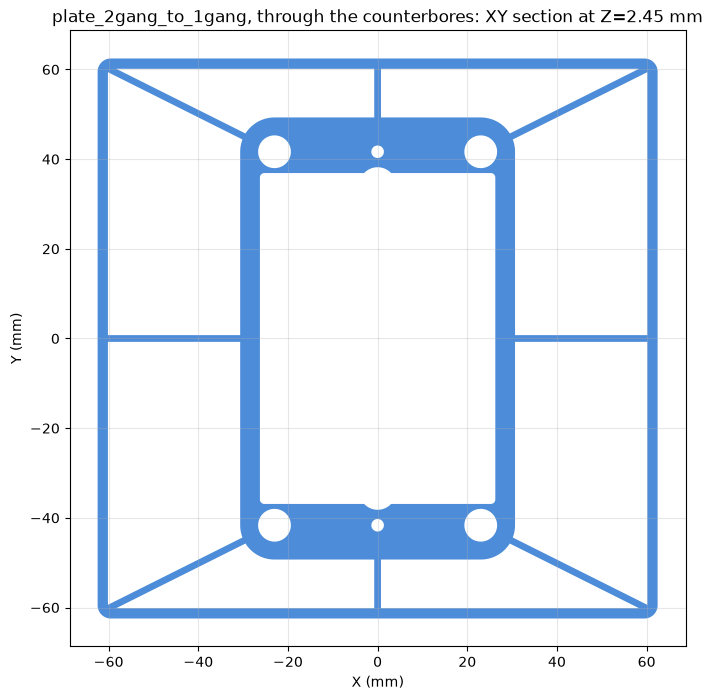

# b123d-print

[](https://pypi.org/project/b123d-print/)
[](https://github.com/KD5RYN/b123d-print/actions/workflows/ci.yml)
[](https://kd5ryn.github.io/b123d-print/)
[](LICENSE)

Design 3D-printable parts with an AI assistant — any assistant. You describe a part (photos,
caliper readings); the model writes a [build123d](https://github.com/gumyr/build123d) Python
script; b123d-print builds it in a sandbox, renders it, cuts cross-sections, runs print checks,
and exports the formats you pick: STEP, STL, 3MF, PNG.

**Documentation: https://kd5ryn.github.io/b123d-print/**

| | |
| --- | --- |
|  |  |
| *Two-part box for an IR transceiver board, with the board stand-ins* | *Section through the LED: lid cone, board, clearances* |
|  |  |
| *Outdoor sensor case: dovetail back plate + support-free cover* | *Wall plate: section just past the face, where the wall check looks* |

**Scope: parts for FDM 3D printing, nothing else.** Everything is built around a printed part:
print orientation with the bed at Z=0, hole compensation, mating clearance, calibration coupons,
and print checks built on [sourced FDM design rules](https://kd5ryn.github.io/b123d-print/BEST_PRACTICES/).
It is not a general CAD framework.

## What's in it

- **`b123d-print` package + CLI** — export, 6-view renders, colored multi-part cross-sections,
  and print checks: **overlap** between mating parts, **overhang** and **bridges** in print
  orientation, **thin features** and **wall thickness** around cuts, **holes** (round tops that
  sag), **bed-edge** fillets, **gaps** between moving parts, **probes** ("is the roof closed?").
- **`b123d-print-mcp`** — an [MCP](https://modelcontextprotocol.io) server, so it works from
  Claude Desktop, Claude Code, Gemini CLI, Cursor, VS Code, Codex and other MCP clients. Part
  scripts are model-written code: they run in a sandbox with a timeout and no network. Runs
  per client over stdio, on a home server [over SSH](https://kd5ryn.github.io/b123d-print/getting-started/ssh/)
  (one key and workspace per machine), or as one shared
  [HTTP service](https://kd5ryn.github.io/b123d-print/getting-started/http/) with a token and a workspace per client.
- **`compare`** — measure a part against a reference STL, 3MF or STEP: size, volume and surface
  differences, a 0–100 score, pass/fail, and a deviation view
  ([comparing parts](https://kd5ryn.github.io/b123d-print/using/compare/)).
- **Remix** — start from someone else's STL, 3MF or STEP: `import_model` makes a mesh a solid
  (coplanar triangles merged), the checks tell the original's problems from the ones the remix
  added, and a before/after view shows the change
  ([remixing a part](https://kd5ryn.github.io/b123d-print/using/remix/)).
- **The workflow, model-neutral** — MCP prompts plus an [`AGENTS.md`](AGENTS.md) any agent can
  read. The rules come from real prints; one exists because a part broke through a 0.05 mm skin
  that no render showed.
- **Examples** — four parts designed this way and printed, plus calibration coupons for holes,
  fits, and overhangs and bridges, in
  [`src/b123d_print/examples/`](src/b123d_print/examples/).

## Quick start

1. Install [uv](https://docs.astral.sh/uv/getting-started/installation/). It fetches Python 3.12
   and every pinned dependency for you.
2. Add the server to your MCP client — Claude Desktop shown, [other clients](https://kd5ryn.github.io/b123d-print/getting-started/mcp-clients/):

   ```json
   {
     "mcpServers": {
       "b123d-print": {
         "command": "uvx",
         "args": ["--from", "b123d-print", "b123d-print-mcp",
                  "--workspace", "/Users/you/parts"]
       }
     }
   }
   ```

3. Restart the client and ask: *"Design a 40 mm round spacer, 10 mm tall, with an M3 hole."*
   Files land in `/Users/you/parts/parts/<name>/out/`.

Parts on a home server instead? [Remote over SSH](https://kd5ryn.github.io/b123d-print/getting-started/ssh/):
`b123d-print setup-ssh --key laptop.pub --workspace laptop --add` on the server, then
`claude mcp add b123d-print -- ssh you@server` (or the same `ssh` command in any client).

The first start downloads a few hundred MB (mostly OpenCascade, the geometry kernel) and can
take a few minutes; later starts are fast. See [Troubleshooting](https://kd5ryn.github.io/b123d-print/troubleshooting/) if your
client gives up waiting.

> **Images:** `render_preview` and `section` return PNG images. The model can only check its own
> work if your client passes tool-result images to the model. Claude Desktop and Claude Code do;
> check your client's docs for others. Without it the checks still run, but the model designs
> blind — look at the PNGs in `out/` yourself.

## Documentation

| | |
| --- | --- |
| **Getting started** | [Quick start](https://kd5ryn.github.io/b123d-print/getting-started/quick-start/) · [MCP clients](https://kd5ryn.github.io/b123d-print/getting-started/mcp-clients/) (Claude Desktop, Claude Code, Gemini CLI, Cursor, VS Code, Codex) · [Remote over SSH (recommended)](https://kd5ryn.github.io/b123d-print/getting-started/ssh/) · [Over the network (HTTP)](https://kd5ryn.github.io/b123d-print/getting-started/http/) · [Docker](https://kd5ryn.github.io/b123d-print/getting-started/docker/) · [CLI and Python](https://kd5ryn.github.io/b123d-print/getting-started/cli/) |
| **Using it** | [How a session goes](https://kd5ryn.github.io/b123d-print/using/workflow/) · [MCP tools and prompts](https://kd5ryn.github.io/b123d-print/using/tools/) · [Output formats](https://kd5ryn.github.io/b123d-print/using/formats/) · [Settings](https://kd5ryn.github.io/b123d-print/using/settings/) · [Hole compensation](https://kd5ryn.github.io/b123d-print/using/hole-compensation/) · [Printer profiles](https://kd5ryn.github.io/b123d-print/using/printer-profiles/) · [The checks](https://kd5ryn.github.io/b123d-print/using/checks/) · [Sandbox](https://kd5ryn.github.io/b123d-print/using/sandbox/) · [Comparing parts](https://kd5ryn.github.io/b123d-print/using/compare/) · [Remixing a part](https://kd5ryn.github.io/b123d-print/using/remix/) |
| **Part scripts** | [The part script](https://kd5ryn.github.io/b123d-print/scripts/convention/) · [Checks API](https://kd5ryn.github.io/b123d-print/scripts/checks-api/) · [Examples](https://kd5ryn.github.io/b123d-print/scripts/examples/) · [Workflow rules](https://kd5ryn.github.io/b123d-print/scripts/rules/) · [Design rules (sourced)](https://kd5ryn.github.io/b123d-print/BEST_PRACTICES/) |
| **More** | [Reference](https://kd5ryn.github.io/b123d-print/reference/) · [Updating](https://kd5ryn.github.io/b123d-print/updating/) · [Troubleshooting](https://kd5ryn.github.io/b123d-print/troubleshooting/) · [Contributing](CONTRIBUTING.md) · [Agent evals](https://kd5ryn.github.io/b123d-print/contributing/evals/) · [Credits and licenses](https://kd5ryn.github.io/b123d-print/credits/) |

## Status

**0.x — early.** The part-script convention may still change. CI tests macOS and Ubuntu, the
built package via `uvx`, and the Docker image on every push. Windows is untested; Docker is the
safe route there.

## Credits and license

b123d-print is a thin layer over [build123d](https://github.com/gumyr/build123d),
[Open CASCADE Technology](https://dev.opencascade.org) (via [OCP](https://github.com/CadQuery/OCP)),
[lib3mf](https://github.com/3MFConsortium/lib3mf), [OrcaSlicer](https://github.com/SoftFever/OrcaSlicer)'s
printer data, [matplotlib](https://matplotlib.org), [NumPy](https://numpy.org), the
[MCP Python SDK](https://github.com/modelcontextprotocol/python-sdk) and [uv](https://github.com/astral-sh/uv).
Details and redistribution notes: [THIRD_PARTY.md](THIRD_PARTY.md).

[MIT](LICENSE) © KD5RYN and contributors.
