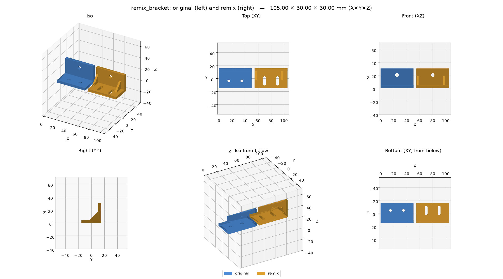
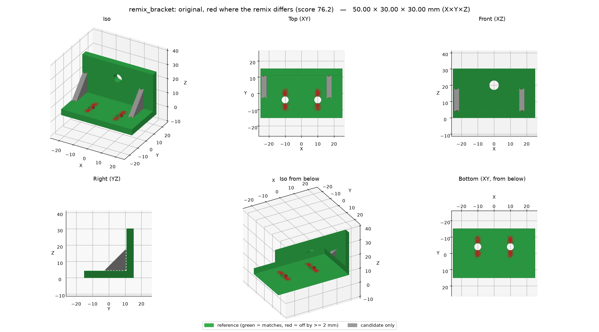

# b123d-print

**Vibe CAD for 3D printing.** Tell your AI assistant what you need, in plain words, with a
photo and a few caliper readings. It designs the part, looks at it from every side, checks it
for printing problems and hands you a file for your slicer. No CAD skills needed, and it works
with any assistant that supports MCP: Claude, Gemini CLI, Cursor, VS Code Copilot, Codex and
[more](<getting-started/mcp-clients.md#which-clients>) (which clients, and how to connect each).

## What you can make

Ask the way you would ask a friend who owns calipers and a CAD program. These were designed
this way, and printed:

- *"A box for this IR blaster board: the LED pointing out the top, a screw-on lid, two tabs to
  mount it on the wall."* A two-part case, checked against a stand-in of the board so it fits.
- *"An outdoor case for this motion sensor. It should slide off a wall plate and keep the rain
  out."* Dovetail rails, a click-in detent, a drain slot, and a cover that prints without
  supports.
- *"An adapter plate: 2-gang box behind, 1-gang smart switch in front."* Counterbored screw
  holes, and a wall check added after the first print broke through a 0.05 mm skin no render
  showed.

Or [remix](using/remix.md) a model you downloaded (STL, 3MF or STEP) and change it:

- *"Here's an L bracket STL I downloaded: turn its two mounting holes into slots and add
  gussets."* The original is loaded as a solid and changed, the checks tell the original's
  flaws from new ones, and a before/after view shows exactly what moved. (A demo for the docs,
  not printed yet.)

Before a long print, test the fit with a [fit-test template](using/templates.md): a thin, quick print
cut from the real part.

- *"Make a fit-test template of the mounting face so I can check the hole pattern."* The
  assistant shows you the face in red, asks you to confirm, and gives you a 1.2 mm plate with the
  part's exact holes: minutes to print instead of hours.

Measuring something big, curved or awkward? [Measuring for the AI](using/measuring.md) shows which tool
to use, how to photograph it with a scale, and a copy-paste measurement sheet and table of
offsets (stations along a datum) that hand the numbers over without ambiguity.

And the everyday things: a spacer, a knob, a bracket, a cable clip, a replacement for a broken
part you can measure. Then keep talking to it: *"make it 5 mm taller"*, *"add a hole for an M4
screw"*, *"the lid is too tight"*. Every dimension stays a named number in a short
[build123d](https://github.com/gumyr/build123d) script, so each change is exact, and you get
STEP files to keep editing in other CAD if you want.

| | |
| --- | --- |
|  |  |
| *Two-part box for an IR transceiver board, with the board stand-ins* | *Section through the LED: lid cone, board, clearances* |
|  |  |
| *Outdoor sensor case: dovetail back plate + support-free cover* | *Wall plate: section just past the face, where the wall check looks* |
|  |  |
| *Remix: a downloaded bracket, before and after* | *Where the remix differs: red cut, grey added* |

## Get started in 2 minutes

The MCP server is a plug-in that gives your AI assistant CAD tools. It runs on your own
computer. The easy way: paste this into your AI assistant (Claude Code, Claude Desktop, Cursor,
Gemini CLI, Codex, …):

```text
Install the b123d-print MCP server for me. It runs with
`uvx --from b123d-print b123d-print-mcp --workspace <folder>`
where <folder> is a folder for my parts, such as ~/parts.
Install uv first if it is missing (https://docs.astral.sh/uv/).
Add the server to your MCP settings, tell me when to restart you,
and after the restart check that its tools (list_parts, new_part,
build_part, ...) are available.
```

It will probably ask to run a few commands: that is expected. Prefer to do it yourself, or want
to see what it does? [Quick start](getting-started/quick-start.md) has the three manual steps.
Then ask: *"Design a 40 mm round spacer, 10 mm tall, with an M3 hole."*

**Scope: parts for FDM 3D printing, nothing else.** Everything is built around a printed part:
print orientation with the bed at Z=0, hole compensation, mating clearance, calibration coupons,
and print checks built on [sourced FDM design rules](BEST_PRACTICES.md). It is not a general CAD
framework.

## What's in it

- **`b123d-print` package + CLI** — export, 6-view renders, colored multi-part cross-sections,
  and print checks: **overlap** between mating parts, **overhang** and **bridges** in print
  orientation, **thin features** and **wall thickness** around cuts, **holes** (round tops that
  sag), **bed-edge** fillets, **gaps** between moving parts, **probes** ("is the roof closed?").
  See [The checks](using/checks.md) and [CLI and Python](getting-started/cli.md).
- **`b123d-print-mcp`** — an [MCP](https://modelcontextprotocol.io) server, so it works from
  Claude Desktop, Claude Code, Gemini CLI, Cursor, VS Code, Codex and other MCP clients. Part
  scripts are model-written code: they run in a [sandbox](using/sandbox.md) with a timeout and
  no network.
- **[`compare`](using/compare.md)** — measure a part against a reference STL, 3MF or STEP: size,
  volume and surface differences, a 0–100 score, pass/fail, and a deviation view.
- **[Remix](using/remix.md)** — start from someone else's STL, 3MF or STEP: `import_model` makes
  a mesh a solid (coplanar triangles merged), the checks tell the original's problems from the
  ones the remix added, and a before/after view shows the change.
- **Fit-test templates** — a quick thin print of a face, a slice or a region of the real part
  (same holes and clearances) to check the hole pattern and the fits before the full print
  ([fit-test templates](using/templates.md)).
- **The workflow, model-neutral** — [MCP prompts](using/tools.md#prompts) plus an
  [`AGENTS.md`](scripts/rules.md) any agent can read. The rules come from real prints; one exists
  because a part broke through a 0.05 mm skin that no render showed.
- **[Examples](scripts/examples.md)** — four parts designed this way and printed, plus
  calibration coupons for holes, fits, and overhangs and bridges.

## Where to start

- New here: [Quick start](getting-started/quick-start.md); other assistants:
  [connect your MCP client](getting-started/mcp-clients.md).
- Parts on a home server, many agents sharing one server, or Docker:
  [Advanced: run it on another machine](advanced/index.md).
- Writing or reviewing part scripts: [The part script](scripts/convention.md) and the
  [Checks API](scripts/checks-api.md).
- Questions first: the [FAQ](faq.md). Taking a part to the slicer: [From part to print](using/slicing.md).
- Something wrong: [Troubleshooting](troubleshooting.md).

## Platforms and status

**0.x — early.** The part-script convention may still change. CI tests macOS, Ubuntu and
Windows, the built package via `uvx`, and the Docker image on every push.

| Platform | Local (stdio) | OS sandbox for part scripts | SSH mode | HTTP mode |
| --- | --- | --- | --- | --- |
| macOS | yes | `sandbox-exec` | server and client | server and client |
| Linux | yes | bubblewrap (install it) | server and client | server and client |
| Windows 10/11 | yes, natively | **none**: process isolation + audit hook ([Sandbox](using/sandbox.md)) | client only | client; the server runs too, without an OS sandbox |

On Windows, run the server in [WSL2](https://learn.microsoft.com/windows/wsl/install) (with
bubblewrap) or [Docker](getting-started/docker.md) when the part scripts come from a model you
don't watch, or from other people. As a client of an SSH or HTTP server elsewhere, Windows needs
nothing extra: `b123d-print pull` uses the OpenSSH client built into Windows (`ssh.exe`).
