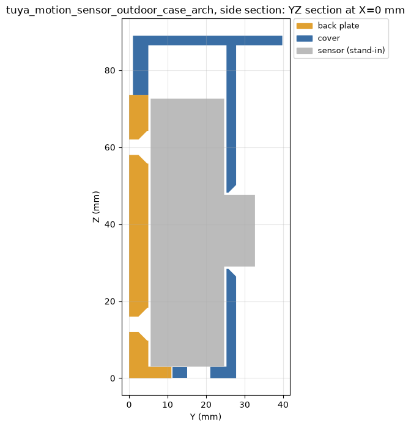
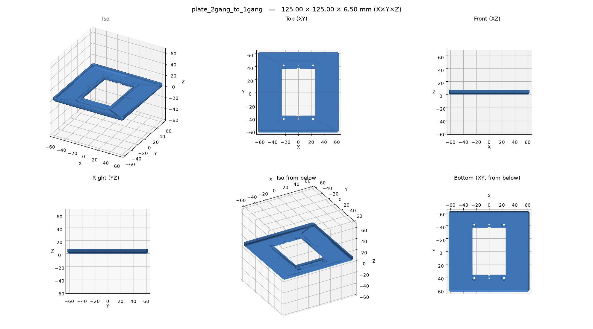
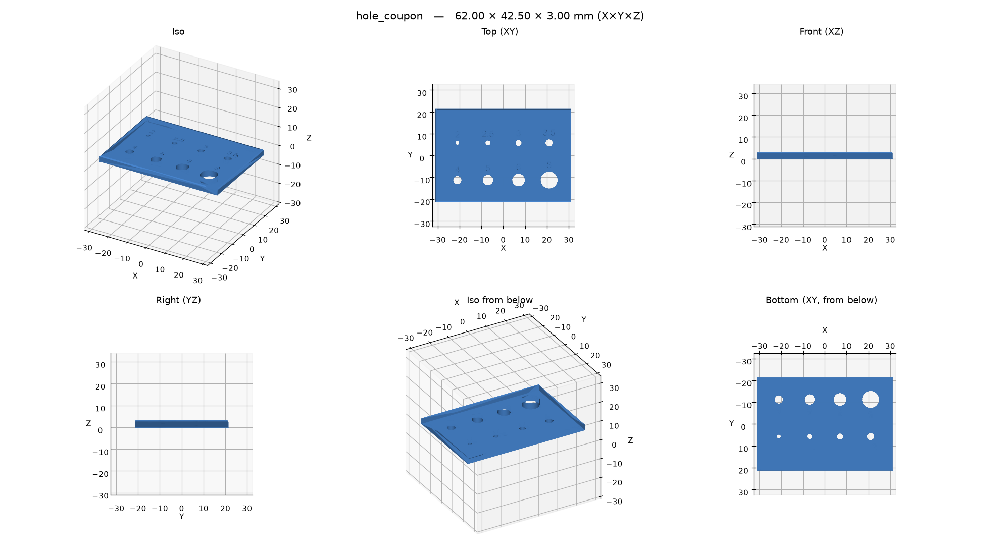

# Examples

Bundled with the package, in
[`src/b123d_print/examples/`](https://github.com/KD5RYN/b123d-print/tree/main/src/b123d_print/examples).
Start a part from one with `new_part("my_part", example="<example>")` over MCP or
`b123d-print new my_part --from <example>`; `b123d-print examples` lists them.

## `esp_ir_blaster`

A two-part box (base and screw-on lid) for an ESP8285 IR transceiver board. Shows an
`assembly(d)` with board, LED and receiver stand-ins, so the overlap check proves the board fits.

*Section through the LED: lid cone, board, clearances.*
[Script](https://github.com/KD5RYN/b123d-print/blob/main/src/b123d_print/examples/esp_ir_blaster/esp_ir_blaster.py)

## `tuya_motion_sensor_outdoor_case`

An outdoor case for a PIR motion sensor: a back plate stays on the wall, a hooded cover slides
down over it on dovetails and clicks into detents. Variants: the standard one (flat on the
wall, flat-top cover), `tilt15` (plate tipped 15° down) and `arch` (a cover that prints without
supports).

*Section through the middle of the arch variant.*

[Script](https://github.com/KD5RYN/b123d-print/blob/main/src/b123d_print/examples/tuya_motion_sensor_outdoor_case/tuya_motion_sensor_outdoor_case.py)

## `plate_2gang_to_1gang`

A 2-gang to 1-gang adapter wall plate for a smart switch, in two sizes (`VARIANTS`). Shows hole
compensation from the config and the wall check around the counterbores — the first print of
this part broke through a 0.05 mm skin there.

*Section just past the face, where the wall check looks.*
[Script](https://github.com/KD5RYN/b123d-print/blob/main/src/b123d_print/examples/plate_2gang_to_1gang/plate_2gang_to_1gang.py)

## `testblock`

The smallest complete example: a block with a rounded notch, a few measured dimensions, one
fillet, one cut.
[Script](https://github.com/KD5RYN/b123d-print/blob/main/src/b123d_print/examples/testblock/testblock.py)

## `hole_coupon`

The calibration coupon for [hole compensation](../using/hole-compensation.md): holes cut at
their nominal size, labeled.
[Script](https://github.com/KD5RYN/b123d-print/blob/main/src/b123d_print/examples/hole_coupon/hole_coupon.py)
