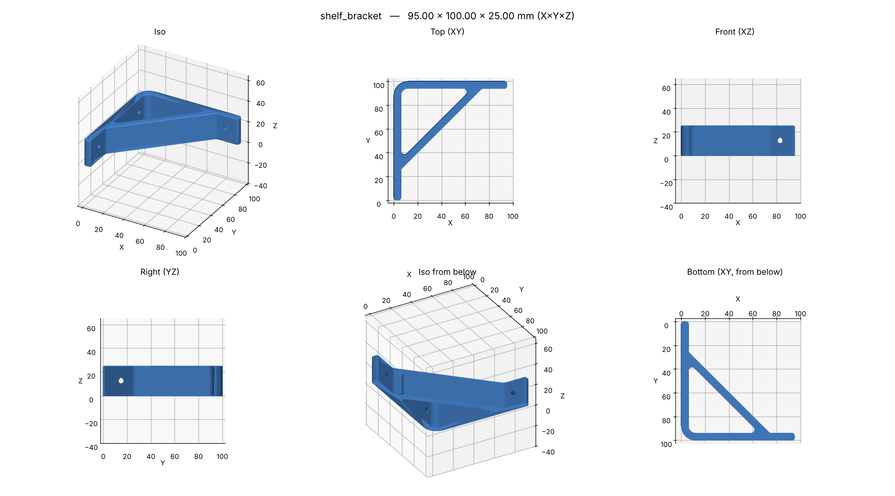
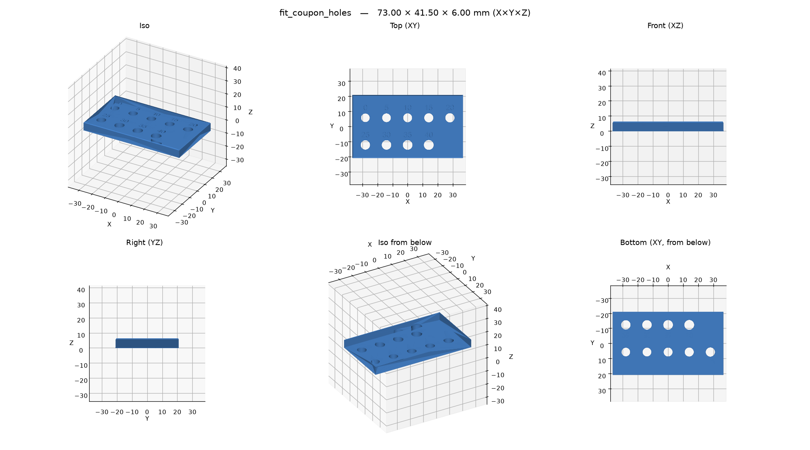
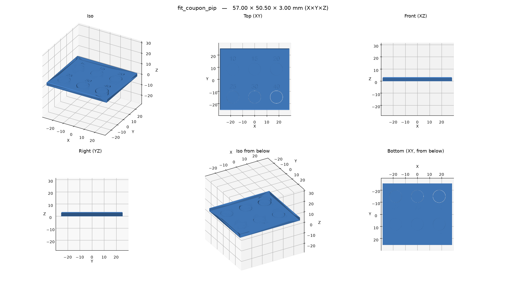
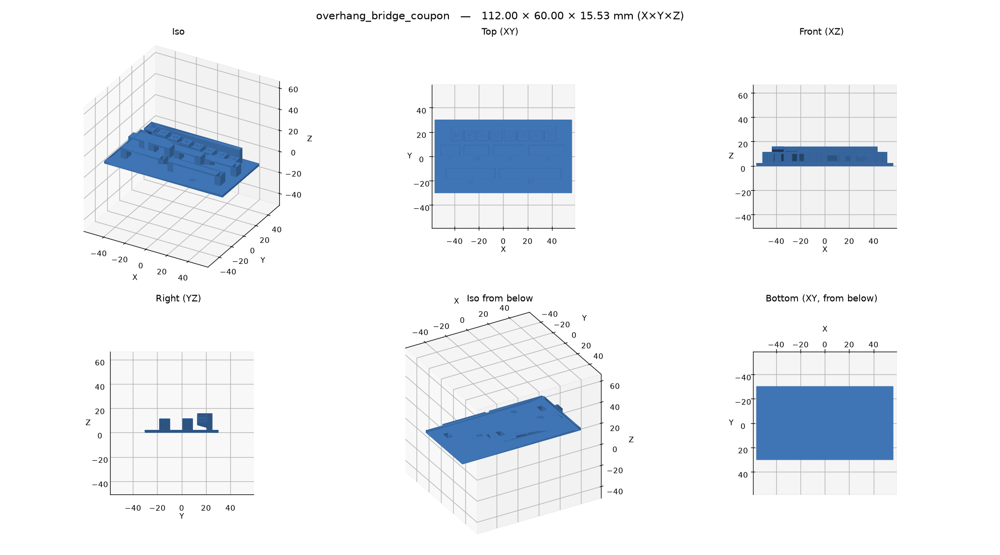

# Examples

Bundled with the package, in
[`src/b123d_print/examples/`](https://github.com/KD5RYN/b123d-print/tree/main/src/b123d_print/examples).
Start a part from one with `new_part("my_part", example="<example>")` over MCP or
`b123d-print new my_part --from <example>`; `b123d-print examples` lists them.

## `remix_bracket`

A [remix](../using/remix.md): an L bracket that exists only as an STL (`ref/l_bracket.stl`, made
for this example, CC0) is loaded with `import_model` and changed: its two mounting holes become
slots, and two gussets stiffen the corner. The faceted 6 mm hole in the upright is the
original's, so its overhang is reported as *inherited from the original*. `new_part(...,
example="remix_bracket")` copies the reference file too.

*The deviation view: red where the slots were cut, grey where the gussets were added.*

[Script](https://github.com/KD5RYN/b123d-print/blob/main/src/b123d_print/examples/remix_bracket/remix_bracket.py)

## `esp_ir_blaster`

A two-part box (base and screw-on lid) for an ESP8285 IR transceiver board. Shows an
`assembly(d)` with board, LED and receiver stand-ins, so the overlap check proves the board fits.

*Section through the LED: lid cone, board, clearances.* Its `templates(d)` adds two
[fit-test templates](../using/templates.md) to every export: the top of the standoffs and lid
posts (set the board on it), and the lid's inner face (lay it on the base, try the screws).
[Script](https://github.com/KD5RYN/b123d-print/blob/main/src/b123d_print/examples/esp_ir_blaster/esp_ir_blaster.py)

## `tuya_motion_sensor_outdoor_case`

An outdoor case for a PIR motion sensor: a back plate stays on the wall, a hooded cover slides
down over it on dovetails and clicks into detents. Variants: the standard one (flat on the
wall, flat-top cover), `tilt15` (plate tipped 15° down) and `arch` (a cover that prints without
supports).

*Section through the middle of the arch variant.*

[Script](https://github.com/KD5RYN/b123d-print/blob/main/src/b123d_print/examples/tuya_motion_sensor_outdoor_case/tuya_motion_sensor_outdoor_case.py)

## `plate_2gang_to_1gang`

A 2-gang to 1-gang adapter wall plate for a smart switch, in two sizes (`VARIANTS`). Shows hole
compensation from the config and the wall check around the counterbores — the first print of
this part broke through a 0.05 mm skin there.

*Section just past the face, where the wall check looks.*
[Script](https://github.com/KD5RYN/b123d-print/blob/main/src/b123d_print/examples/plate_2gang_to_1gang/plate_2gang_to_1gang.py)

## `shelf_bracket`

The [`structural` style](../using/design-review.md) in one part: an L bracket with a diagonal
brace that prints lying on its side, so the shelf's load bends the arms along the layers, not
across them. Every inside corner is filleted at half the wall or more, the outside corner is
inside radius + wall, the arms are 6 mm (13 lines), and the screw holes are teardrops at least
2.5 diameters from every edge. `b123d-print metrics shelf_bracket` has no findings for it;
the same L with sharp corners, or standing up, gets them ([DS-T*](../DESIGN_GUIDE.md#34-structural-load-bearing)).
An example with estimated sizes: not printed yet.
[Script](https://github.com/KD5RYN/b123d-print/blob/main/src/b123d_print/examples/shelf_bracket/shelf_bracket.py)

## `split_trim`

A 420 mm trim strip, too long for a 256 mm bed, cut in the middle with
[`split()`](../using/splitting.md#in-the-part-script-b123d_printjoints) into two 210 mm pieces.
A bowtie key sunk into the back takes the pull across the seam; two square pins standing on a
corner (a 45° roof, no bridge) line the faces up. The pieces print visible face down; the key
and the pins are separate prints, laid flat. `Gap` checks prove the key and the pins have
exactly `CLEARANCE` all round, a `Wall` check measures the material between the key recess and a
pin socket, and two fit-test templates cut each piece's end around the joint. Variant
`dovetail`: one through dovetail instead (the pieces slide together along Z). An example: not
printed yet.
[Script](https://github.com/KD5RYN/b123d-print/blob/main/src/b123d_print/examples/split_trim/split_trim.py)

## `testblock`

The smallest complete example: a block with a rounded notch, a few measured dimensions, one
fillet, one cut.
[Script](https://github.com/KD5RYN/b123d-print/blob/main/src/b123d_print/examples/testblock/testblock.py)

## `hole_coupon`

The calibration coupon for [hole compensation](../using/hole-compensation.md): vertical holes in
the plate and horizontal ones in the tab (round, and teardrop), cut at their nominal size and
labeled. Measures `hole_comp` and `hole_comp_h`.
[Script](https://github.com/KD5RYN/b123d-print/blob/main/src/b123d_print/examples/hole_coupon/hole_coupon.py)

## `fit_coupon`

Measures the fits, per side, for your printer and material: a 6 mm peg (part `peg`) tried in
holes 0 to 0.40 mm bigger per side (part `holes`; the label is hundredths of a mm), and discs
printed inside rings with gaps of 0.10 to 0.40 mm (part `pip`). The results go into
`press_fit`, `clearance`, `free_fit` and `pip_clearance` ([Settings](../using/settings.md#keys)).
Its `checks(d)` shows a declared `Gap` (the discs are closer than `pip_clearance` on purpose)
and `ThinFeature` ignoring the engraved labels.

[Script](https://github.com/KD5RYN/b123d-print/blob/main/src/b123d_print/examples/fit_coupon/fit_coupon.py)

## `overhang_bridge_coupon`

Measures your printer's limits: ledges whose undersides are 40° to 75° from vertical, and
bridges of 5 to 40 mm between pillars. The steepest clean ledge is your `max_overhang`, the
longest clean bridge your `max_bridge`. The overhang and bridge checks warn on it on purpose.
[Script](https://github.com/KD5RYN/b123d-print/blob/main/src/b123d_print/examples/overhang_bridge_coupon/overhang_bridge_coupon.py)
