# Examples

Bundled with the package, in
[`src/b123d_print/examples/`](https://github.com/KD5RYN/b123d-print/tree/main/src/b123d_print/examples).
Start a part from one with `new_part("my_part", example="<example>")` over MCP or
`b123d-print new my_part --from <example>`; `b123d-print examples` lists them.

## `remix_bracket`

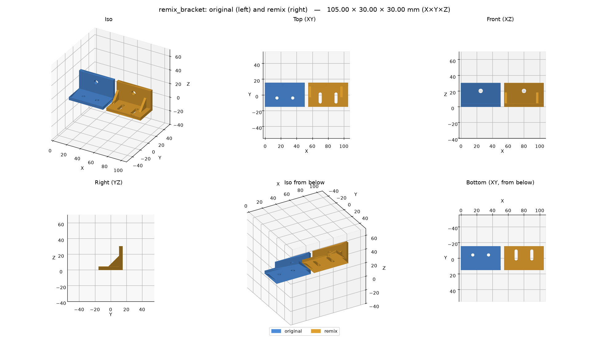

A [remix](../using/remix.md): an L bracket that exists only as an STL (`ref/l_bracket.stl`, made
for this example, CC0) is loaded with `import_model` and changed: its two mounting holes become
slots, and two gussets stiffen the corner. The faceted 6 mm hole in the upright is the
original's, so its overhang is reported as *inherited from the original*. `new_part(...,
example="remix_bracket")` copies the reference file too.

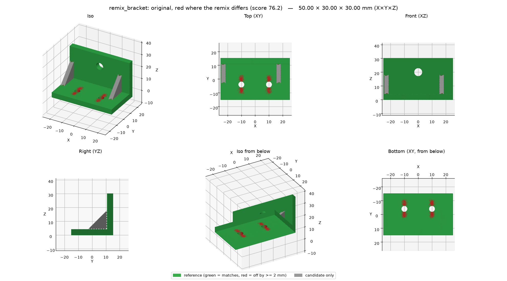

*The deviation view: red where the slots were cut, grey where the gussets were added.*

[Script](https://github.com/KD5RYN/b123d-print/blob/main/src/b123d_print/examples/remix_bracket/remix_bracket.py)

## `esp_ir_blaster`

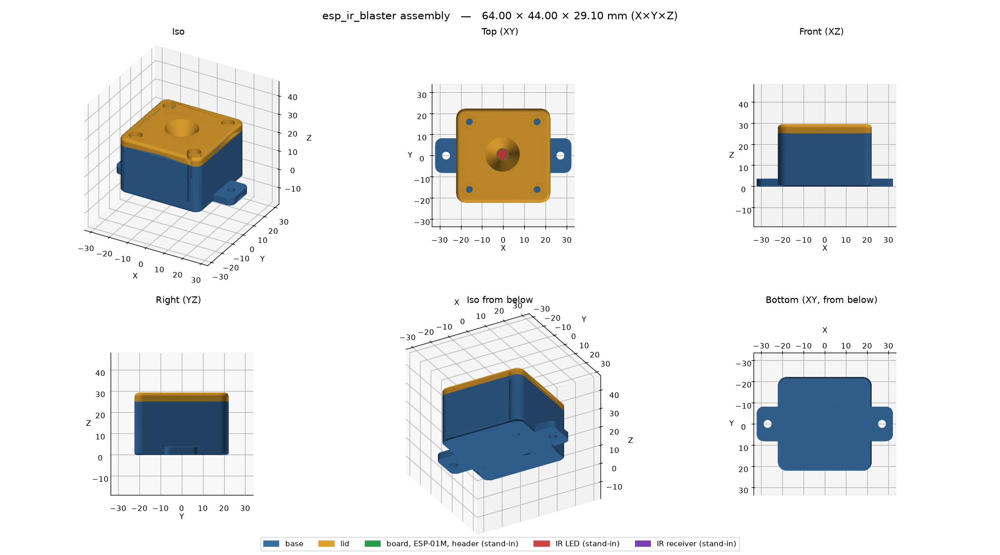

A two-part box (base and screw-on lid) for an ESP8285 IR transceiver board. Shows an
`assembly(d)` with board, LED and receiver stand-ins, so the overlap check proves the board fits.

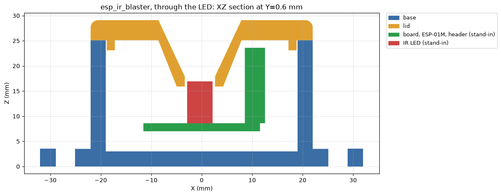

*Section through the LED: lid cone, board, clearances.* Its `templates(d)` adds two
[fit-test templates](../using/templates.md) to every export: the top of the standoffs and lid
posts (set the board on it), and the lid's inner face (lay it on the base, try the screws).
[Script](https://github.com/KD5RYN/b123d-print/blob/main/src/b123d_print/examples/esp_ir_blaster/esp_ir_blaster.py)

## `tuya_motion_sensor_outdoor_case`

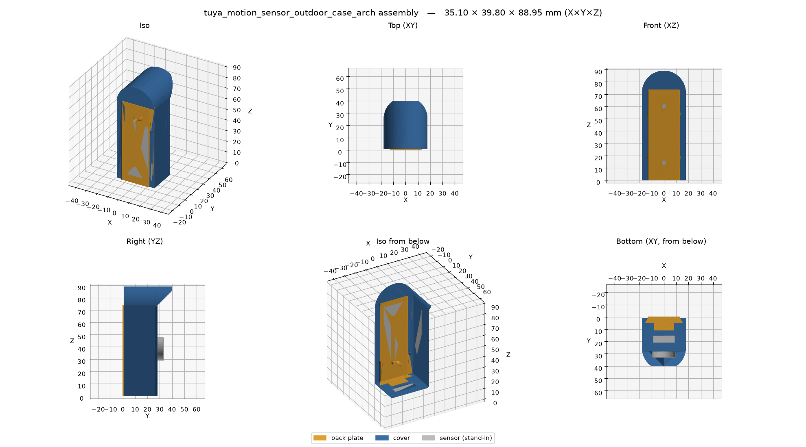

An outdoor case for a PIR motion sensor: a back plate stays on the wall, a hooded cover slides
down over it on dovetails and clicks into detents. Variants: the standard one (flat on the
wall, flat-top cover), `tilt15` (plate tipped 15° down) and `arch` (a cover that prints without
supports).

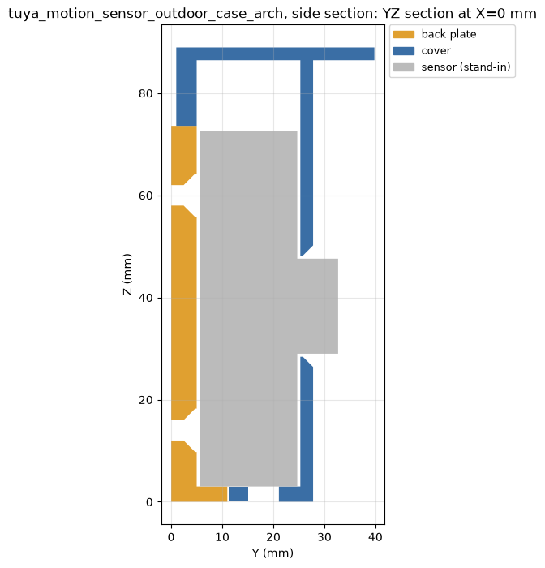

*Section through the middle of the arch variant.*

[Script](https://github.com/KD5RYN/b123d-print/blob/main/src/b123d_print/examples/tuya_motion_sensor_outdoor_case/tuya_motion_sensor_outdoor_case.py)

## `plate_2gang_to_1gang`

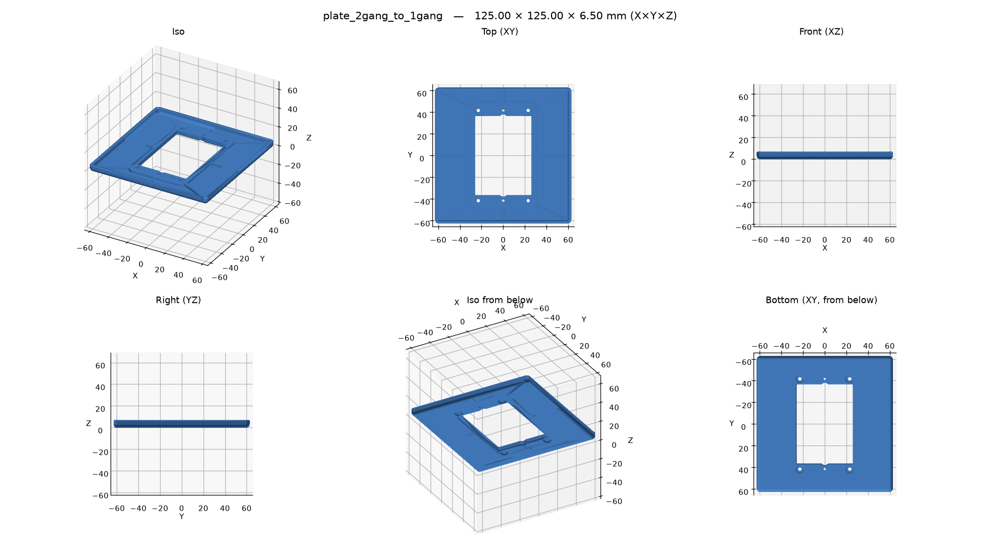

A 2-gang to 1-gang adapter wall plate for a smart switch, in two sizes (`VARIANTS`). Shows hole
compensation from the config and the wall check around the counterbores — the first print of
this part broke through a 0.05 mm skin there.

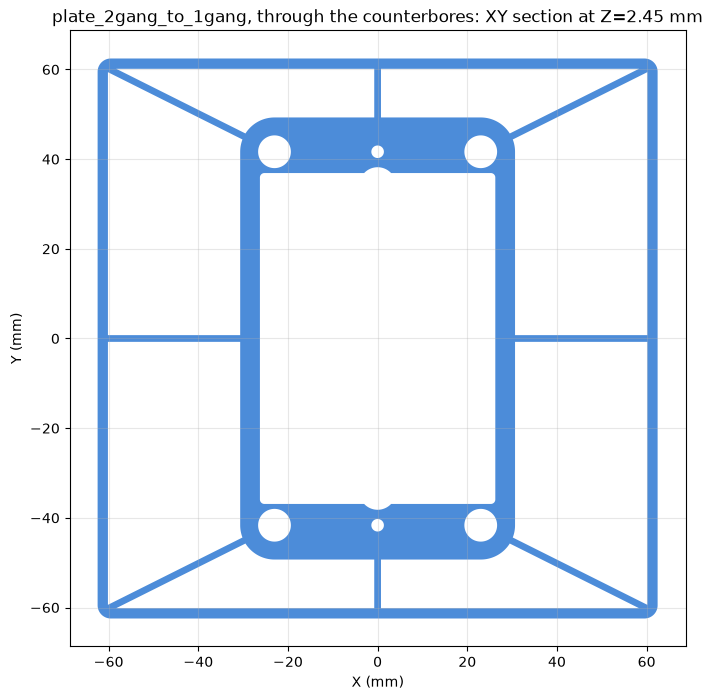

*Section just past the face, where the wall check looks.*

It is also the [replicate](../using/replicate.md) example: a copy of an injection-molded plate,
started from the original's drawing (`ref/original_drawing.png`, not a mesh). Its `MEASURE.md`
is the replication spec: the hole spacings, hole sizes, counterbores and opening are critical
and modeled as measured; the outline and depths are free (the `140` variant makes them bigger);
the molded back's coring and extra screw bosses became a solid frame and straight ribs, each
with its reason. `b123d-print spec plate_2gang_to_1gang` prints the table.

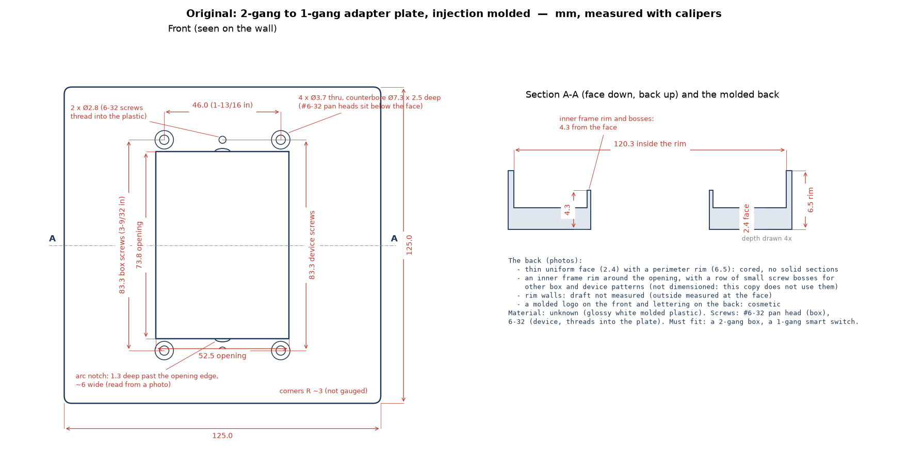

[Script](https://github.com/KD5RYN/b123d-print/blob/main/src/b123d_print/examples/plate_2gang_to_1gang/plate_2gang_to_1gang.py) ·
[MEASURE.md](https://github.com/KD5RYN/b123d-print/blob/main/src/b123d_print/examples/plate_2gang_to_1gang/MEASURE.md)

## `shelf_bracket`

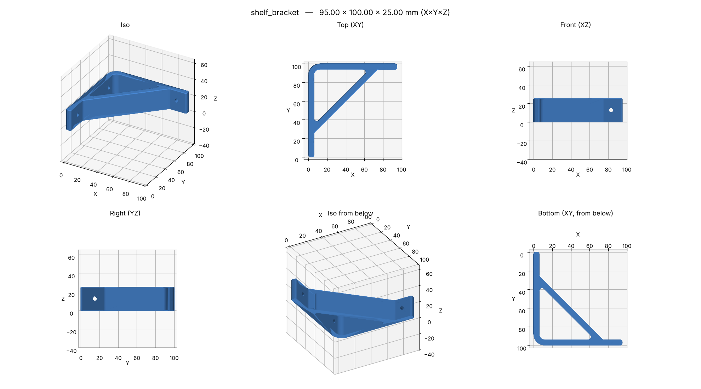

The [`structural` style](../using/design-review.md) in one part: an L bracket with a diagonal
brace that prints lying on its side, so the shelf's load bends the arms along the layers, not
across them. Every inside corner is filleted at half the wall or more, the outside corner is
inside radius + wall, the arms are 6 mm (13 lines), and the screw holes are teardrops at least
2.5 diameters from every edge. `b123d-print metrics shelf_bracket` has no findings for it;
the same L with sharp corners, or standing up, gets them ([DS-T*](../DESIGN_GUIDE.md#34-structural-load-bearing)).
An example with estimated sizes: not printed yet.
[Script](https://github.com/KD5RYN/b123d-print/blob/main/src/b123d_print/examples/shelf_bracket/shelf_bracket.py)

## `banana`

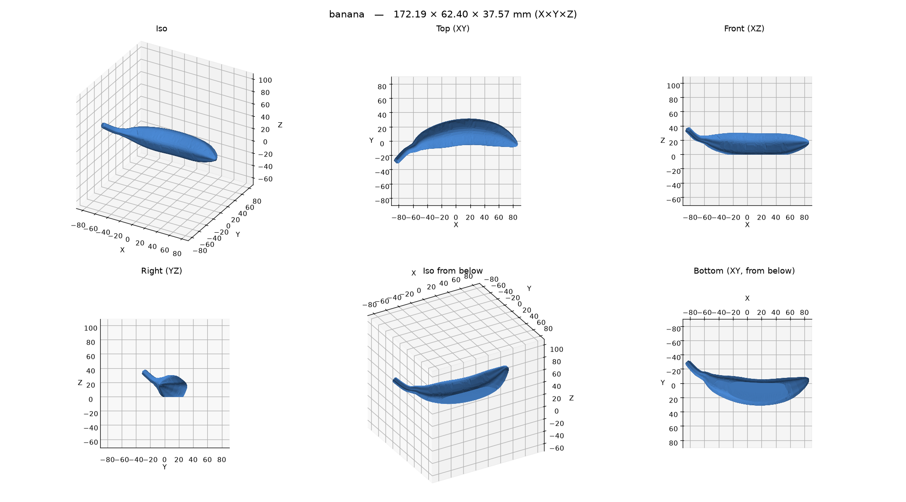

The [`organic` style](../using/design-review.md) and the [organic recipes](../using/recipes.md#organic-shapes)
in one part, CC0: a whole banana lying on its side. The body is `spine_loft`: soft five-ridged
sections across a curved spine, full in the middle, a long taper to the neck and a quick one to
a blunt, rounded blossom end; the ridges sharpen towards both ends. The stem is a
`tapered_sweep` that bends on with the curve and curls up, its cut end eased by a small fillet;
`organic_blend` joins it to the neck with a lofted collar, not a fillet. `flat_base` cuts a
4 mm strip under the belly for the bed. Nothing is a box or a cylinder, the ends lift by
different amounts, and `b123d-print metrics banana` has no suggestions for it. It prints lying
down, the curve in the layers, with tree supports under the lifted ends and the stem
([DS-O*](../DESIGN_GUIDE.md#35-organic-natural)). Sizes are estimates for a medium banana: not
printed yet.
[Script](https://github.com/KD5RYN/b123d-print/blob/main/src/b123d_print/examples/banana/banana.py)

## `twisted_vase`

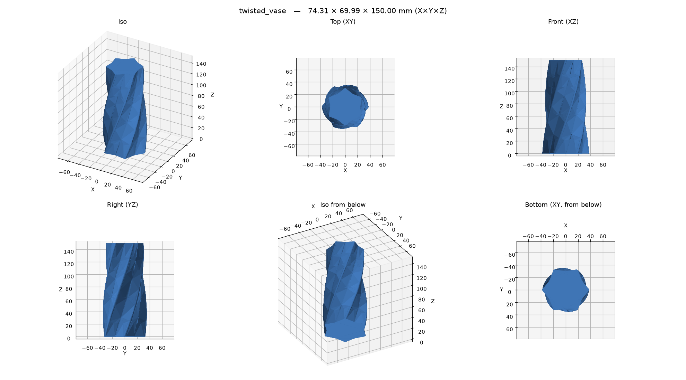

The [`decorative` style](../using/design-review.md) and vase mode in one part: a six-pointed
star with rounded points, lofted 150 mm up with a quarter turn and a taper to 80 % (the
[`twisted_loft` recipe](../using/recipes.md#decorative-bodies-and-vase-mode)), so the points
become spiral ridges that read from across a room. It is a solid on purpose: its
`PRINT = {"vase": True, ...}` tells the print sheet to give the slicer's vase-mode switch, and the
slicer prints one continuous wall from the outside, with no top. `b123d-print metrics
twisted_vase` notes that every layer is one closed contour and how far the wall leans
([DS-D*](../DESIGN_GUIDE.md#36-decorative-vase)). For dry flowers: a vase for water wants a liner.
CC0. An example with chosen sizes: not printed yet.
[Script](https://github.com/KD5RYN/b123d-print/blob/main/src/b123d_print/examples/twisted_vase/twisted_vase.py)

## `text_knob`

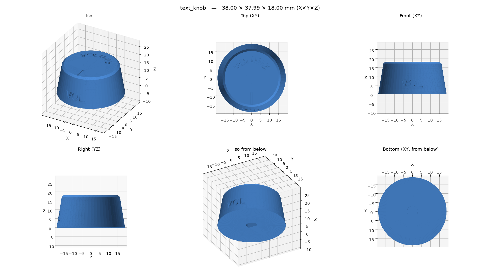

Text beyond flat labels: a 38 mm control knob for a 6 mm D shaft (a snug press fit), standing on
its base. "VOL" is wrapped into the tapered side with the
[`text_on_surface` recipe](../using/recipes.md#text-on-curved-faces-and-paths), sunk 0.8 mm along
the surface normal, so the letters keep their size on the curve; "VOLUME" is sunk 0.6 mm along an
arc on the top with `text_on_path`, and a pointer groove sits above the side label. The text and
the pointer are one solid, `label(d)`: for a two-colour print it is the inlay that fills the
pockets (`body(d) & label(d)`). `check` warns on the 4.6 mm bridge over the bore, the roofs of the
sunk side letters and the pointed tips of the V's. CC0. An example with chosen sizes: not printed
yet.
[Script](https://github.com/KD5RYN/b123d-print/blob/main/src/b123d_print/examples/text_knob/text_knob.py)

## `split_trim`

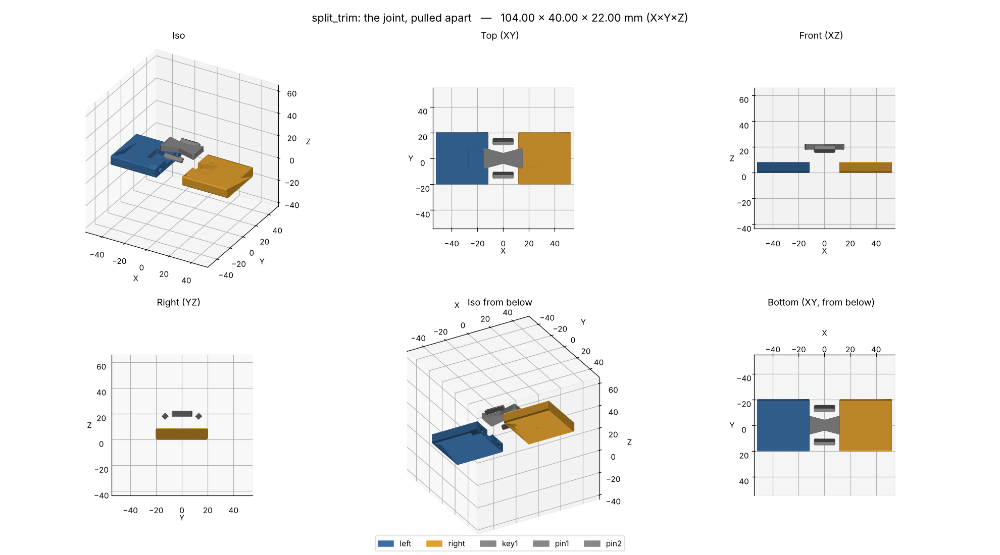

A 420 mm trim strip, too long for a 256 mm bed, cut in the middle with
[`split()`](../using/splitting.md#in-the-part-script-b123d_printjoints) into two 210 mm pieces.
A bowtie key sunk into the back takes the pull across the seam; two square pins standing on a
corner (a 45° roof, no bridge) line the faces up. The pieces print visible face down; the key
and the pins are separate prints, laid flat. `Gap` checks prove the key and the pins have
exactly `CLEARANCE` all round, a `Wall` check measures the material between the key recess and a
pin socket, and two fit-test templates cut each piece's end around the joint. Variant
`dovetail`: one through dovetail instead (the pieces slide together along Z). An example: not
printed yet.
[Script](https://github.com/KD5RYN/b123d-print/blob/main/src/b123d_print/examples/split_trim/split_trim.py)
## `jar_lid`

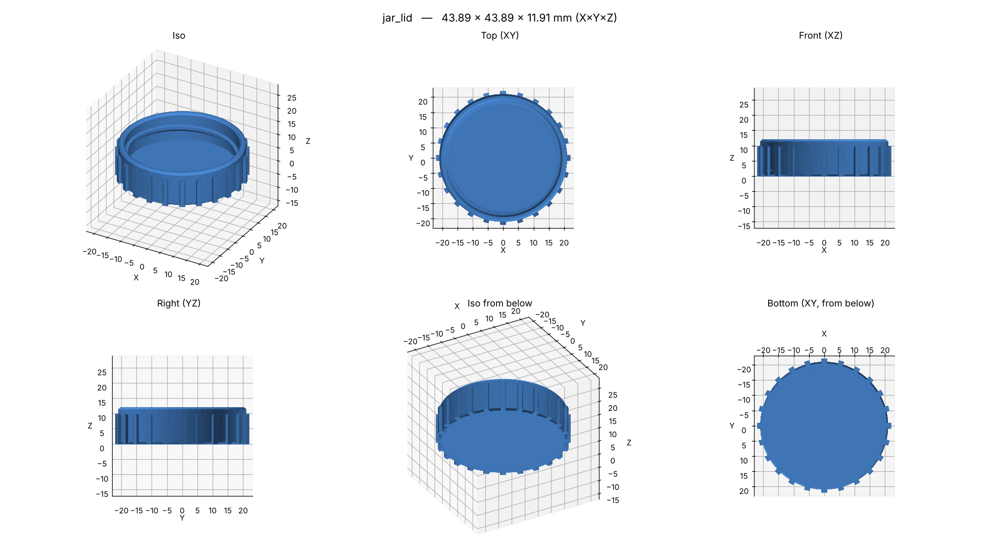

A screw cap for a 38-400 jar or bottle neck, with an internal plastic bottle thread from
`bd_warehouse.thread.PlasticBottleThread` (ASTM D2911, buttress profile). It prints top-down:
the thread's steep flank faces down and its flat flank faces up, so it needs no supports. The
thread's radial clearance is your sliding fit, and both ends fade out. The faded ends are
excluded from the thin-feature check (`ThinFeature(ignore=...)`). See
[Threads, fasteners and gears](../using/threads-fasteners-gears.md).
[Script](https://github.com/KD5RYN/b123d-print/blob/main/src/b123d_print/examples/jar_lid/jar_lid.py)

## `insert_bracket`

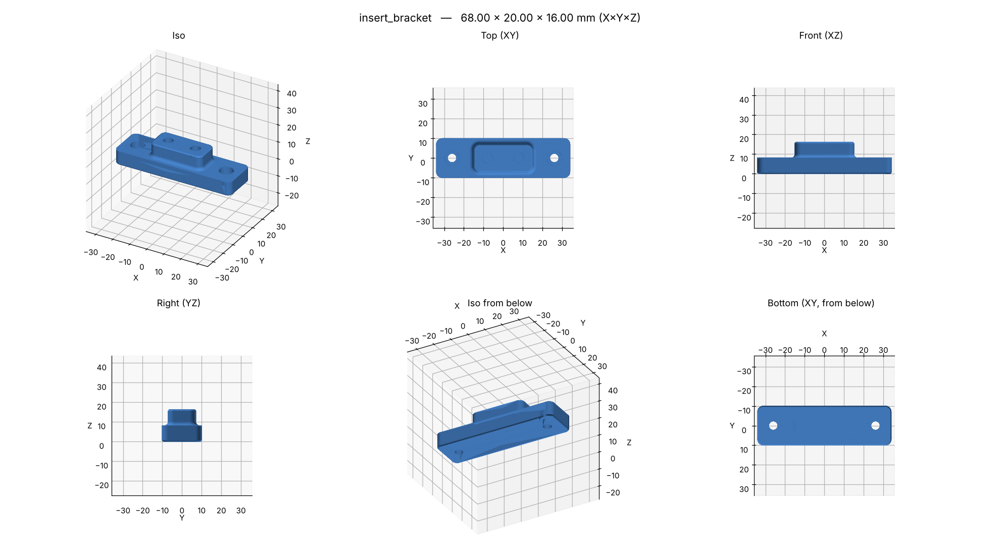

A mounting block with two CNC Kitchen M4 heat-set inserts on top and two counterbored M4 screw
holes in its foot. The insert's length and minimum wall come from bd_warehouse's `HeatSetNut`
table, the screw's clearance and head sizes from `SocketHeadCapScrew`. Each hole is cut once
with `HOLE_COMP`: the insert hole at the maker's 5.6 mm, 1 mm deeper than the insert. `Wall`
checks measure the material around the inserts and the counterbores.
[Script](https://github.com/KD5RYN/b123d-print/blob/main/src/b123d_print/examples/insert_bracket/insert_bracket.py)

## `gear_pair`

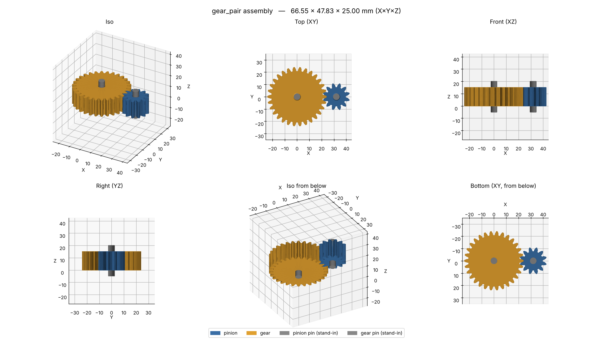

A 12-tooth pinion and a 30-tooth gear, module 1.5, made with py_gearworks. The pinion gets the
profile shift that avoids undercut, `mesh_to` sets the center distance, and 0.3 mm of backlash
in total is measured by a `Gap` check in the assembly (0.15 mm at the closest point). Both print
flat, with free-fit bores on 5 mm pins.
[Script](https://github.com/KD5RYN/b123d-print/blob/main/src/b123d_print/examples/gear_pair/gear_pair.py)

## `flip_hinge`

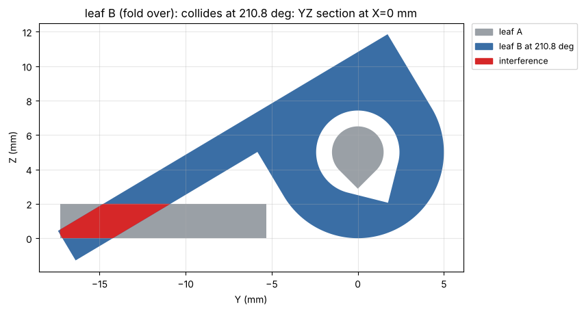

The [`pip_hinge`](../using/recipes.md) recipe with its motion checked: `assembly(d)` splits the
print-in-place hinge into its two leaves, and a `Motion` in `checks(d)` folds leaf B 180° over
leaf A about the pin's axis with every gap held at 0.2 mm or more (it measures the 0.3 mm
`pip_clearance` all the way). Set `OPEN_DEG = 220` and the check fails where the leaves meet,
just under 200° (above). See [motion clearance](../using/checks.md#motion-clearance).
[Script](https://github.com/KD5RYN/b123d-print/blob/main/src/b123d_print/examples/flip_hinge/flip_hinge.py)

## `vslot_mount`

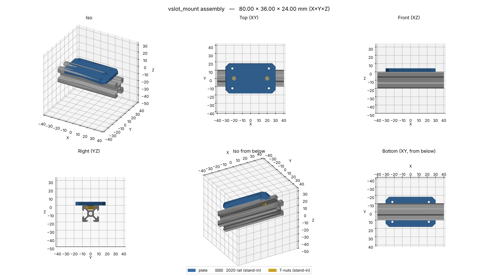

A plate that bolts onto 2020 V-slot extrusion with two M5 screws into T-nuts. A V-shaped key
with 45° sides sits in the slot's groove and keeps the plate square. The rail and T-nuts are
stand-ins from `bd_warehouse.open_builds`, so the `Gap` checks prove the key clears the
groove's flanks (your sliding fit) and the T-nuts' necks.
[Script](https://github.com/KD5RYN/b123d-print/blob/main/src/b123d_print/examples/vslot_mount/vslot_mount.py)

## `testblock`

The smallest complete example: a block with a rounded notch, a few measured dimensions, one
fillet, one cut.
[Script](https://github.com/KD5RYN/b123d-print/blob/main/src/b123d_print/examples/testblock/testblock.py)

## `hole_coupon`

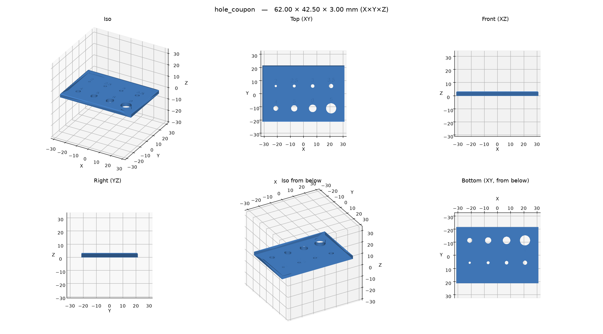

The calibration coupon for [hole compensation](../using/hole-compensation.md): vertical holes in
the plate and horizontal ones in the tab (round, and teardrop), cut at their nominal size and
labeled. Measures `hole_comp` and `hole_comp_h`.
[Script](https://github.com/KD5RYN/b123d-print/blob/main/src/b123d_print/examples/hole_coupon/hole_coupon.py)

## `fit_coupon`

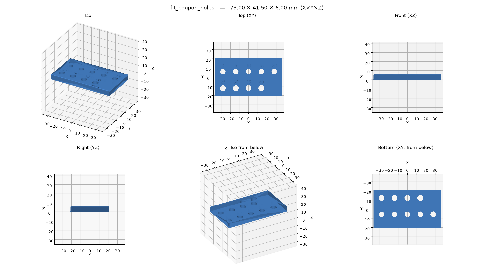

Measures the fits, per side, for your printer and material: a 6 mm peg (part `peg`) tried in
holes 0 to 0.40 mm bigger per side (part `holes`; the label is hundredths of a mm), and discs
printed inside rings with gaps of 0.10 to 0.40 mm (part `pip`). The results go into
`press_fit`, `clearance`, `free_fit` and `pip_clearance` ([Settings](../using/settings.md#keys)).
Its `checks(d)` shows a declared `Gap` (the discs are closer than `pip_clearance` on purpose)
and `ThinFeature` ignoring the engraved labels.

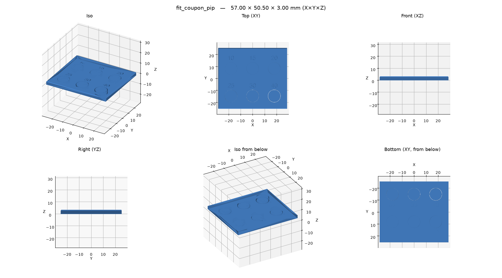

[Script](https://github.com/KD5RYN/b123d-print/blob/main/src/b123d_print/examples/fit_coupon/fit_coupon.py)

## `overhang_bridge_coupon`

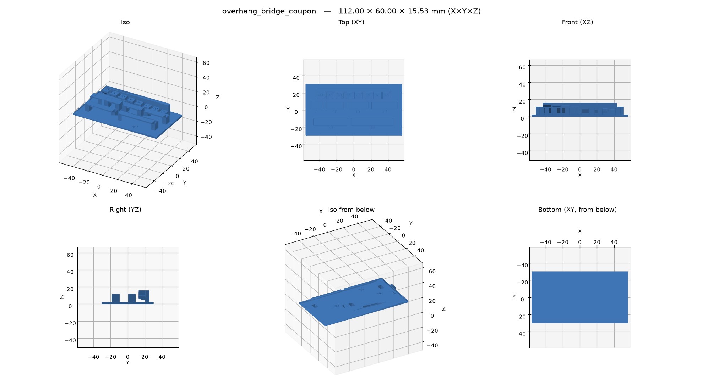

Measures your printer's limits: ledges whose undersides are 40° to 75° from vertical, and
bridges of 5 to 40 mm between pillars. The steepest clean ledge is your `max_overhang`, the
longest clean bridge your `max_bridge`. The overhang and bridge checks warn on it on purpose.
[Script](https://github.com/KD5RYN/b123d-print/blob/main/src/b123d_print/examples/overhang_bridge_coupon/overhang_bridge_coupon.py)

## `inlay_tag`

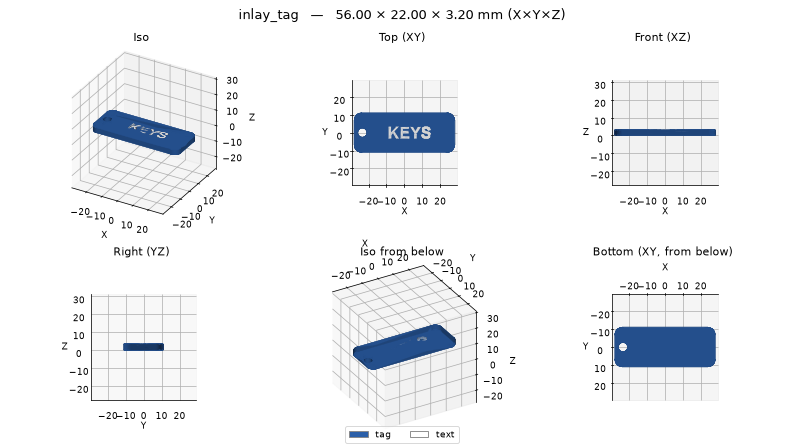

A key tag with flush text in a second colour, for a multi-colour printer: the
[`inlay` recipe](../using/recipes.md#multi-colour-inlays) cuts the text's pocket with the text and
keeps the text as its own body, so the 3MF opens as one object with two named, coloured parts
(`tag` and `text`) and the [print sheet](../using/slicing.md#the-print-sheet) lists both bodies
and the three layers they share. The `bodies` check confirms they do not overlap; the other checks
run on their union. A variant `name` shows another text and colour. CC0. An example with chosen
sizes: not printed yet.
[Script](https://github.com/KD5RYN/b123d-print/blob/main/src/b123d_print/examples/inlay_tag/inlay_tag.py)

## `rounded_enclosure`

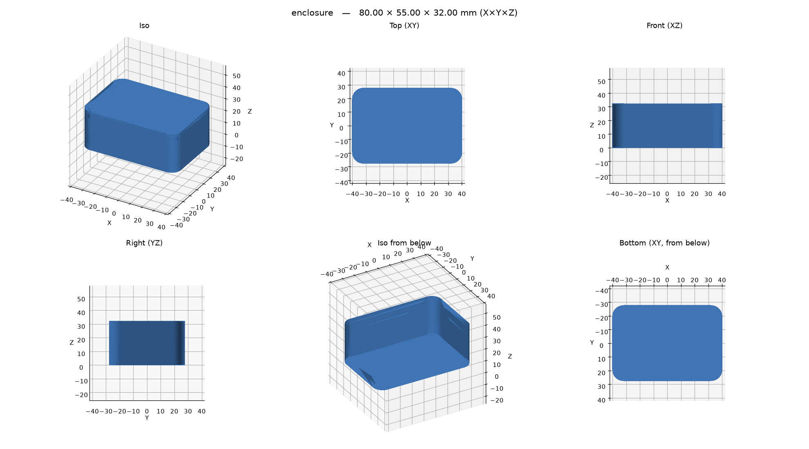

A box with rounded corners and a lid with a lip, in two pieces. The box is drawn solid and made
hollow with the [`hollow` recipe](../using/recipes.md#shapes-from-profiles), so its 2 mm wall is
the same on the flat sides and round the 8 mm corners (a `Wall` check at the corner says 2.00 mm).
The lid is drawn from 2D sketches: a rounded plate and a lip ring that follows the inside of the
walls with the user's sliding clearance; a `Gap` check measures it and the fit check sees no
interference. CC0. An example with chosen sizes: not printed yet.
[Script](https://github.com/KD5RYN/b123d-print/blob/main/src/b123d_print/examples/rounded_enclosure/rounded_enclosure.py)

## `hose_adapter`

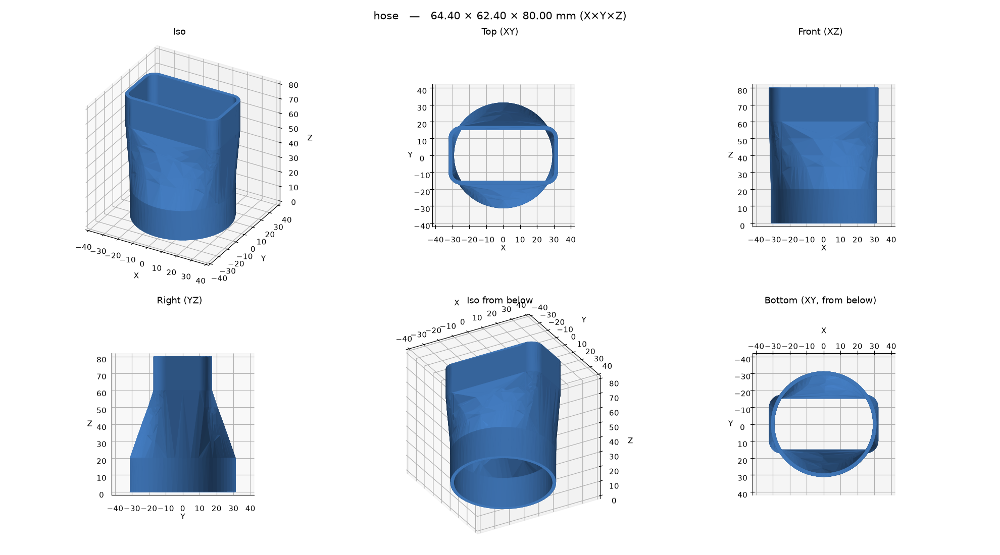

A round pipe to a rounded-rectangle dust port, made with the
[`transition_loft` recipe](../using/recipes.md#shapes-from-profiles): a straight hollow loft with a
collar at each end that slips over the pipe and the port with the user's clearance. The sides
lean at most ~19 degrees, so it prints standing on the round end without supports; a `Wall`
check through the leaning side shows the across-the-section wall of 2 mm reads 1.89 mm square to
the surface. The `port80` variant takes a wider port. CC0. An example with estimated sizes:
measure your pipe and port first.
[Script](https://github.com/KD5RYN/b123d-print/blob/main/src/b123d_print/examples/hose_adapter/hose_adapter.py)
