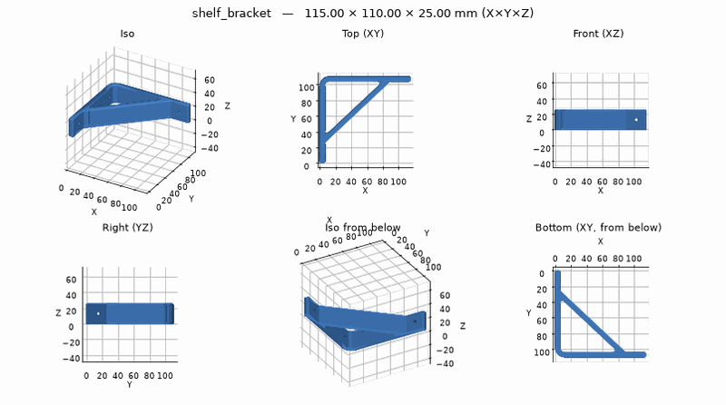
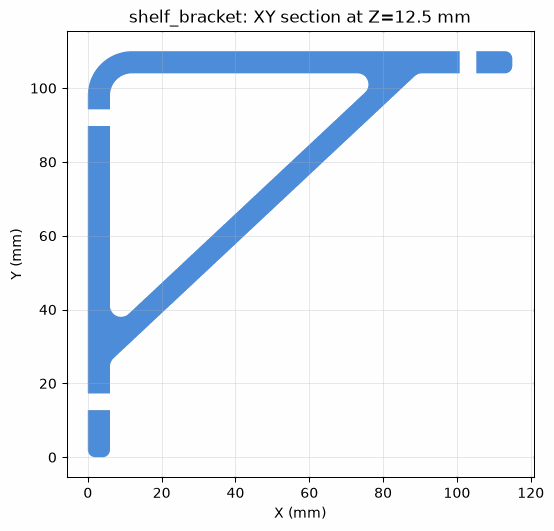
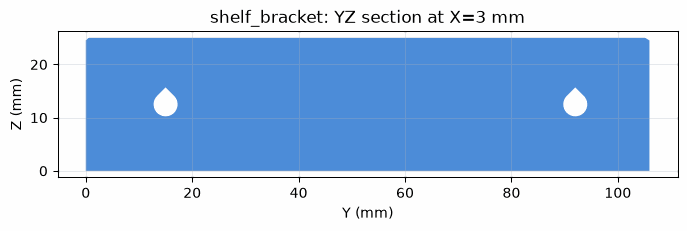
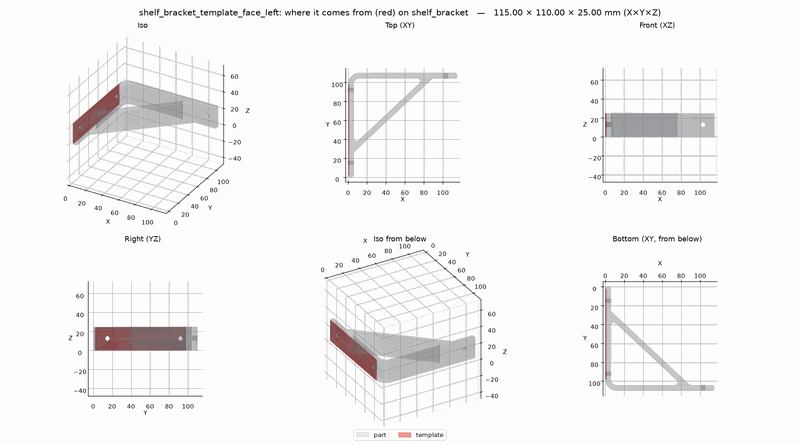

# Your first part: a shelf bracket

From an empty folder to a bracket on the print bed: install, set up the printer, describe the
part, check it, export it and slice it. It takes about half an hour, most of it reading.

!!! note "What is real here"
    Every tool call and result on this page comes from running the bundled server on a laptop
    (stdio, the way Claude Code and Claude Desktop run it), trimmed where marked `...` and with
    the paths shortened to `~/parts`. The pictures are the ones the tools returned. What you and
    the assistant *say* is paraphrased: your assistant words it its own way.

## 1. Install and connect

Follow the [Quick start](../getting-started/quick-start.md): install uv, then add the server to
your assistant. In Claude Code:

```bash
claude mcp add b123d-print -- uvx --from b123d-print b123d-print-mcp --workspace ~/parts
```

Restart Claude Code and run `/mcp`: `b123d-print` should be listed as connected. Other clients:
[Connect your MCP client](../getting-started/mcp-clients.md).

## 2. Tell it your printer

Ask *"Set up b123d-print for my printer"* (or pick the `setup_workspace` prompt). The assistant
starts with `list_parts`, which shows generic mode and says to offer setup:

```text
>>> list_parts()
{
 "workspace": "~/parts",
 "parts": [],
 ...
 "printer": {
  "mode": "generic",
  "note": "no printer profile: no build-volume check, generic limits. Offer the user setup (the
           setup_workspace prompt: printer, material, formats, style, calibration)"
 },
 ...
}
```

It asks one question at a time. You say *"a Bambu A1"*; it searches and lets you pick:

```text
>>> use_printer(search="bambu a1")
{"matches": ["bambu_lab_a1", "bambu_lab_a1_mini"], "more": 0}
```

You answer *"the big one, PLA, 3MF for Bambu Studio and STEP in case I edit it in Fusion"*, and
for the style *"structural, it's for shelves"* ([styles](../using/design-review.md)). It saves
the answers:

```text
>>> save_setup(printer="bambu_lab_a1", material="pla", formats="3mf,step,png", style="structural")
{
 "written": [
  {"key": "printer", "value": "bambu_lab_a1", "was": null, "file": "~/.config/b123d-print/config.toml"},
  {"key": "material", "value": "pla", ...},
  {"key": "formats", "value": "step,3mf,png", ...},
  {"key": "style", "value": "structural", ...}
 ],
 "conflicts": [],
 "printer": {"mode": "printer", "label": "Bambu Lab A1", "bed_x": 256.0, "bed_y": 256.0,
             "height": 256.0, "nozzle": 0.4, "line_width": 0.45, "min_wall": 0.9, ...,
             "material": {"label": "PLA", "notes": "Stiff, easy to print. Softens around 55-60 C:
                          not for parts in sun, cars or near heat. ..."}},
 "calibration": "Calibrate (print each, measure, store the result; ...):
  1. hole_coupon: hole compensation, vertical and horizontal holes -> ...
  2. fit_coupon: the press, sliding and free fits -> ...
  3. overhang_bridge_coupon: the overhang angle and bridge length that print cleanly -> ..."
}
```

A value you set earlier is never replaced silently: `save_setup` lists it under `conflicts`
and the assistant asks before saving again with `overwrite=true`. From a terminal,
`b123d-print setup` asks the same questions ([CLI](../getting-started/cli.md)).

The assistant offers the hole coupon next. Print it now if the screw holes matter to you
([hole compensation](../using/hole-compensation.md)); this tutorial prints it later, at step 9.

## 3. Describe the part, with measurements

> *"Design a bracket for a 120 mm deep pine shelf. It screws to the wall with two 4 mm wood
> screws, and the wall side should be about 110 mm tall."*

Give the numbers you know and say what they are; [Measuring for the AI](../using/measuring.md)
says what to measure and how. The assistant does not model yet. It lists every dimension, where
it came from, and what it is assuming, then waits:

> | Dimension | Value | Source |
> | --- | --- | --- |
> | shelf arm (X) | 115 mm | your 120 mm shelf, 5 mm short of its front edge |
> | wall arm (Y) | 110 mm | typed by you |
> | width (Z, under the shelf) | 25 mm | estimate |
> | arms and brace | 6 mm thick | structural style: 13 lines of 0.45 mm |
> | wall screws | 4.5 mm holes at 15 and 92 mm up | for your 4 mm screws; estimate |
> | shelf screw | one 4.5 mm hole up into the shelf, 12 mm from the end | estimate |
>
> It prints lying on its side, so the shelf's load bends it along the layers. OK?

This is the moment to correct anything. You say *"yes"*.

## 4. Build and look

The assistant writes the script (`new_part`, then `write_part`): every number above is a named
field of `Dims` with its source in a comment ([the part script](../scripts/convention.md)).
Then it builds:

```text
>>> build_part("shelf_bracket")
{"variants": {"standard": {"parts": {"part": {"x": 115.0, "y": 110.0, "z": 25.0,
  "volume": 48605.74, "solids": 1, "valid": true}}, ...}}}
```

It looks at the part with `render_preview`, the same picture you get:



and cuts sections through what a render hides: the L and its brace in the middle of the width,
and the wall arm through both screw holes. The holes lie on their side, so they are teardrops
with a 45° roof that prints without supports:

```text
>>> section("shelf_bracket", plane="XY", at=12.5)
>>> section("shelf_bracket", plane="YZ", at=3)
```





## 5. Check

```text
>>> check("shelf_bracket")
PASSED

shelf_bracket [standard]
  [OK  ] valid    part: valid solid
  [OK  ] overhang part: nothing steeper than 45 deg
  [OK  ] fit      part: Bambu Lab A1: 115.0 x 110.0 x 25.0 fits 256 x 256 x 256
  [OK  ] thin     part: nothing thinner than 0.9 mm (2.0 lines)
  [OK  ] holes    part: 3 round hole(s), 0 vertical; no round-topped horizontal holes
  [OK  ] bed edge part: no fillets on the bed edges
  [OK  ] tip-over part: stable: 25 mm tall on a 77.93 x 157.48 mm footprint ...
  [WARN] hole_comp settings: this part has 3 round hole(s) and hole_comp has never been set
         (...), so they are cut at nominal size and print small. Print the hole_coupon example ...
```

The `fit` line is there because a printer is set: in generic mode nothing checks the bed size.
The warning is the hole coupon from step 2, still not printed. [The checks](../using/checks.md)
explains each line.

## 6. Design review in the structural style

When the checks pass, the assistant offers a [design review](../using/design-review.md):

```text
>>> design_metrics("shelf_bracket")
shelf_bracket [standard]
style: structural (script; built-in style structural), up: +Z
...
part: 115.0 x 110.0 x 25.0 mm, 48.6 cm3
  filament 26.6 g, shell 78% / infill 22%  [simple estimate, roughly ±20 %]
  time ~42 min  [rough estimate: extruded / 10 mm3/s + 125 layers x 3 s]
  supports 0.0 g on 0 face(s)
  ...
  inside corners: sharp 0%, filleted 100%, chamfered 0% of 122.5 mm, smallest r/wall 0.5 (r 3 / 6);
  walls none under 1.35 mm; hole edge distance 2.67 d (M4); slenderness 0.6

no findings for this style
...
```

No findings: every inside corner is filleted at least half the wall, the holes are well away
from the edges. The assistant still reads the structural rubric printed below the numbers and
reminds you of what the slicer has to do: 4-6 walls, 15-30 % gyroid infill.

## 7. Orientation with the load

A bracket carries load, so the assistant runs `suggest_orientation` with the load direction:
the shelf bends the arms in the XY plane of the part as modeled.

```text
>>> suggest_orientation("shelf_bracket", load="XY")
shelf_bracket: 7 orientations ranked (lower score is better; rough estimates); load along (0.707, 0.707, 0)
 #  rotation             on the bed     supports  contact  height   time  score  notes
                                         mm2 / g      mm2      mm    min
 1  Rot(0, 0, 0)         -Z side           0 / 0     1960    25.0   42.0   0.11  load along the layers; as modeled now
 2  Rot(180, 0, 0)       +Z side        66 / 0.1     1710    25.0   42.2   0.18  load along the layers; supports under 66.1 mm^2
 3  Rot(0, -90, 0)       -X side       380 / 1.8     2380   115.0   65.2   2.83  load 45 deg out of the layers; ...
 4  Rot(-90, 0, 0)       +Y side     2549 / 15.4     2520   110.0   82.2   3.65  load 45 deg out of the layers; ...
    ...

The part is already in the best orientation: nothing to change.
```

Standing it up (rows 3 and 4) would put the load across the layers, where a print is weakest,
and need supports. Lying on its side it needs none.

## 8. A fit-test template, then export

The wall face has the screw pattern, so the assistant offers a [fit-test
template](../using/templates.md): a 1.2 mm plate cut from that face, holes and all, that prints
in a few minutes. You hold it on the wall and check the screws reach studs or plugs before
printing the bracket. It shows you the face first:

```text
>>> list_faces("shelf_bracket", highlight="left")
>>> make_template("shelf_bracket", kind="face", face="left")
Template shelf_bracket_template_face_left (standard, from part): 24.50 x 96.00 x 1.20 mm, valid=True,
1 piece(s), laid with the part's left side down
Label: 'shelf_bracket face_left' engraved 0.5 mm deep
Note: printed with the part's left side down, not in the part's print orientation: a hole lying on its
side in the part stands up here, so check positions and spacing with it, and hole sizes on a template
printed the way the part is

Checks: PASSED
...
Files:
  parts/shelf_bracket/out/shelf_bracket_template_face_left.step
  parts/shelf_bracket/out/shelf_bracket_template_face_left.3mf
  ...
```



Then the part itself, with the [print sheet](../using/slicing.md#the-print-sheet) for the slicer:

```text
>>> export("shelf_bracket", formats="3mf,step,png,print")
Exported 4 file(s), 466 KB in all.
[standard]
  part: 115.00 x 110.00 x 25.00 mm, valid=True
  ...
  parts/shelf_bracket/out/shelf_bracket.step
  parts/shelf_bracket/out/shelf_bracket.3mf
  parts/shelf_bracket/out/shelf_bracket.png
  parts/shelf_bracket/out/shelf_bracket_print.md

3D view (self-contained HTML files, no server needed: ...):
  [standard] ~/parts/parts/shelf_bracket/out/shelf_bracket_view.html
```

Open `shelf_bracket_view.html` in a browser to turn the part around before you print it
([3D view](../using/formats.md#3d-view-in-the-browser)).

### Where the files are

=== "On your machine (stdio)"

    The server writes straight into your project folder, so there is nothing to fetch.
    `download_part` says so:

    ```text
    >>> download_part("shelf_bracket")
    Part 'shelf_bracket': 11 file(s): the script, 10 in out/, 0 in ref/, 1.6 MB in all.
    This server runs locally: the files are already in the project folder,
    ~/parts/parts/shelf_bracket. Nothing to download.
      parts/shelf_bracket/shelf_bracket.py  (6 KB)
      parts/shelf_bracket/out/shelf_bracket.3mf  (51 KB)
      ...
    ```

=== "On a shared server (HTTP or SSH)"

    The server's copy is a temporary working copy, deleted after some days unused. The
    assistant must bring the part home before it reports: `download_part("shelf_bracket")`
    returns one link (over HTTP) to a zip of the part in the same layout, which it fetches with
    `curl -fLo shelf_bracket.zip '<link>'` and unzips in your project folder; over SSH it
    returns a `b123d-print pull` command. **If the assistant's shell has no network** (some
    sandboxed clients), it calls `download_part("shelf_bracket", embed=True)` instead: the zip
    (up to 8 MB) comes back inside the result, and the assistant writes it to disk.
    Either way it then lists `parts/shelf_bracket/out/` to show the files are on your machine.
    See [Get the files](../getting-started/http.md#get-the-files).

## 9. Slice and print

Open `shelf_bracket.3mf` in Bambu Studio, OrcaSlicer or PrusaSlicer. It opens in print
orientation, lying on its side: don't auto-orient it. [From part to print](../using/slicing.md)
says which file to use and which slicer settings the part assumes; the print sheet
(`shelf_bracket_print.md`) has them for this part:

```text
| Piece | Size X × Y × Z (mm) | Volume (cm³) | Filament (g) | Time | Supports |
| part | 115 × 110 × 25 | 48.6 | 26.6 | 42 min | none |
...
- **Walls and infill:** structural style: 4-6 walls, 15-30 % gyroid infill (strength comes from the walls); ...
- **Screw holes** (M4): 3-4 or more walls around them ...
- **Hole compensation applied in the CAD:** none (hole_comp was 0, so holes may print small). ...
```

Slice with 5 walls and 20 % gyroid, print the template first, then the bracket.

## 10. "The holes are tight"

The 4 mm screws bind in the printed holes: the warning from step 5. You print the hole coupon
the assistant offered at setup (`new_part("hole_coupon", example="hole_coupon")`, then export
it), measure it, and the assistant works out the compensation and stores it for this printer
and PLA:

```text
>>> save_setup(hole_comp=0.2, hole_comp_h=0.3)
{
 "written": [
  {"key": "hole_comp", "value": "0.2", "was": null, "file": "~/.config/b123d-print/calibration.toml"},
  {"key": "hole_comp_h", "value": "0.3", "was": null, "file": "~/.config/b123d-print/calibration.toml"}
 ],
 ...
}

>>> check("shelf_bracket", fresh=True)
PASSED
  ...
  [OK  ] holes    part: 3 round hole(s), 0 vertical; no round-topped horizontal holes
  ...
```

The warning is gone: the bracket now cuts its holes 0.3 mm larger (they lie on their side, so
`HOLE_COMP_H`), and so will every later part that reads `hole_comp(__file__)`, as the template's
scripts do. If you'd rather only loosen this bracket, a
dimension changes in place with `set_params`, without rewriting the script:

```text
>>> set_params("shelf_bracket", {"SCREW_D": 4.8})
Changed parts/shelf_bracket/shelf_bracket.py:
  SCREW_D (Dims, line 46): 4.5 -> 4.8
Rebuilt [standard]:
  part: 115.00 x 110.00 x 25.00 -> 115.00 x 110.00 x 25.00 mm; volume 48563.6 -> 48518.8 mm^3 (-44.8, -0.1 %); valid=True
Undo: set_params('shelf_bracket', {"SCREW_D": 4.5})
```

Then `export` again and reprint.

## Next

- [Remix a downloaded STL](remix-stl.md): the second tutorial.
- [How a session goes](../using/workflow.md): what to expect from the assistant in general.
- The bundled [`shelf_bracket` example](../scripts/examples.md) is the script this tutorial
  started from.
