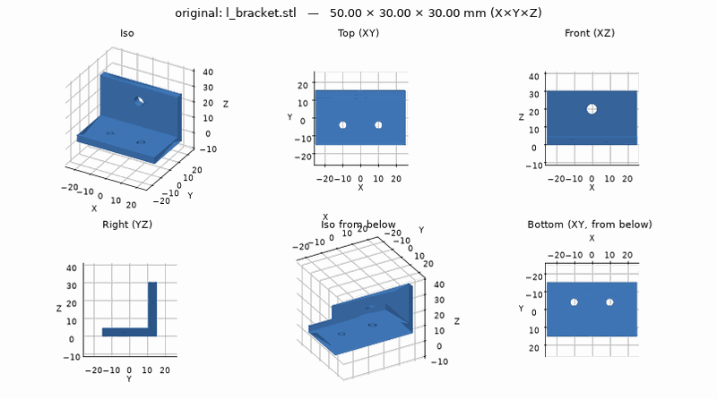
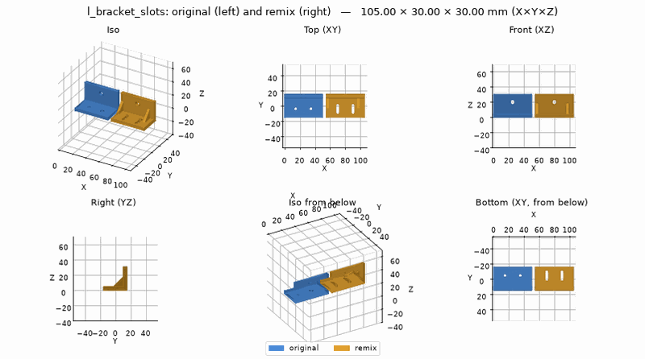
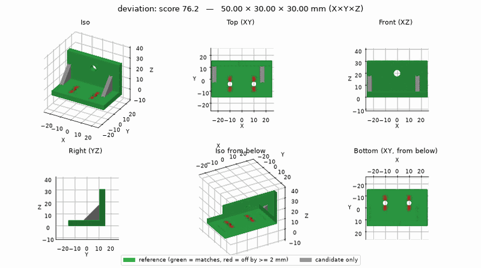
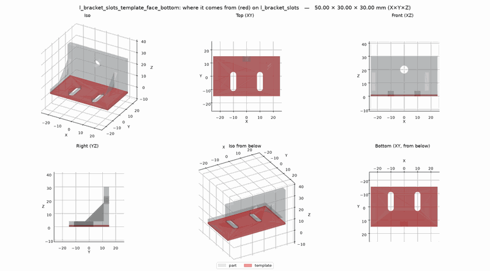

# Remix a downloaded STL

You downloaded an L bracket from a model site. It's nearly right, but you want slots instead of
its two screw holes, so you can adjust it, and gussets to stiffen the corner. You ask for that
in plain words; the assistant changes the model and gives you files to print.

!!! note "What is real here"
    The pictures and numbers come from a real run of the server, using the bundled
    [`remix_bracket` example](../scripts/examples.md) (CC0) as the "download". What you and the
    assistant say is paraphrased. Under each step, **What the assistant did** shows the tool
    calls, for the curious.

Set up first: the [Quick start](../getting-started/quick-start.md), and ideally your printer
([first tutorial, step 2](first-bracket.md#2-tell-it-your-printer)).

## 1. Check the license

On the model's page, find the license. **-ND** (no derivatives) means no remixes: stop there.
**-NC** means not for sale; **BY** means you credit the author when you share. Tell the assistant
the license and the page's address; it records them with the part.

## 2. Give it the file

> *"I want to remix ~/Downloads/l_bracket.stl: slots instead of the two holes, and add
> gussets. It's CC0, from <URL>."*

The assistant gets the file to where the server can read it, in the part's `ref/` folder. How
depends on your app:

- **Apps that can work with files on your computer** (Claude Code, Antigravity, Cursor and
  similar): the assistant copies or uploads the file itself. On a shared server it uploads it
  with a short-lived upload link. You do nothing.
- **Small files** can also go straight through to the server as part of the request.
- **Apps that can't open files on your computer** (a chat-only app): attaching the STL to the
  chat lets the *assistant* see it, but not the server. The assistant tells you which folder to
  drop it in (on your own machine), or gives you a one-line command that uploads it (on a shared
  server).

??? info "What the assistant did"
    `upload_reference(part="l_bracket_slots", filename="l_bracket.stl")`. On your own machine
    the answer is the folder to copy it to. On a shared server it is a signed upload link
    (`curl -fT <file> '<link>'`, no token needed, expires), or over SSH a `b123d-print push`
    command. With `data_base64` the assistant sends the file's content directly (practical for
    small files). Details: [Remixing a part](../using/remix.md#get-the-original-onto-the-server).

## 3. It looks at the original

> *It's 50 × 30 × 30 mm, which looks right for a bracket, so the units are millimeters. It has
> two 4.5 mm screw holes in the base and a 6 mm hole in the upright. It's mostly flat faces, so
> I'll change it directly rather than redraw it.*

If the size had looked wrong (a "bracket" 2 mm long), the file would have been drawn in inches,
and the assistant would say so and load it with inch units.

??? info "What the assistant did"
    `describe_model`, which reports the size, the units, the holes it finds and whether to
    modify or redraw the model.

## 4. You agree on the plan

The assistant lists each change and its size, and waits:

> | Change | Size |
> | --- | --- |
> | slots over the two screw holes | 4.5 mm wide (same screws), 10 mm of adjustment |
> | two triangular gussets | 3 mm thick, 14 mm up the corner, clear of the slots |
>
> The 6 mm hole in the upright stays. OK?

You say *"yes"*.

## 5. It makes the change and checks it

> *Done: slots and gussets added. It passes the printing checks. One note: the top of the 6 mm
> hole in the upright overhangs a little. That was in the original too, so I left it alone. Say
> if you want it fixed.*

The assistant also measures how much the remix differs from the original. Red is what changed
(the old holes, now slots), grey is new (the gussets), green is untouched:

??? info "What the assistant did"
    `new_part` and `write_part`: the script loads the original with `import_model` and cuts and
    adds to it, with the license in its header ([the `remix_bracket`
    example](../scripts/examples.md) is that script). Then `build_part`, `check` (the overhang
    is marked "inherited from the original"), `before_after` and `compare`. A remix *should*
    fail `compare`'s "is this the same part?" test; the picture is the useful part
    ([inherited findings](../using/remix.md#inherited-findings),
    [comparing parts](../using/compare.md)).

## 6. A test plate, then the files

> *"Make a test plate for the base."*

It cuts a thin plate from the bottom with the slots in it. It prints in minutes; hold it against
whatever the bracket screws to before printing the real thing.

Then it exports the remix to `parts/l_bracket_slots/out/` in your project folder: the 3MF and
STL for your slicer, and pictures. On a shared server the assistant brings the files home before
it's done, the same as in the [first tutorial](first-bracket.md#6-your-files).

Slice the 3MF as usual ([From part to print](../using/slicing.md)).

??? info "What the assistant did"
    `make_template(kind="face", face="bottom")` and `export(formats="stl,3mf,png")`; on a shared
    server, `download_part` too.

## 7. Share it with credit

The assistant ends with the line to use when you post the remix:

> Remix of "L bracket" by b123d-print contributors, CC0 1.0, <URL>

For a BY license that credit is required; for -NC, the remix isn't for sale either.

## Next

- [Remixing a part](../using/remix.md): units, modify vs redraw, and the rest.
- [Your first part](first-bracket.md), if you skipped it.
