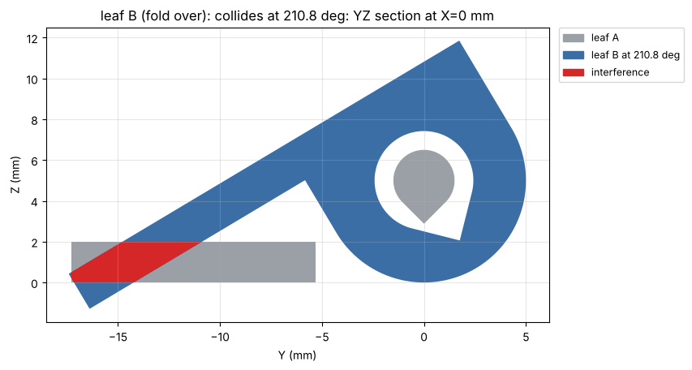

# The checks

`check` (MCP tool or CLI command) builds every variant and runs these. A **FAIL** must be fixed;
a **WARN** is reported and left to you. The CLI exits with code 1 on any failure.

- **valid** — every printable part is a valid, non-empty solid.
- **overlap** — intersection volume between every pair of `assembly(d)` parts, stand-ins
  included; > 0.01 mm³ fails. This is how a box is checked against the board it holds.
- **overhang** — downward faces in print orientation, angle from vertical (wall 0°, ceiling
  90°); > 45° (or the `max_overhang` setting) is reported, the bed face is ignored. Flat
  ceilings are told apart: a **bridge** rests on walls on two opposite sides and is listed with
  its span; a **cantilever** hangs off one side and is an overhang like any other. The top of a
  horizontal round hole is marked `hole`. `Overhang(part, fail=True)` for parts that must print
  without supports (bridges never fail).
- **bridge** — a bridge longer than `max_bridge` (10 mm unless your printer or the
  [overhang/bridge coupon](../scripts/examples.md#overhang_bridge_coupon) says more) warns: it sags.
- **wall** — thinnest material in a cross-section, optionally only around one cut: across the
  wall along the surface normal, and between separate outlines (hole to edge). Tips of ordinary
  corners don't count as thin; knife edges sharper than about 25° do. Below `min_wall` fails.
  The result says what it measured (section area, how far `near` is from material, the region),
  and fails when nothing lies within `radius` of `near`.
- **thin** — the wall measurement on sections all over the part (XY, XZ and YZ, at every
  flat-face level and every 2 mm). A wall thinner than one line width (0.45 mm, or your
  printer's) **fails**: it does not print as modeled. Thinner than `min_wall` warns. A spot that
  is thin in only one plane, or tapers, is a **knife edge** (a wedge tip, a corner cut at an
  angle) and warns.
- **holes** — lists the round holes. Warns on a horizontal hole with a round top (its top sags
  and prints small: use a teardrop or a flat roof, or turn the part) and on holes under 1 mm.
- **bed edge** — warns on a fillet (any curved face) that starts on the bed: its lowest band is a
  flat overhang that flares. Bed edges get a chamfer.
- **tip-over** — warns when a part is tall on a small first layer: the nozzle can knock it off
  the bed, or it wobbles and its top prints badly. The measure is OrcaSlicer's (and Bambu
  Studio's) *Auto* brim: the brim it would add is `tip_speed × H² × W / (1920 I)`, from the
  height H and the footprint's second moment of area I and width W about its weaker principal
  axis; from 5 mm it warns, the size below which OrcaSlicer adds no brim. It also warns on a
  footprint that is a thin strip (area / perimeter under 1.1 mm, where OrcaSlicer adds 5 mm of
  brim) and on a centre of mass outside the footprint. Parts under 10 mm tall are not checked.
  The finding gives the height over the narrowest footprint width and the contact area, and
  suggests a 5–10 mm brim or mouse ears, laying the part down
  ([`suggest_orientation`](tools.md#suggest_orientation)) or printing several together, tied.
  `tip_speed` (default 200 mm/s, your slicer's fastest print move) scales it; `0` turns it off.
  [Rule B6](../BEST_PRACTICES.md#5-bed-edges-first-layer-warping).
- **gap** — for a part made of several solids (printed in place): fails when two are closer than
  `pip_clearance`, because they fuse. Declared between two parts, it checks a fit:
  `Gap("lid", "base", min=..., max=...)`.
- **fit** — only with a [printer profile](printer-profiles.md): the part fits the build volume
  in print orientation.
- **probe** — material must be present (or absent) in a small box: "the roof is closed",
  "the cable channel is clear". The result shows the box against the part's bounding box; a box
  entirely outside the part fails (expected solid) or warns (expected empty).
- **mate**, **align** — the [fit between pieces](fit.md) of an `assembly(d)`: overlaps (fail),
  gaps under the clearance (warn), screw holes that do not line up across pieces (fail) or whose
  sizes match no one screw (warn). Run with `check_fit` / `b123d-print fit`, or by listing
  `Mates()` in `checks(d)`.
- **motion** — a hinge, flip lid, latch or slider moved through its motion against the other
  pieces of the `assembly(d)`: the first collision and the smallest clearance over the whole
  motion, with a picture of the worst position. Declared with `Motion(...)` or `Slide(...)` in
  `checks(d)`; see [Motion clearance](#motion-clearance).
- **hole_comp** — once per run, a warning when the part has holes but `hole_comp` has never been
  set: they are cut at nominal size and print small. See [Hole compensation](hole-compensation.md).

!!! tip "Pin Wall and Probe to the assembly"
    Wall and Probe coordinates are in print orientation by default. Turn the part over and
    they point at another feature, and may still say OK. Parts with an `assembly(d)` should
    declare them with `frame="assembly"` — see [which frame](../scripts/checks-api.md#which-frame).

**valid**, **overlap**, **overhang** (with **bridge**), **thin**, **holes**, **bed edge**,
**tip-over**, **gap** and **fit** run on every part on their own; **wall** and **probe** run where the script

**gap** and **fit** run on every part on their own; **wall**, **probe** and **mate** / **align** run where the script
asks for them in `checks(d)`, which can also change or narrow the automatic ones — see the
[Checks API](../scripts/checks-api.md). The rules behind each check, with their sources, are in
[Design rules](../BEST_PRACTICES.md).

For a [remix](remix.md) (a script that loads a model with `import_model`) the automatic checks
also run on the original, and findings the original already had are labeled **inherited from
the original**: reported, never failing the check, not the remix's to fix. An **import** line
says what was loaded and warns when its units look wrong.

## Motion clearance

A lid that is clear closed and clear open can still hit a wall half-way, and a print-in-place
hinge whose knuckles clear when flat can close up a gap at 120°. Declare the motion in
`checks(d)` and `check` sweeps it:

```python
from b123d_print import Motion, Slide

def checks(d):
    return [
        # leaf B turns about the hinge axis (X, at the knuckle center), 0..180 deg, against leaf A
        Motion("leaf B", axis_point=(0, 0, d.axis_z), axis_dir=(1, 0, 0), start_deg=0, end_deg=180,
               against=("leaf A",), min_clearance=0.2, label="fold over"),
        # the drawer slides 60 mm out (+Y) of its case
        Slide("drawer", direction=(0, 1, 0), distance=60, against=("case",)),
    ]
```

The pieces are the ones `assembly(d)` places, stand-ins included, so a lid can be checked
against the board or the cable it must clear. Motions live in `checks(d)`, not a hook of their
own: they then run with every `check`, inside its time limit and its split over check workers,
and `checks(d)` can already name assembly labels.

How it samples: `samples` coarse steps over the range, each pose measured against every
`against` piece (measure's distance: the gap and its closest points, or the interference
volume; pairs whose bounding boxes are far apart are skipped). Where two neighbouring poses are
clear but the piece's farthest point travels further between them than the gap, a collision
could hide: that step is split, most suspicious first. Then the first contact is bisected to
about 0.01 mm of travel or, with no collision, the smallest clearance is closed in on.
`max_evals` (96) caps the poses measured, so a motion costs about that many distance calls.

```text
[OK  ] motion   leaf B (fold over): clears through 0 deg..180 deg: smallest clearance 0.300 mm at 0 deg (leaf B / leaf A ...; 102 poses, steps up to 3.75 deg) (min 0.2)
[FAIL] motion   leaf B (fold over): leaf B hits leaf A at 199.7 deg (moving 0 deg..220 deg); interference 227.461 mm^3 at 210.8 deg around (0.0, -14.416, 1.025). ...
```

The finding's data holds the numbers (`min_clearance`, `min_at`, `min_pair`, `first_contact`,
`volume`, `worst_at`, the sampled `curve`) and, under `images`, a render of the worst pose (the
piece see-through where it started, the interference in red) and a section through the worst
point, across the motion, in the part's `out/` folder.



*The [`flip_hinge`](../scripts/examples.md#flip_hinge) example folded 220° instead of 180°: the
section at the worst angle, the interference in red.*

**Print-in-place hinges.** Sources give at least 0.2–0.3 mm per side between the pin and its
bore and between knuckles (Fabbaloo's test: 0.1 fused, 0.2 moved; the Prusa forum calls 0.25
"easy"; 0.1–0.15 only on a tuned printer, and at least one line width across and one layer
height between layers): the `pip_clearance` setting, 0.3 by default
([rule F3](../BEST_PRACTICES.md#6-fits-and-clearances)). Measure yours with the
[fit coupon](../scripts/examples.md#fit_coupon). A Motion with `min_clearance` set holds that gap
through the whole swing, which the automatic gap check (flat, as printed) cannot.

## Time limit

Over MCP, a `check` call has its own time limit, longer than a build's: 300 s by default
(`--check-timeout`, `B123D_PRINT_CHECK_TIMEOUT`; never shorter than `--timeout`). Shortly before
it (30 s at most), the checks stop and you get every finding that finished, plus a **timeout**
FAIL that names the check that was still running and the ones not run:

```text
[FAIL] timeout  standard: time limit reached while running ThinFeature(part) (after 268 s of checks on this variant):
       it was stopped; not run: Holes(part), BedEdge(part), Gap(part). The findings above are complete. ...
```

Raise the limit for that server, or narrow the slow check (`ThinFeature(part, step=4.0)`, or
fewer `planes`). The CLI's `b123d-print check` has no time limit.

Over MCP, one `check` uses several cores: the server starts up to `--max-builds` sandboxed
workers at once (default: half the CPU cores). Each builds the part, taking the converted model
from the cache, and runs its share of the checks, the original's included; the findings are
put back in their usual order. Every worker takes a build slot like any build, so on a busy
server the shares take turns, and with `--max-builds 1` a check is one worker, as before. A
worker takes about 3 s to start, so a small part stays in one worker (the split pays from a few
seconds of checks up). When the time limit comes, every finished share's findings are kept.

Checks on a mesh-derived part (a remix) are the slow case: a section through a solid made from
10,000 triangles has thousands of edges. Such parts (over 1500 faces, or 400 or more that are
nearly all flat) are cut from their triangulation, which is exact for flat faces and much faster.
A remix's original does not change while you work on the remix, so its findings are cached in
`out/.cache/` next to the converted model, keyed by its geometry, the check's arguments, your
settings and the b123d-print version: after the first `check`, only the remix is checked.
The same goes for the pieces of any part checked by the MCP server: each piece's per-piece
findings are cached by its geometry, so after changing one piece only that piece is checked again,
while the checks across pieces always run ([the build cache](../scripts/convention.md#big-and-multi-piece-projects)).
`fresh=True` checks everything again.

!!! warning "Why wall checks matter"
    `is_valid` and hole-diameter checks do not catch a 0.05 mm skin. A real print broke there.
    Wherever a cut goes deeper than the wall it starts in, add a `Wall` check just past the wall.

Example output (`b123d-print check -v` on the wall plate example):

```text
plate: 3 ok, 1 warn, 0 fail
  [OK  ] valid    part: valid solid
  [OK  ] wall     part (corner counterbore in its boss): min wall 1.10 mm (limit 0.8) at [-23.0, -38.0], XY @ 2.45 near (-23.0, -41.65)
  [OK  ] wall     part (center screw boss): min wall 2.05 mm (limit 0.8) at [-0.0, -39.22], XY @ 3.4 near (0, -41.65)
  [WARN] overhang part: 16 face(s), 1064 mm^2 steeper than 45 deg: 4 x 228 mm^2 at 80 deg, z 0.03..0.88 (cylinder); ...
all checks passed
```
