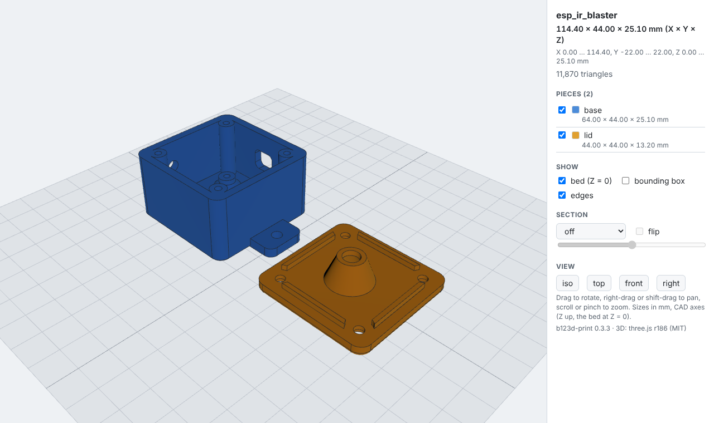

# Output formats

| File | For |
| --- | --- |
| `<name>.py` (always) | the parametric source: change a `Dims` value, rebuild everything |
| `.step` | editing in other CAD (Fusion, Onshape, FreeCAD, SolidWorks): an exact solid you can push/pull, fillet and cut, without feature history; changes there don't flow back to the script |
| `.stl` | any slicer |
| `.3mf` | slicers that read it (Bambu Studio, OrcaSlicer, PrusaSlicer); keeps units |
| `.png` | 6-view preview, assembly render, section views |
| `.glb` | binary glTF: web pages, three.js, Blender, Windows 3D Viewer, AR; one named, colored node per piece, in meters (glTF's unit) and Y-up (glTF's axes); a tessellated mesh, not an exact solid. Not in the default set: ask for it with `formats="glb"` or `all` |
| `_print.md` | the [print sheet](slicing.md#the-print-sheet): size, filament and time estimates, supports, tip-over, walls and infill, fits and hole compensation, assembly notes, for the slicer. Not in the default set: `formats="print"` or `all` |
| `_hardware.json` | the declared whole-assembly [hardware BOM](../scripts/convention.md#declared-hardware): versioned JSON metadata, with variant and confirmation status; opt in with `formats="hardware"` or `all` |
| `_view.glb`, `_view.html` | the [3D view](#3d-view-in-the-browser): `export` writes one per variant (`view=`) |

!!! note "Bambu Studio: \"The 3mf file has invalid config, load geometry data only\""
    That message is expected. The 3MF files are plain, standard 3MF (the shape, in millimeters)
    without a Bambu project config (printer, filament and plate settings). Click **OK**: the part
    loads normally and you slice it with your own settings. If a large part lands off the plate,
    use **Arrange** (A).

Pick them in your config (`formats = ["3mf", "png"]`, see [Settings](settings.md)), per run
(`b123d-print build --formats step,3mf`), or with `formats=` on the MCP `export` tool. `all`
means all seven (`step`, `stl`, `3mf`, `png`, `glb`, `print`, `hardware`). Default: `step`, `stl`, `3mf` and `png`.
What to do with the files in the slicer: [From part to print](slicing.md).

The `hardware` download/pull format filter selects only `*_hardware.json` BOMs; other JSON
outputs, such as traced outlines, remain available in an unfiltered whole-part download.

Files go to `parts/<name>/out/`. A variant's files carry its key as a suffix, and section
views carry the plane and position (`plate_2gang_to_1gang_xy2.45.png` is the `XY` section at
Z = 2.45).

## 3D view in the browser

Turn the part around in a browser before you print it, without a slicer. `export` makes one
view per variant (its `view=` parameter: `print`, the default, shows the printable parts on the
bed as they print, side by side; `assembly` shows `assembly(d)` with its stand-ins; `none` makes
none):

- `parts/<name>/out/<name>[_<variant>]_view.glb` (or `_assembly_view.glb`): the model, one
  node per piece, each in its own color;
- **over HTTP**, a signed view link: `https://<server>/view/<workspace>/<expires>.<signature>/<name>/<name>_view`.
  It opens the viewer page and needs no token; it expires with the download links
  (`--link-ttl`). `download_part` lists the view links again;
- **locally** (stdio), `parts/<name>/out/<name>_view.html`: one self-contained file, viewer and
  model inline. It opens from `file://`, works offline and loads nothing from the network, so you
  can mail it or keep it with the part. `b123d-print view <name>` writes the same file from the
  command line (`--assembly`, `--variant`, `--parts`, `--open` to open the browser too);
- **over SSH**, the `.glb` comes home with `b123d-print pull`; then `b123d-print view <name>`
  on your machine writes the HTML.

The viewer shows the pieces in the part's own coordinates (millimeters, Z up, the bed at Z = 0)
with: orbit (drag), pan (right-drag or shift-drag) and zoom (scroll or pinch); a list of the
pieces with their sizes, to show or hide each one; the bed grid (10 mm squares); the overall
size and extent in mm and an optional bounding box; a section plane across X, Y or Z with a
slider (and flip); and iso, top, front and right views.

The viewer is [three.js](https://threejs.org) (MIT), shipped inside the package, so the page
needs no internet access, neither on the server nor in the browser. See
[Credits](../credits.md) for its license.
