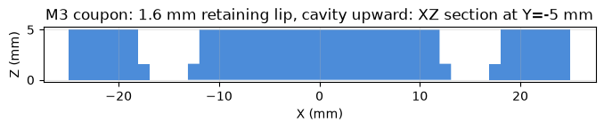
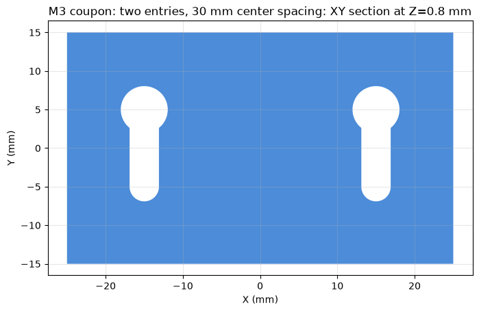

# Recipes

Small, tested build123d functions for features that come up in almost every printed part, with
the printing numbers behind them and their sources. Use one before improvising the feature: each
recipe's demo part is built and run through `check` in the test suite.

```python
from b123d_print.recipes import teardrop_hole, screw_hole, nut_trap, snap_arm

part -= Pos(0, 0, d.H) * screw_hole("M3", depth=d.H, head="counterbore", hole_comp=d.HOLE_COMP)
part -= Pos(10, 0, 6) * teardrop_hole(d.PIN_D + d.HOLE_COMP_H, length=30)
```

The AI reads them with the `recipe(name)` tool or the `b123d-print://recipes/<name>` resource
(the code, a tested example, printing notes, sources); on the command line,
`b123d-print recipes [name]`.

## Conventions

- Every dimension is a named parameter in mm; pass the script's `Dims` fields, never numbers
  from somewhere else.
- **Cutters** (holes, pockets, slots, text to deboss) open on Z=0 and go down, or are centered
  on their axis: `part -= Pos(x, y, top) * nut_trap("M3")`. **Bodies** (snap arm, hinges, lid,
  gusset) come in print orientation, bottom on Z=0.
- Hole diameters are the printed size: pass the user's hole compensation as `hole_comp`
  (`d.HOLE_COMP`, or `d.HOLE_COMP_H` for horizontal holes).
- Fits take the user's values: `clearance=d.CLEARANCE`, `fit=d.PRESS_FIT`,
  `clearance=d.PIP_CLEARANCE` for print-in-place.
- The BP-* ids point to the sourced rules in [Design rules](../BEST_PRACTICES.md).

## The recipes

| Recipe | What | Functions | Summary |
| --- | --- | --- | --- |
| `teardrop_hole` | Teardrop / flat-roof horizontal hole | `teardrop_hole` | A horizontal hole along Y, centered on the origin, that prints without support: a circle |
| `screw_hole` | Counterbore and countersink | `screw_hole` | A vertical screw clearance hole (ISO 273 normal) with a counterbore for a socket head |
| `keyhole_mount` | Keyhole wall mount | `keyhole_mount` | Head entry and a retained shaft endpoint, with an optional continuous head cavity |
| `mounting_slot` | Adjustable screw mounting slot | `mounting_slot` | Round-ended shaft adjustment slot with optional opposite-face head recess |
| `nut_trap` | Hex nut trap | `nut_trap` | A captive hex nut pocket (ISO 4032 across flats + 2 x clearance; 0.1 per side, BP-T7) with |
| `magnet_pocket` | Magnet pocket | `magnet_pocket` | A round magnet pocket: diameter d + 2 x fit (per side; the user's press_fit, BP-F1) plus |
| `pcb_standoff` | PCB supports and reference boards | `pcb_standoff`, `pcb_board`, `pcb_mounting_pattern` | Explicit blind/through pilot, optional base flare, arbitrary board holes, exact sourced patterns |
| `snap_arm` | Snap-fit cantilever | `snap_arm`, `snap_strain`, `snap_length` | A cantilever snap arm lying flat (it bends in XY, along the layers, BP-N1), tapered from |
| `living_hinge` | Living hinge | `living_hinge` | Two leaves joined by a thin web `thickness` thick (0.4-0.6 mm, at least two lines, BP-N7) |
| `pip_hinge` | Print-in-place hinge | `pip_hinge` | A print-in-place hinge lying flat: two leaves (-Y and +Y) on the bed, knuckles along X |
| `lid_with_lip` | Lid with a lip and clearance | `lid_with_lip`, `box_shell` | A lid for a box `outer_w` x `outer_l` with walls `wall` thick: a plate top_t thick and a |
| `text_label` | Embossed and debossed text | `text_label` | Text as a solid from Z=0 up `depth`, centered on the origin. Emboss: part += Pos(x, y, top) |
| `bed_chamfer` | Fillet-safe chamfer on bed edges | `bed_chamfer` | Chamfer every edge on the bed (Z=0) by `size` at 45 degrees, holes included, by cutting a |
| `zip_tie_slot` | Cable and zip-tie slots | `zip_tie_slot`, `cable_slot` | A rectangular tunnel along X for a zip tie (width tie_w, thickness tie_t, + clearance per |
| `gusset` | Ribs and gussets | `gusset`, `ribs` | A triangular gusset in the XZ plane for an inside corner between a floor (Z=0, extending to |

## PCB supports and board stand-ins

`pcb_standoff(height, outside_d, pilot_d, pilot_depth, flare=0, flare_h=0, hole_comp=0)`
returns a support with its base on Z=0 and the pilot opening upward at `height`. The remaining
floor is `height - pilot_depth`; equal depth and height makes a through spacer. `flare` adds
that much **radius** at the bottom, tapering to the shaft at `flare_h`; supply both or neither.
Choose height from the measured underside components, solder joints and desired clearance.
Check the wall `(outside_d - pilot_d - HOLE_COMP) / 2` and remaining floor before printing.

Supply the target printed `pilot_d` and pass `hole_comp=d.HOLE_COMP` once. Plastic screw
pilots depend on the screw, material and orientation; use the maker's guidance and a coupon.
For a clearance spacer, reuse the selected hardware's existing dimensions:

```python
from bd_warehouse.fastener import SocketHeadCapScrew
from b123d_print.recipes import pcb_standoff

screw = SocketHeadCapScrew("M2-0.4", 10, "iso4762", simple=True)
# d.SPACER_H, d.SPACER_D and d.HOLE_COMP are named fields in your script.
spacer = pcb_standoff(d.SPACER_H, d.SPACER_D,
                      screw.clearance_hole_diameters["Normal"], d.SPACER_H,
                      hole_comp=d.HOLE_COMP)
```

Metal `tap_hole_diameters` are tap drills, not automatic plastic pilot sizes. For a heat-set
insert use its maker's hole and depth guidance; for enclosure screw clearance/counterbores,
reuse `screw_hole`. These are printed supports, not models of purchased standoff hardware.
Print base down, pilots vertical and open at the top; give bosses 3–4 or more perimeters
([BP-T8](../BEST_PRACTICES.md#8-threads-screws-inserts-nuts-bosses)).

`pcb_board(width, length, thickness, holes, hole_d)` returns a rectangular board **stand-in**.
The datum is the board center in XY, its underside at Z=0; X spans width and Y spans length.
Hole centers are `(x, y)` in that frame, viewed from above (+Z), and need not form a rectangle.
An empty sequence gives a board without holes. Holes must be distinct and entirely within the
board. `hole_d` is the actual board drill diameter and receives **no printer compensation**.
The rectangular envelope excludes connectors, underside components and edge cutouts: add
separate measured component volumes to `assembly(d)`.

`pcb_mounting_pattern(model)` provides two exact manufacturer patterns, also available as
`b123d_print.pcb.PCB_PATTERNS`. The frozen record contains `model`, `width`, `length`, `holes`,
`hole_d`, `datum` and `source`. Thickness and component keep-outs must be supplied separately.
Unknown model keys raise `ValueError`; there is no universal ESP32 pattern.

| Exact model key | Board envelope X × Y | Hole centers from board center | Hole diameter | Top-view axes and source |
| --- | --- | --- | --- | --- |
| `raspberry_pi_zero_v1_2` | 65 × 30 | (±29, ±11.5) | 2.75 | +X away from microSD; +Y toward GPIO. [RPI-ZERO-V1_2 drawing, 2015-09-23](https://datasheets.raspberrypi.com/rpizero/raspberry-pi-zero-mechanical-drawing.pdf) |
| `raspberry_pi_pico_rev3` | 21 × 51 | (±5.7, ±23.5) | 2.1 | +Y toward micro-USB; +X right on component-side view. [RP2040 Pico Rev3 datasheet, chapter 2](https://datasheets.raspberrypi.com/pico/pico-datasheet.pdf), [product brief drawing](https://datasheets.raspberrypi.com/pico/pico-product-brief.pdf) |

All table dimensions are mm. These records describe only those boards/drawings; compare your
actual board before using one. For example, `p = pcb_mounting_pattern("raspberry_pi_pico_rev3")`
then `pcb_board(p.width, p.length, d.PCB_T, p.holes, p.hole_d)` preserves its center datum.

### Compose an enclosure and check the underside

This digital fixture illustrates an asymmetric three-hole board; the values are illustrative,
not a newly printed example. The already printed
[`esp_ir_blaster`](../scripts/examples.md#esp_ir_blaster) is the physical workflow reference.
The standoff recipe's demo and these tests establish geometry, not physical fit.

```python
from dataclasses import dataclass
from build123d import Align, Box, Pos
from b123d_print import Mates, Template, Wall, hole_comp
from b123d_print.recipes import box_shell, pcb_board, pcb_standoff

@dataclass(frozen=True)
class Dims:
    BOX_W: float = 48.0  # illustrative envelope
    BOX_L: float = 36.0  # illustrative envelope
    BOX_H: float = 12.0  # illustrative height
    WALL: float = 2.0  # illustrative wall
    FLOOR: float = 2.0  # illustrative floor
    PCB_W: float = 34.0  # replace with measured board width
    PCB_L: float = 24.0  # replace with measured board length
    PCB_T: float = 1.6  # replace with measured board thickness
    HOLES: tuple = ((-13.0, -7.0), (12.0, -7.0), (-10.0, 8.0))  # measured center coordinates
    PCB_HOLE_D: float = 3.4  # replace with actual board holes
    SUPPORT_H: float = 5.0  # chosen underside clearance above floor
    SUPPORT_D: float = 7.0  # chosen boss outside diameter
    PILOT_D: float = 2.5  # illustrative pilot; verify screw/material with a coupon
    PILOT_DEPTH: float = 4.0  # leaves 1 mm within support, plus box floor
    FLARE: float = 1.0  # extra base radius
    FLARE_H: float = 1.0  # base flare height
    UNDER_W: float = 8.0  # replace with measured underside component envelope
    UNDER_L: float = 6.0  # replace with measured envelope
    UNDER_H: float = 3.0  # component extends below board at its center
    TEMPLATE_T: float = 1.2  # existing template default
    MIN_SUPPORT_WALL: float = 1.6  # chosen wall minimum
    HOLE_COMP: float = hole_comp(__file__)  # your printer calibration

    @property
    def PCB_Z(self):
        return self.FLOOR + self.SUPPORT_H


def base(d):
    part = box_shell(d.BOX_W, d.BOX_L, d.BOX_H, wall=d.WALL, floor=d.FLOOR)
    for x, y in d.HOLES:
        part += Pos(x, y, d.FLOOR) * pcb_standoff(
            d.SUPPORT_H, d.SUPPORT_D, d.PILOT_D, d.PILOT_DEPTH,
            flare=d.FLARE, flare_h=d.FLARE_H, hole_comp=d.HOLE_COMP)
    return part


def build(d):
    return {"base": lambda: base(d)}


def assembly(d):
    board = Pos(0, 0, d.PCB_Z) * pcb_board(d.PCB_W, d.PCB_L, d.PCB_T, d.HOLES, d.PCB_HOLE_D)
    underside = Pos(0, 0, d.PCB_Z - d.UNDER_H) * Box(
        d.UNDER_W, d.UNDER_L, d.UNDER_H,
        align=(Align.CENTER, Align.CENTER, Align.MIN))
    return [(base(d), None, "base"), (board, None, "board (stand-in)"),
            (underside, None, "underside component (stand-in)")]


def checks(d):
    return [Mates(), Wall("base", "XY", d.FLOOR + d.SUPPORT_H / 2,
                         near=d.HOLES[0], radius=d.SUPPORT_D / 2,
                         min=d.MIN_SUPPORT_WALL, frame="assembly", label="PCB pilot")]


def templates(d):
    return [Template.slice("XY", d.PCB_Z - d.TEMPLATE_T / 2,
                           part="base", name="pcb_supports", thickness=d.TEMPLATE_T)]
```

Run `b123d-print fit <name>` or the `check_fit` tool: the board contacts its supports without
interference. Moving a support under the central component produces an interference finding;
resolve it by changing the design. The check never removes material automatically.

Inspect the highlighted template region with `make_template` before printing. The slice joins
separate supports with the existing thin base and preserves their spacing. Set the board on it
and try the intended screws to check hole position and printed diameter. It does not verify
standoff height, component clearance, full enclosure fit or long-term screw strength. Measure
and physically validate the fit before printing the full enclosure or publishing it as a
printed example.

## Sources

The printing numbers come from the [sourced design rules](../BEST_PRACTICES.md) (holes BP-H,
overhangs BP-O, fits BP-F, snap fits and hinges BP-N, screws and nuts BP-T, text BP-X, ribs
BP-R, bed edges BP-B), and for screw and nut sizes from ISO 273 (clearance holes), ISO 4762
(socket head cap screws), ISO 10642 (countersunk screws) and ISO 4032 (hex nuts); the screw
hole recipe reads its sizes from bd_warehouse's fastener tables (see
[Threads, fasteners and gears](threads-fasteners-gears.md)). The snap-arm
strain formulas are from Bayer MaterialScience's *Snap-Fit Joints for Plastics* design guide;
the allowable strains are provisional (one source, BP-N4): say they are estimates.


## Wall mounts and adjustable screw slots

`keyhole_mount` and `mounting_slot` cut flat plates for light enclosure mounting. Their geometry
is checked in CAD; the fixture below has **not been physically printed or load tested**. Neither
recipe specifies wall anchors, a safe load, vibration retention or a certified strength rating.

Both take `shaft_d`, `head_d`, `plate_t`, `travel`, `head_depth`, `clearance`, `hole_comp`, `size`
and `min_lip`. All dimensions are mm. Omitted diameters come from `_screw(size)`: bd_warehouse's
ISO 273 Normal clearance and ISO 4762 socket-head tables, with the existing `SCREW` fallback.
Explicit `shaft_d` is the base opening diameter (use the measured shaft for a custom fit), and
`head_d` is the **measured maximum head diameter**, including any washer that must pass. Do not
assume a pan head has socket-head dimensions. Use `size=None` with both explicit diameters for
other metric or inch screws; convert inch measurements to mm.

The cutter adds **2 × `clearance` per diameter** (`clearance` is per side) and then adds
**`hole_comp` once per diameter** (total). Table clearance holes already have an allowance:
`clearance` adds extra to that base, so set it to zero to keep the table's shaft clearance.
Do not pre-add `HOLE_COMP` (0 unless you opted in; then the slicer's hole compensation stays 0). The actual head must remain
larger than the compensated shaft opening; excessive allowances are rejected. `head_depth` is
an axial dimension with no diameter compensation: leave axial space for the measured head height.

```python
from build123d import Pos, Rot
from b123d_print.recipes import keyhole_mount, mounting_slot

# Insert at (x, y), then the screw moves +Y relative to the plate by TRAVEL.
part -= Pos(d.X, d.Y, d.PLATE_T) * keyhole_mount(
    shaft_d=d.SHAFT_D, head_d=d.HEAD_D, size=None, plate_t=d.PLATE_T,
    travel=d.TRAVEL, head_depth=d.HEAD_DEPTH, clearance=d.CLEARANCE,
    hole_comp=d.HOLE_COMP, min_lip=d.MIN_LIP)
# Rotate +90 degrees around Z: screw travel becomes -X.
part -= Pos(d.OTHER_X, d.Y, d.PLATE_T) * Rot(0, 0, 90) * mounting_slot(
    size="M3", plate_t=d.PLATE_T, travel=d.TRAVEL, hole_comp=d.HOLE_COMP)
```

The origin is the head entry center (`keyhole_mount`) or first shaft center (`mounting_slot`),
at the insertion face **Z=0**. The cutter ends at **Z=-plate_t**. Shaft center travel is from
**Y=0 to Y=travel**; overall slot length also includes its round ends. For a hanging plate,
choose the orientation so gravity moves the *plate* opposite this relative screw motion. A
`mounting_slot` has no head entry: insert the screw axially before tightening it, and loosen it
to adjust the position. It is not a freely captive slide.

With `head_depth=0`, a keyhole head passes through the entry and remains proud of the opposite
face; provide room for it behind that face. With `head_depth>0`, a head-sized recess opens from
**the opposite face at Z=-plate_t**, up toward Z=0, continuously along the entire travel. This
is not a counterbore on the insertion face. The lip next to Z=0 is `plate_t-head_depth` thick.
`min_lip` is a project-chosen minimum for that axial thickness; its default zero only rejects a
vanished lip. Also inspect the radial overlap `(actual head diameter - compensated shaft width)/2`
and the material between the recess and the plate edges. Positive thickness alone says nothing
about load capacity. A head cavity opening downward in print orientation creates a roof under
the lip; orient the cavity upward where possible, and run the overhang/bridge checks otherwise.

### Two-screw fit coupon

Download the [CAD-only coupon source](../fixtures/wall_mount_coupon.py) and copy it into
`parts/wall_mount_coupon/wall_mount_coupon.py`. It uses two M3 ISO 4762 socket heads at **30 mm
center spacing**, **10 mm center travel**, a **5 mm plate**, and a **3.4 mm head cavity** leaving
**1.6 mm axial lip**. These are chosen fixture dimensions, not a mounting standard. Measure your
actual screws and set the `Dims` fields first. The script uses your clearance and hole compensation.

```bash
uv run parts/wall_mount_coupon/wall_mount_coupon.py --formats 3mf,png
b123d-print check wall_mount_coupon
b123d-print fit wall_mount_coupon
b123d-print view wall_mount_coupon --assembly
```

The saved views and these sections come from the actual coupon CAD, with the cavity facing up
in print orientation. The center section shows the lip depth; the XY section through that lip
shows the two entry/retention profiles.





Inspect the `Wall` result in assembly coordinates near the retained screw endpoint and verify
that it measured the lip. `assembly(d)` supplies two screw stand-ins at retained positions for
`fit`; it also gives the positions for inspecting head insertion and travel in sections. The
regression tests sweep representative head/shaft positions through entry and travel and confirm
that pulling the head through the narrow lip collides. Tighten the screws to hold the final
position; keyholes alone do not prevent reverse travel or lifting off.

The fixture's `templates(d)` exports a **full-depth crop** with the normal export tools. Print
that small coupon with the same orientation, material, layer height and hole settings planned
for the mount. If `check` reminds you that the slicer's hole compensation is not set, print
the existing `hole_coupon` and set it before judging the mounting fit. A thin face/slice template can check the 30 mm pattern and entry diameter, but
cannot check recess depth, head travel or lip retention. Try both screws, head insertion, the
full slide, seating and removal without forcing it. Record screw measurements, printer/material,
allowances and the physical result. A maintainer must print and try this fixture before adding
it as a physically validated bundled example; no such validation is claimed here.

### Which dimensions are standardized?

[ISO 273](https://www.iso.org/standard/4183.html) specifies clearance-hole diameters, and
[ISO 4762](https://www.iso.org/standard/34460.html) specifies metric socket-head cap screws.
[ASME B18.3](https://www.asme.org/codes-standards/find-codes-standards/socket-cap-shoulder-set-screws-and-hex-keys-%28inch-series%29)
covers inch-series socket cap/shoulder/set screws and includes related drill/counterbore data.
Those fastener dimensions are distinct from this recipe's head entry, travel, spacing and lip.
The recipes do not claim a universal ISO/ASME keyhole-mount layout or an ASME inch-size table;
use explicitly measured dimensions for unsupported hardware.
