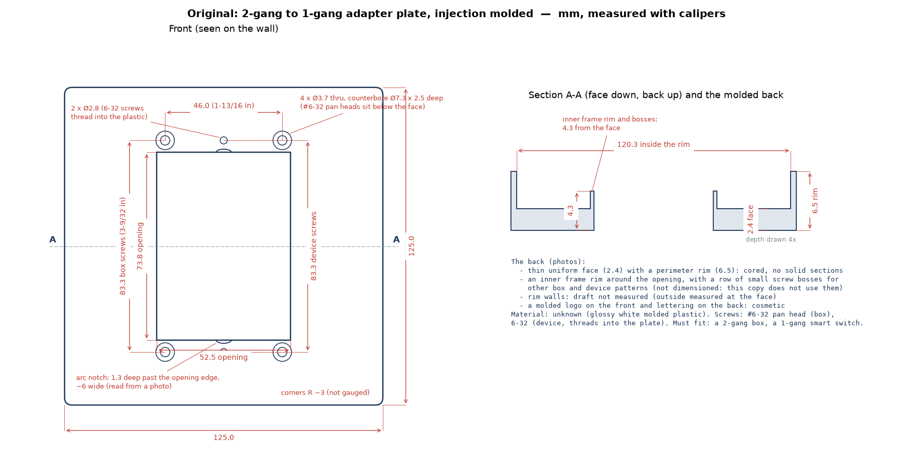

# Replicating a physical part

You have the part in your hand: a broken clip, a wall plate, a knob, a bracket from an
appliance. Usually it was injection molded. You want a printed one that does the same job.
That is not the same as copying its shape: a molded part is designed around the mold (draft,
thin even walls, coring, ribs, a living hinge in polypropylene), and a print is better without
most of that. What must stay the same is what it **fits**: the holes, their spacing, the faces
that touch something else.

So replicating is three jobs:

1. **Measure the right things, well**: every size that fits something, from one datum, three
   times; the rest only as well as the look needs.
2. **Decide, for each dimension, whether it must match** (critical) **or may change** (free),
   and what to do with each molded feature.
3. **Keep the record** (the *replication spec*) and check the model against it.

The MCP prompt **`replicate_part`** walks an assistant through all of it, with two stops for
your confirmation: after the measurement plan, and after the list of changes. The record is the
part's **`MEASURE.md`** (the [measurement sheet](measuring.md#measurement-sheet-template) with
four more columns), and the **`replication_spec`** tool checks the script's `Dims` against it.

If you also have a 3D scan of the part, it helps with the shape; it is used the way a
[remix](remix.md) uses a downloaded mesh, but calipers win for every size that fits something.

## How a session goes

1. **Identify.** You describe the part, what it mates with and how (screws, a snap, a press fit,
   a seal), and attach photos or a drawing. The assistant names how it was made (molded parts
   show draft, a parting line, round ejector-pin marks, a gate) and asks what it cannot see:
   the mating parts, the material (look for a recycling mark such as `>PP<` or `>ABS<` molded
   inside), heat, sunlight, how often it comes apart.
2. **Measurement plan** (stop). The assistant writes `MEASURE.md` with one row per dimension,
   the values empty: the feature, its class, the tool and method, the accuracy you need, the
   Dims field it will become, and the photos to take. You measure and fill it in.
3. **Classify and decide** (stop). The assistant reads your readings back, points out readings
   that disagree (a tapered wall, an oval hole), and proposes what to do with each molded
   feature, each with its reason in the **Why changed** column; plus the material, the print
   orientation and the fits. You confirm.
4. **Model.** Every dimension becomes a named `Dims` field; critical ones as measured, or with
   the reason they differ (a clearance, a standard size).
5. **Verify.** The usual checks, then `replication_spec` until it has no warnings, `measure` on
   the critical features of the built part, and a [fit-test template](templates.md) of each
   critical interface before the full print.

## The measurement plan

The [measuring guide](measuring.md) has the methods: calipers (outside, inside, depth, step),
gauges, tracing, offsets, photos with a scale. For a part you are copying, the plan adds:

- **One datum** for everything (the centre of the main hole pattern, a flat back, a mating face),
  and hole spacings measured edge to edge (outside of both and inside of both, averaged) rather
  than chained.
- **Three readings of every critical size**, at slightly different places, all three in the
  Value cell: `4.21, 4.19, 4.22`. The spec averages them and warns when they spread wider than
  the accuracy you wrote.
- **Where on a molded wall you measured.** Molded walls taper (draft), so a wall or a boss reads
  differently at its root and at its tip. Measure where it mates, or at mid-height, and say so.
- **Threads** with a thread pitch gauge and calipers on the outside diameter; metric and inch
  sizes look alike (M3 and 4-40, M6 and 1/4-20).
- **Standard sizes** (a screw clearance hole, NEMA box screw spacing, a bearing seat) get the
  source `standard` with the standard's name, and are still checked against the part.
- **Photos**: an overview, each critical feature square on with a scale in its plane, the back
  (coring, ribs, bosses) and any marking.

## Critical or free

Each row of the spec has a **Class**:

| Critical: must match | Free: may change to print better |
| --- | --- |
| mating interfaces: faces that sit against something | outer styling, the look of the outside |
| hole sizes and hole spacings; slots that take a screw | ribs, gussets, coring |
| fits: press, sliding, free (with the clearance from your [settings](settings.md)) | wall thickness away from the interfaces |
| sealing and bearing faces | fillets and chamfers that touch nothing |
| snap and latch geometry: the hook, the catch, its travel | text, logos, texture |
| threads (size, pitch, length of engagement) | features for other variants of the product (extra bosses, knock-outs) |
| the envelope where it fits into or against something | the overall size where nothing constrains it |

When in doubt, the assistant asks; "it fits into this recess" makes the outline critical.

## Molded features and what to do with them

A molded part carries features that exist for the mold, not for the job. The prompt proposes
what to do with each, and the reason goes in the spec's **Why changed** column. The rules (C1–C12)
and their sources are in [BEST_PRACTICES §19](../BEST_PRACTICES.md#19-replicating-molded-parts).

| Molded feature | Why the mold has it | In the printed copy | Rule |
| --- | --- | --- | --- |
| Draft (faces taper along the mold's opening; molded 0.5–2°, more under texture) | so the part releases | remove it; keep a taper only where it does a job (a taper fit, parts that nest or stack) or is part of the look. Measure a drafted wall where it mates, or at mid-height, and say which | C1, C2 |
| Thin even walls, coring (molded walls ~2–4 mm, thick areas hollowed) | to fill and cool evenly without sink | solid, or thicker walls in whole line widths; keep a cored pocket only where it does a job (weight, clearance, a mating feature) | C3 |
| Ribs and gussets (molded 40–60 % of the wall) | stiffness without sink | keep where they run (the stiffening intent) at full wall thickness, or drop them where solid replaces them | C4 |
| Sink marks, parting line and flash, ejector-pin marks, gate vestige, knit lines | marks of the molding | never model them or measure on them; a sink shows a thick section behind it; a crack on a knit line is a molding weakness | C5 |
| Living hinge (PP or PE, 0.2–0.35 mm, a million cycles) | PP flexes for ever | cannot be copied: 0.4–0.6 mm in nylon, TPU or PP with the hinge width along Z (tens of cycles), or a pin or print-in-place hinge | C6 |
| Snap fit (sized for POM, PP, nylon) | molded resins take high strain | recompute the arm for the print material's strain (the snap_arm recipe), print it flat, ~60 % of the strain for snaps opened often | C7 |
| Screw bosses, self-tapping holes, molded threads, inserts | sized for sink and molding | the position and the screw, not the molded proportions: thicker wall and gussets; a heat-set insert or nut for screws taken out often; threads modeled only at M5–M6 and up; declare the screw as hardware | C8 |
| Material (PP, POM, PA, ABS, PC) | chosen for strain, heat, creep, chemicals or sunlight | pick the print material by that property: strain or a hinge → PETG, nylon, TPU or a redesign; heat → ASA, PC, PA (PLA softens near 55–60 °C, molded PP ~80–85, POM ~110); outdoors → ASA; sliding → nylon. The copy is weaker across its layers: put the load along them and say so | C9 |
| Mold shrinkage | the mold was cut oversize | none: the part is already at nominal size, so model what you measure; FDM shrinkage is the slicer's | C12 |
| Extra bosses, knock-outs, features for other models of the product | one mold serves several products | drop what this copy does not use; say so in Why changed | C10 |

Measuring a part to copy: one datum, not chained; the design intent (what fits and works), not the
as-built shape; threads by major diameter and pitch against a chart; a worn or broken part measured
on its unworn areas and the mating part [C10]. Provisional (one source): round a reading to the
value the designer meant (43.97 → 44 mm, inch vs mm, standard sizes) and say so [C11].

**Heat**, the usual surprise: heat deflection temperatures at 0.45 MPa are about 57–60 °C for
PLA, 69–78 °C for PETG, 87–100 °C for ABS, 100–103 °C for ASA and 111–117 °C for PC (Bambu Lab
and Polymaker data), against about 80–85 °C for molded polypropylene and 110 °C for acetal. A
clip from a car or a dishwasher should not become PLA.

**Strength across the layers**: Bambu Lab's own impact data put the across-layer value at 12–52 %
of the in-plane one, and CNC Kitchen's hooks printed standing were at least 50 % weaker. Turn the
copy so its load runs along the layers ([S4, S5](../BEST_PRACTICES.md#4-supports-and-orientation-for-strength)).

## The replication spec

The spec is the part's `MEASURE.md`: the header of the [measurement
sheet](measuring.md#measurement-sheet-template) and one table with these columns (the first five
are the sheet's own):

| Column | What goes in it |
| --- | --- |
| Feature | what was measured: "box screw hole Ø", "wall at the clip root" |
| Value | the reading in mm; several readings separated by `,` or `;` are averaged; `in` or `"` means inches; text in parentheses is a note: `83.3 (3-9/32 in, NEMA WD-6)` |
| Method | the tool and how |
| Accuracy | what you can trust the reading to: `±0.05`; without it the spec assumes ±0.1 |
| Status | `CONFIRMED` or `estimated` (a `~` in front of the value means estimated too) |
| Class | `critical` or `free` |
| Source | `measured`, `standard`, `derived`, `changed` (for printing) or `estimate` |
| Field | the `Dims` field that models it, or a simple expression of fields: `PLATE_W - 2 * RIM_WALL` |
| Why changed | why the copy differs from the original: "draft removed, modeled at the mating height" |

`replication_spec(name)` (CLI `b123d-print spec <part>`) joins it with the script's real `Dims`
values (the variant's overrides, derived `@property` values and `hole_comp()` included) and
prints one table plus flags:

```text
| Feature | Field | Class | Source | Measured | Tol | Modeled | Δ | Why changed |
| Box screw hole Ø | `CORNER_HOLE_D` | critical | measured | 3.7 | ±0.05 | 3.7 | +0.00 |  |
| Wall around each corner counterbore | `BOSS_WALL` | free | changed |  |  | 2 |  | the molded boss is thin; ... |

- WARN Clip root thickness (MEASURE.md line 24): readings spread 0.30 mm, more than ±0.05:
  tapered (draft), oval or warped? Say where it was measured ...
```

| Flag | When |
| --- | --- |
| **WARN** critical and not measured yet | a critical row with no reading |
| **WARN** critical but an estimate | read from a photo, `~`, or `estimated` |
| **WARN** (critical) / note (free) readings spread | the readings differ by more than the accuracy |
| **WARN** (critical) / note (free) modeled differs | the `Dims` value is off the average by more than the accuracy and **Why changed** is empty |
| **WARN** unknown field | the `Field` names nothing in `Dims` |
| **WARN** critical with no Field | the spec cannot check it |
| note | rows without a class; a plain measurement sheet without the replication columns |

A variant that changes a size on purpose (the bigger `140` wall plate) is not flagged: its
differences are labeled `(variant 140)`. Nothing here fails `check`; the spec is the record of
the copy, and `--strict` exits 1 on a warning for scripts. The `spec` [export
format](formats.md) writes the same table to `out/docs/<name>_spec.md`, next to the print files.

## Checking the copy against the original

- **`measure`** on the built part: hole diameters, spacings, the opening, against the spec's
  measured values.
- **A [fit-test template](templates.md)** of each critical interface: the mounting face with its
  holes, the snap, the opening. Minutes to print; lay it on the original or the mating part.
- **An outline**: a 1:1 paper print of a slice, laid on the original; or [trace](tracing.md) a
  flatbed scan of the original and compare.
- **With a scan**: define `original(d)` returning `import_model("ref/<scan>")` placed like the
  copy, and call `before_after`: the free changes show in the deviation view, the critical faces
  should not move. [`compare`](compare.md) gives the score.

## Example

The [`plate_2gang_to_1gang` example](../scripts/examples.md#plate_2gang_to_1gang) is a copy of an
injection-molded 2-gang to 1-gang adapter plate, started from the original's drawing, not a
mesh:



Its `MEASURE.md` keeps the hole spacings (NEMA standard), the hole and counterbore sizes and the
opening as critical and modeled as measured. The outline and depths are free; the `140` variant
makes them bigger. The molded back (a 2.4 mm face, a 6.5 mm rim, a cored inner frame with
extra screw bosses for other boxes) became a solid frame around the opening with straight ribs,
and the wall around each counterbore became 2.0 mm after the first print broke through a
0.05 mm skin there. Each of those rows says why.

```bash
b123d-print new plate --from plate_2gang_to_1gang
b123d-print spec plate
```
