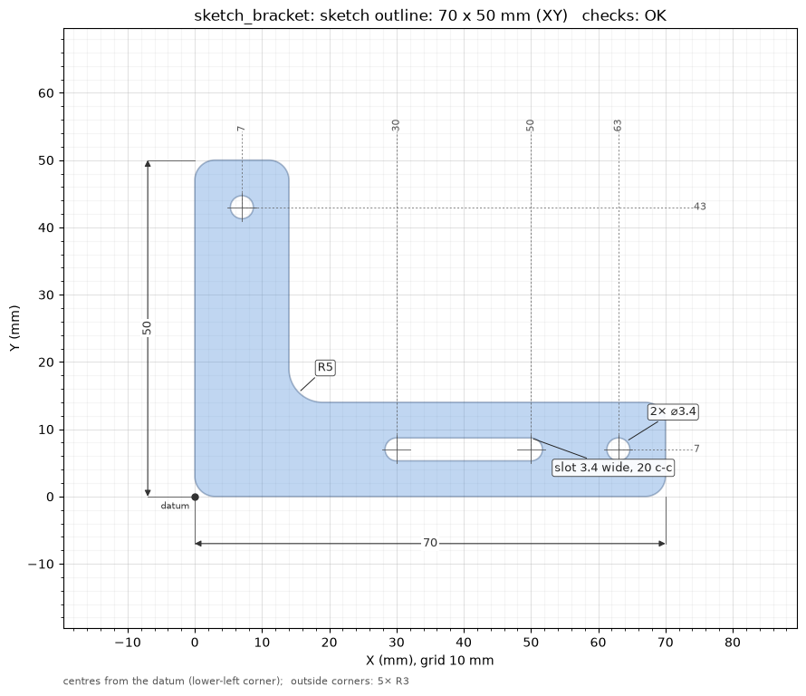

# Sketch first

Many printed parts are a 2D shape made solid: a bracket or a plate is an outline extruded, a
knob or a pulley is a profile turned about an axis, a hook is a section swept along a path. For
those, drawing and agreeing on the 2D sketch before any 3D gives a cleaner part than stacking
boxes and cylinders, and it is quicker to check: one flat picture with its dimensions.

Sketch first is **optional, per part**. The AI offers it when the part fits: outlines extruded
flat (brackets, plates, clips, spacers, gaskets), profiles revolved (knobs, pulleys, spool
parts, bushings) and sections swept (hooks, handles). It does not offer it for boxy enclosures
(a box, a shell, a lid) or for organic shapes, which have their [own recipes](recipes.md#organic-shapes).
Say no and it models the part as usual.



*The [`sketch_bracket`](../scripts/examples.md#sketch_bracket) example's outline: overall size,
holes grouped by size, the slot, the inside radius, hole and slot centres measured from the
lower-left corner.*

## How it goes

1. **Dimensions first**, as always: the AI lists what it read and waits for you to confirm.
2. **The sketch.** `new_part(name, sketch_first=True)` (CLI `b123d-print new <name> --sketch`)
   starts a script with a `sketches(d)` hook next to `build(d)`:

    ```python
    from b123d_print.recipes import bed_chamfer, rounded_outline, slot

    def outline(d):
        pts = [(0, 0), (d.ARM_X, 0), (d.ARM_X, d.ARM_W), (d.ARM_W, d.ARM_W), (d.ARM_W, d.ARM_Y), (0, d.ARM_Y)]
        s = rounded_outline(pts, [d.CORNER_R, d.CORNER_R, d.CORNER_R, d.INSIDE_R, d.CORNER_R, d.CORNER_R])
        s -= Pos(d.ARM_X - d.HOLE_INSET, d.ARM_W / 2) * Circle((d.HOLE_D + d.HOLE_COMP) / 2)
        s -= slot((d.SLOT_FROM, d.ARM_W / 2), (d.SLOT_TO, d.ARM_W / 2), d.HOLE_D + d.HOLE_COMP)
        return s

    def sketches(d):
        return {"outline": lambda: outline(d)}  # lazy, like pieces: made only when asked for
    ```

    A sketch's name becomes part of its picture's file name: 1-40 letters, digits, `_` or `-`,
    starting with a letter or digit.

3. **The picture and the checks.** `render_sketch(name)` (CLI `b123d-print sketch <name>
   [<sketch>]`) draws the sketch on a mm grid, writes it to `out/images/<name>_sketch_<sketch>.png`,
   lists the sizes, holes, slots and corner radii, and runs the sketch checks below. The AI
   fixes any failure, shows you the picture and **waits for your OK**.
4. **The solid.** `build(d)` extrudes, revolves or sweeps the same `outline(d)`, so the part is
   the sketch you approved, then adds what only exists in 3D: countersinks, `bed_chamfer`, a
   lip. From here the usual flow: build, preview, sections, check, design review, export.

```python
def build(d):
    p = extrude(outline(d), d.THICK)
    return bed_chamfer(p, d.BED_CHAMFER)  # chamfers the inside radius and the holes too
```

A sketch is drawn on `Plane.XY`, in the script's own coordinates. A profile to revolve can be
drawn on `Plane.XZ` (`Plane.XZ * sketch`); the picture then reads it in that plane's own axes.
An outline [traced from a scan](tracing.md) gives the points for `rounded_outline`.

## The dimensions on the picture

- **Overall size**: width along the bottom, height along the left.
- **Holes** by diameter, identical ones on one label (`3× ⌀4.4`); **slots** by width and
  centre-to-centre length; **inside corner radii** grouped the same way (`2× R4`). Outside
  radii are listed under the picture.
- **Centres** of holes and slots as ordinate dimensions from the **datum**, the lower-left
  corner of the sketch: one per distinct X along the top, one per distinct Y down the right.
- Findings are circled in red: a sharp or tight inside corner, the narrowest neck, a hole too
  small to print.

On a busy sketch, labels are placed so they do not overlap, values close together move out a
row, and with more than 14 distinct centres along an edge the centres are listed in the text
result instead of drawn. `dims=False` (CLI `--no-dims`) draws the shape and the grid only.
The dimensions are only on the picture: they change nothing in the part or the checks, and the
same numbers are in the text result.

## The sketch checks

| Check | What | Level |
| --- | --- | --- |
| `region` | one closed region: an open outline (its two ends and the gap), a closed wire that is not yet a face, or several separate regions | FAIL |
| `neck` | the narrowest material in the sketch, between two boundaries or across a wall, against `min_wall` (WARN) and one line width (FAIL); a point that tapers to nothing warns | WARN / FAIL |
| `corners` | inside corners with no radius or one under 0.5 mm ([BP-R1](../BEST_PRACTICES.md)); outside corners print rounded anyway | WARN |
| `holes` | holes under 1 mm do not print round | WARN |
| `bed` | with a printer profile, the outline laid flat against the bed | WARN |

They are 2D only and quick: the part's own [checks](checks.md) still run on the solid.

## Recipes

- `rounded_outline(points, radii)`: a closed outline through the points in order, one radius
  per point (0 = sharp) or one for all. It refuses radii that do not fit on an edge, naming the
  two corners, where `FilletPolyline` alone would make a bad face.
- `slot(a, b, width)`: a slot whose round ends are centred on `a` and `b`, at any angle; a hole
  when `a == b`.

`b123d-print recipes rounded_outline` shows the code, an example and the notes.
