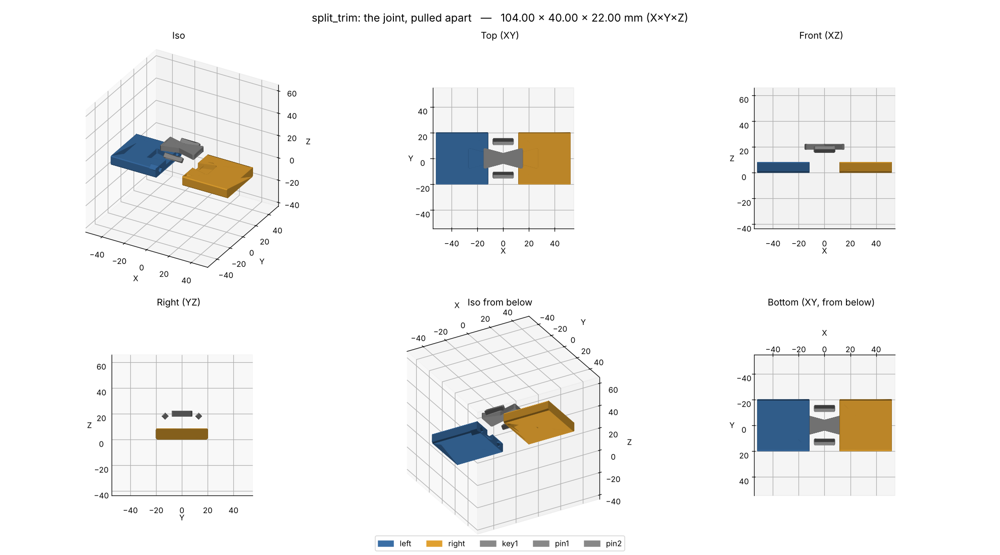
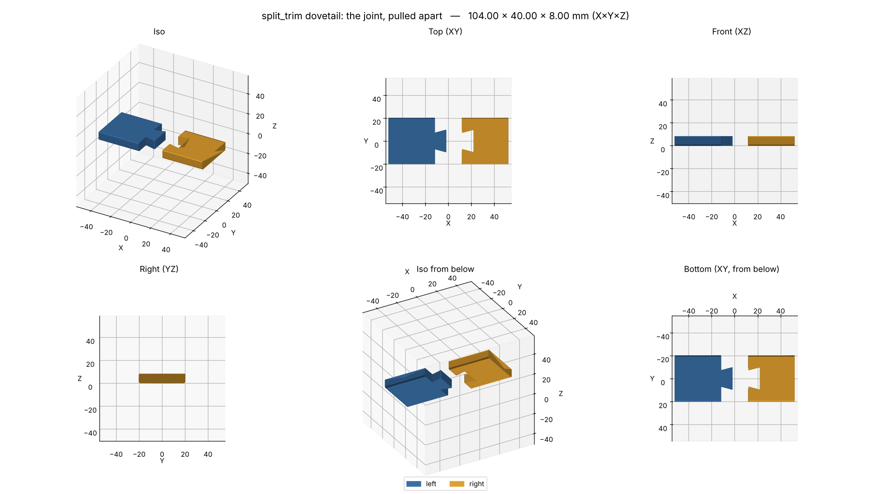

# Splitting parts and joining them

Some parts are too big for the bed. Others print better in pieces: with less support, with each
piece in its strongest orientation, or with less to lose when a print fails. This page covers
when to split, where to cut, which joint to use and how much clearance it needs, how to glue and
finish the seam, and how a part script does it with
[`b123d_print.joints`](#in-the-part-script-b123d_printjoints).



*The [`split_trim`](../scripts/examples.md#split_trim) example, pulled apart. A 420 mm strip is
cut into two 210 mm pieces. A bowtie key sunk into the back takes the pull across the seam, and
two square pins line the faces up. The key and the pins are separate prints.*

The rules behind this page, with their sources, are in [BEST_PRACTICES §11](../BEST_PRACTICES.md#11-splitting-parts-and-joints)
(J1–J8). Where a number has only one source, this page says so.

## Just ask your assistant

- *"This trim is 1.5 m long and my bed is 256 mm. Split it, and key the pieces together."*
- *"Cut the bracket so it prints without supports, and bolt the two halves together."*
- *"Make a fit test of the joint before I print the pieces."*

The assistant proposes where to cut and which joint to use, and waits for your OK. It then cuts
the part with `split()`, checks every piece, and offers a fit-test template of the joint. Its
report says how to put the pieces together.

## When to split

Split when at least one of these is true [J1]:

| Reason | What it looks like |
| --- | --- |
| **It does not fit the bed** | Bigger than the build volume in every orientation. Turn it first: a 256 × 256 bed takes 362 mm on the diagonal. With a [printer profile](printer-profiles.md) set, the `fit` check fails on any piece that is too big. |
| **Supports** | A part that needs a lot of support often splits into pieces that each have a big flat face on the bed and need none. Supported surfaces come out rough [S1, S2]. |
| **Strength** | Layers are the weak direction: across them a part has roughly half its strength [S4, S5]. A hook, an L bracket or a long arm can be split so each piece lies with its load along the layers. |
| **Print time and failure risk** | A failure 20 hours into one big print costs 20 hours; in pieces it costs one piece. Pieces also fit more than one printer. |
| **Materials and colors** | Different pieces in different materials or colors. |

Splitting costs something too: joint features to model, a fit to tune, an assembly step, and a
seam that is weaker than the solid part and visible unless it is hidden. Don't split a part that
fits and prints well whole.

## Where to cut

[J6]

- **Away from load.** Put the seam where the bending moment is low. A seam at the root of an
  arm, or right next to a hole that takes the screw load, is the worst place for it. The seam is
  the weakest spot [J5], and a short piece hanging off a joint levers it open.
- **Along a design line.** A seam on an edge, a groove, a change of surface or a color break is
  hardly seen. A seam in the middle of a flat face shows however well it is filled. On a long
  trim, cut at a bend, a molding line or a fastener.
- **So each piece prints well.** Each piece should have a big flat face for the bed, need no
  supports, and lie so its load runs along its layers. Often the cut that makes the pieces
  print well is also the cut that hides the seam.
- **Square to the length, on a flat section.** A flat cut through a straight, constant section
  gives two matching faces and room for the joint. A cut through a curve or a taper works, but
  the joint features must fit inside both pieces.
- **Room for the joint.** The joint features need wall around them: at least `min_wall`, and
  more under a key recess or around a pin socket. Check it with a `Wall` check
  ([Verify](#verify-the-pieces-and-the-joint)).
- **Equal pieces, where it makes no difference otherwise.** Equal pieces print in about the
  same time, and the same joint repeats.

## Choosing the joint

A flat butt joint, two faces glued together, has the least glue area and nothing to line the
pieces up, and it loads the glue in peel. It is the weakest joint [J2, J5]. Every joint below
adds a mechanical key, alignment, or both.

| Joint | Best for | Strength | Alignment | Glue? | Printability |
| --- | --- | --- | --- | --- | --- |
| **Dowel pins**, round or square (`Dowel`) | Lining up flat faces; light loads; pieces that come apart | Shear across the seam only; pins pull out unless glued | Good: two pins fix the faces, and one square pin also stops twisting | Optional (CA in the sockets) | Loose pins print lying down: square ones on a side, round ones on a 45° flat, so the shear runs along their layers [S4]. A round socket lying on its side is a round horizontal hole [H3]: use square pins there, standing on a corner for a 45° roof. Min. pin ~3 mm (UZH); under 5 mm, fillet the base of an attached pin or use a steel one (Hubs) |
| **Plug** (`Dowel(plug=True)`) | Like dowels, with no separate part | As the pin; an attached pin that stands across the layers is weak | Good | Optional | The plug stands on the cut face. If that face lies on the bed, the plug stands across the layers. |
| **Bowtie / butterfly key** (`Bowtie`) | Long seams under tension: trims, panels, signs | Good in tension across the seam; the key prints flat, so the pull runs along its layers | Fair: in the face plane only (add pins for the faces) | Usually: CA gel or epoxy; dry with screws | The recess opens upward if the key goes into the side facing up in print: no support needed. Keep ≥ ~3 lines of floor under it |
| **Dovetail** (`Dovetail`) | Sectioned parts that slide together; locks against pulling apart | Good along the normal; free along the slide direction | Good in two directions | Optional; something must stop the slide (glue, a screw, a stop) | A through dovetail with its slide direction along Z prints with vertical walls, no overhang. Prints better than a dovetail across Z |
| **Lap / rebate** (`Lap`) | Glued seams that need area; hides the seam's straight line; blocks light | Good with glue; the glue works in shear | Fair in one direction | Yes | The tongue or the rebate hangs over air unless the step stands vertical in print: turn the piece, or keep the overhang short |
| **Heat-set insert and screw** (`Insert`) | Joints that come apart; structural joints | Strong; an insert holds ~3 Nm, a screw in plastic ~1 Nm [T5] | Only with pins or a dovetail | No | The insert maker's hole + `HOLE_COMP`, depth = length + 1 mm, the maker's wall around it [T2, T3, T4]. Put it on a flange or a boss: the head needs access from the far side |
| **Snap fit** | Covers and lids, tool-free | Low, set by the arm | Good | No | See the snap-fit rules [N1–N5]. Not in `joints`: model the arm |

Combine them: a bowtie key across the seam plus two square pins is a good default for a long
strip. Inserts plus pins suit a joint that must come apart. A glued lap is quick for a seam that
never sees load.

**Slicer cut tools.** PrusaSlicer's and Bambu Studio's cut tools add plugs, dowels, snaps and
dovetails to a mesh. PrusaSlicer puts its tolerance on the hole and adds none by default.
Bambu Studio adds 0.1 mm by default. Use them for a mesh you don't model; in a part script,
`split()` uses your measured clearance and keeps the joint in the parametric source.

## Clearances and the test-snippet habit

All values here are **per side**, our convention [F4]. `split()` and every joint take the
script's `CLEARANCE` (from your config: `clearance(__file__)`). A joint can override it, e.g.
`Dowel(..., clearance=d.PRESS_FIT)`.

| Fit | Per side | When | From |
| --- | --- | --- | --- |
| Press | `press_fit`, ~0.05 | Pins that should stay in without glue | [F1], measured with `fit_coupon` |
| Sliding (the default) | `clearance`, 0.2 | Keys, dovetails and pins that assemble by hand | [F1, F2] |
| Free | `free_fit`, 0.3 | Parts that must move, or a first try on an unknown printer | [F1, F2] |
| Glued with CA | 0 to ~0.1 | Faces that touch: the butt faces of the seam | [J7]: thin CA bridges ~0.15 mm at most |
| Glued with epoxy or CA gel and activator | 0.1 to 0.25 | A key or a tongue in a clearance fit | [J7] |

The starting material many guides repeat ("0.15–0.20 standard, 0.05–0.10 friction, 0.25–0.30
for glue") is close for sliding and press fits, which our defaults already cover. For glue it
needs two corrections. Thin CA does not fill 0.25–0.3 mm per side: that gap wants epoxy, or CA
gel with an activator [J7]. And the seam's main faces touch, with no gap at all; only the joint
features have clearance.

**Why printed fits come out tight.** The usual causes:

- **Elephant's foot.** The first layer is squashed against the bed and spreads out. Correct it
  in the slicer (PrusaSlicer: ~0.2 mm for a 0.4 mm nozzle), not in the CAD [B1].
- **Extrusion width and over-extrusion.** A line wider than the slicer thinks pushes every wall
  out a little.
- **Corner bulge and the seam.** Outer walls bulge at corners and at the start/end seam of
  each loop, so a key's corners hit first. The joints round every profile corner, and the
  female's corners sit exactly `clearance` away.
- **Faceted holes.** A round hole exported as a polygon has its flats inside the true circle,
  so holes print small. `HOLE_COMP` corrects this together with the printer's own error [H1].
- **Shrinkage**, in ABS, ASA and nylon over long distances. Place mating features near each
  other [F5, M1].

"Die swell", the strand swelling as it leaves the nozzle, is real. It is a known effect on
strand size in the research literature (De Rosa et al., *Micromachines* 2023). But the slicer's
extrusion width already absorbs it, so it is not a separate cause of tight fits to design for.

**Test the joint first.** Before printing two 6-hour pieces, print the joint: a short slice of
each piece around the cut, plus a loose key or pin, about 15 minutes. Fit them. Too tight or
too loose: change `CLEARANCE` (or the joint's own `clearance`) and print the snippet again.
A [fit-test template](templates.md) does this from the real pieces, so the snippet's joint is
exactly the part's. `Template.crop(...)` around the cut in `templates(d)` exports it with every
build, as `split_trim` does.

## In the part script: `b123d_print.joints`

```python
from build123d import Plane
from b123d_print import clearance
from b123d_print.joints import Bowtie, Dowel, split

CLEARANCE: float = clearance(__file__)          # in Dims: per side, from your config

s = split(strip, Plane.YZ.offset(d.CUT_X), [
        Bowtie(30, 16, 8, 4, at=(0, d.THICK)),            # in the back, across the seam
        Dowel(3.5, 16, square=True, at=(-13, 4), angle=45),
        Dowel(3.5, 16, square=True, at=(13, 4), angle=45),
    ], clearance=d.CLEARANCE, hole_comp=d.HOLE_COMP_H)
s.a, s.b      # the two pieces, where they were in the part: turn and move them for printing
s.loose       # {"key1": ..., "pin1": ..., "pin2": ...}, each laid flat on Z=0, ready to print
s.placed      # the same pins and keys where they sit when assembled (for assembly(d))
```

`split(part, plane, joints, clearance, hole_comp=0)` cuts at a build123d `Plane`. Piece **a**
is below the plane (against its normal), **b** above. Each joint is placed with `at=(u, v)` in
the plane's own coordinates (for `Plane.YZ`: Y and Z) and `angle` (degrees about the normal).
Attached features (a plug, a dovetail's tail, a lap's tongue) go on **a**, the sockets into
**b**; `flip=True` swaps them. Attached features are clipped to the original part, so nothing
sticks out of its outline. A cut that leaves a piece in two bodies, or misses the part, is an
error that says so. To cut into three or more pieces, split a piece again.

In the joint's own frame, Z is the cut plane's normal:

| Joint | Arguments (mm, degrees) | Male | Female |
| --- | --- | --- | --- |
| `Dowel` | `d`, `length` (in all), `square`, `plug`, `chamfer` (lead-in) | the pin: loose, or a plug on a | sockets in both pieces, `d + 2 × clearance` across and `clearance` at each end; round ones also get `hole_comp` |
| `Bowtie` | `length` (across the seam), `width` (ends), `waist`, `depth`, `r` (corners) | the loose key, lying in the frame's XZ plane, sunk into −Y from `at` | the recess, `clearance` bigger all round and under it |
| `Dovetail` | `width` (at the root), `length`, `taper` (each side, from the normal), `height` (None: through), `r` | the tail on a | the slot in b; the pieces slide together along the frame's Y |
| `Lap` | `length`; the step is at `at`'s v | a's tongue, below the step | b's rebate, `clearance` over the tongue and at its end |
| `Insert` | `size` (M2–M6), `grip`, or `hole`/`length`/`wall` from another maker's datasheet | (the bought insert) | the pocket in a (hole + `hole_comp`, length + 1 mm deep); in b the screw's clearance hole over `grip`, then head access through the rest of b |

Every joint also works on its own: `Dowel(6, 20).pair(d.CLEARANCE)` returns `Pair(male,
female, loose)` in the joint frame, for a script that places joints itself. The female is
always the male grown by `clearance` on every side: across a pin, a key, a tail or a tongue it is
exactly `2 × clearance` bigger. The tests check this, and that the pieces' volumes add up.
`Insert(...).min_wall` is the insert maker's minimum wall, for a `Wall` check.

**Defaults and where they come from.** The CNC Kitchen insert table (M2–M6: hole, length, wall)
is the maker's own, as listed by 3DJAKE; the same numbers are in bd_warehouse's `CNCKitchen`
rows. The dovetail's 15° taper is a convention, also b3dkit's default. Woodworkers use 7–14°
(1:8 to 1:6) for wood; no FDM test gives a best angle. The bowtie's proportions (waist half the
width, ends ~8–15° off the axis) follow woodworking. Woodworkers make keys ¼–⅓ of the slab thick;
in a thin printed strip the key can go to half, if ≥ ~3 lines of floor remain under it. These
are starting points: print the snippet.

**Other libraries.** [bd_warehouse](https://github.com/gumyr/bd_warehouse) (Apache-2.0) has
`HeatSetNut` and `InsertHole` for McMaster-Carr, Hilitchi, ruthex and CNC Kitchen inserts. Its
hole is the drill-chart size (CNC Kitchen M3: 4.09 mm) and its depth is the insert length,
where our rules use the maker's hole (4.0) and length + 1 mm [T2, T3]. Part scripts can import
it ([Threads, fasteners and gears](threads-fasteners-gears.md)). For other makers, take the
insert's length from its table (`HeatSetNut("M3-0.5-Standard", "McMaster-Carr").nut_data["m"]`)
and the hole and minimum wall from the maker's datasheet, and pass them to `Insert`. (Its
`material_thickness` column is CNC Kitchen's minimum wall, 1.6 for M3, but McMaster-Carr's
recommended plastic thickness, 6.5: not the same thing.)
[b3dkit](https://b3dkit.readthedocs.io) (MIT) has dovetails (traditional, snug-tail,
T-slot), click fits and twist snaps. Its `tolerance` is shared between tail and socket, half
each, so its 0.025 default is about 0.0125 per side, far below a printed sliding fit. If you use
it, pass twice your per-side `CLEARANCE`.

## Assembly and adhesives

[J4, J5, J7]

| Adhesive | For | Gap | Notes |
| --- | --- | --- | --- |
| **CA (thin)** | PLA, PETG, ABS, ASA, nylon: all common filaments | Faces that touch, ≤ ~0.15 mm | Sets in seconds; weak in peel and torsion [J5]. Thin CA wicks into a seam that is already clamped |
| **CA gel + activator** | The same; keys and pins in a sliding fit | Up to ~1 mm with activator (Loctite 454) | The gel stays put on vertical faces; the activator sets it in a clearance gap |
| **Epoxy (5-minute or 30-minute)** | Loaded joints, gaps, large pieces; PETG | Typical bond line 0.1–0.25 mm; fills more | Longer working time to line the pieces up; the strongest choice for a joint that carries load |
| **Acetone (solvent weld)** | ABS and ASA only | Faces that touch | Softens both faces into one; ventilate. Not for PLA (barely) or PETG (not at all) [J4] |

1. **Dry-fit first.** Assemble without glue, with tape or clamps; check the faces line up and
   the seam closes. Sand or trim anything that binds now, not after the glue.
2. **Clean the faces.** Remove stringing and the brim; sand glossy faces lightly for grip.
3. **Glue the joint features and the faces.** Pins and keys go in with glue in their recesses.
4. **Clamp while it sets.** For a long strip, clamp along its length (a strap, or the pieces
   pushed together against a stop) and flat on a straight surface, so the seam closes without a
   kink. CA: minutes. Epoxy: as its label says, often hours to full strength.
5. **Screws and inserts.** Heat-set inserts go in before assembly, with the iron at print
   temperature + 10–20 °C [T3]. A screw through each piece into the wall (or the RV) takes the
   load off the glued seam.

## Seams

[J8]

1. **Glue it flush.** A seam that is flush before filling needs little filler. Pins and keys line
   the faces up; clamp to a flat surface.
2. **Fill.** Spot putty or body filler in thin layers, sanding between them; or CA with baking
   soda or talc, set with activator, for a small gap.
3. **Sand.** Coarse (~P100) to level the filler, then finer (P400) before primer.
4. **Prime.** Filler primer shows what is left; fill and sand again; then paint.
5. **Or don't hide it:** a seam on a design line, or a deliberate groove (a chamfer on both
   edges at the seam, a "reveal"), looks intended and needs no filling.

On a part printed visible face down (a trim on its back), the visible face comes out flat and
smooth from the bed, and the seam's only step is in the CAD: none.

## Verify the pieces and the joint

Everything in [Verify before reporting](../scripts/rules.md) applies to each piece, plus:

- **Every piece fits the bed.** With a printer profile, the `fit` check does it. Otherwise
  compare each piece's size with the bed in the script, as `split_trim` does.
- **An `assembly(d)`** with the pieces where they were and `s.placed` (the keys and pins in
  place): the overlap check proves nothing collides.
- **`Gap` checks:** the key and the pins against each piece, `min` and `max` around
  `CLEARANCE`. They prove the clearance is what the report says.
- **`Wall` checks** around the joint features: under a key recess, between a recess and a pin
  socket, around an insert pocket (`min=Insert(...).min_wall`). Use `frame="assembly"`.
- **Sections** through the joint: across the cut (YZ for a cut along X) and along a pin.
- **A fit-test template** of the joint, before the pieces.

## Worked examples

### A long trim, split into keyed pieces

A wall trim 1.5 m long, an L-shaped section 40 × 12 mm, curved at both ends, for a 256 × 256
bed. The same steps apply to any long, thin part: a shelf edge, a cable cover, a frame.

1. **Measure** with a table of offsets along the length and a profile gauge across it
   ([Measuring for the AI](measuring.md)): the trim's section, where it curves, and where the
   screws can go.
2. **Plan the cuts.** 1500 mm in pieces of at most ~240 mm (some room on the bed): straight
   pieces of equal length, and the curved ends as their own pieces, cut where the curve meets
   the straight. Two curved end pieces + six 225 mm straights. A piece that turns a corner or
   drops down (a "drop piece") is its own piece too, cut where the section changes.
3. **Orient.** Each piece visible face down: smooth face, chamfered bed edges, no supports.
   The back faces up.
4. **Joint.** A bowtie key in the back at every seam (the pull along the trim), plus two square
   pins standing on a corner (the faces line up; no overhang). Screws through each piece into
   the wall take the load: the joint only holds the line.
5. **Script.** One script, one `Dims`: the section, the cut stations as a tuple, and the joint
   sizes. `split()` in a loop: cut the remaining piece at each station.
   `build(d)` returns `{"p1": ..., "p2": ..., "key1": ..., "pin1": ...}`. The keys and pins are
   identical, so print one of each and set the copies in the slicer.
6. **Check.** `Gap` on a key and a pin, `Wall` under the recess, the `fit` check on every piece.
7. **Fit test.** A template crop of one joint (both sides) plus a key and a pin. Fit them, and
   adjust `CLEARANCE` if needed.
8. **Assemble.** Dry-fit on a flat surface, glue keys and pins (CA gel + activator, or epoxy),
   clamp along the length, then screw to the wall. Fill and sand the seams if they show.

`split_trim` is this example cut down to one seam: a 420 mm straight strip, two pieces, one key
and two pins, with a `dovetail` variant.



*The `dovetail` variant: the pieces slide together along Z; glue or a screw stops the slide.*

### A bracket split for strength

An L bracket standing on its foot has its upright across the layers, and the load bends it right
there [S4]. Lying on its side, its profile is in the layers, but a wide bracket may not fit that
way. Split it at the corner: each arm lies flat. Join with a lap at the corner and two `Insert`s
and screws. The joint then carries the load in screws, not across layers. Fillet the inside
corner of each arm where it meets the joint [R1].

### A box too tall for the printer

Split it horizontally at a design line (a rim or a groove), not in the middle of a face. Use a
lap all round so the seam is light-tight, plus a few square pins, glued. Or use inserts and
screws if the box must open.
