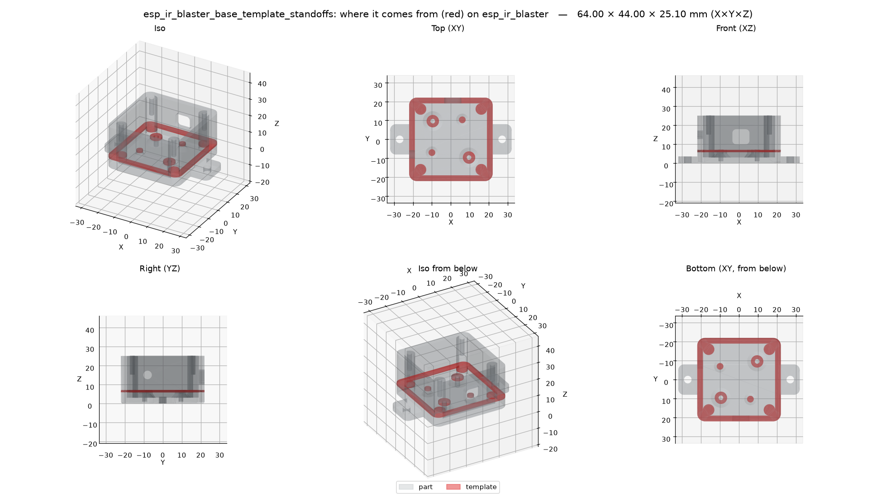
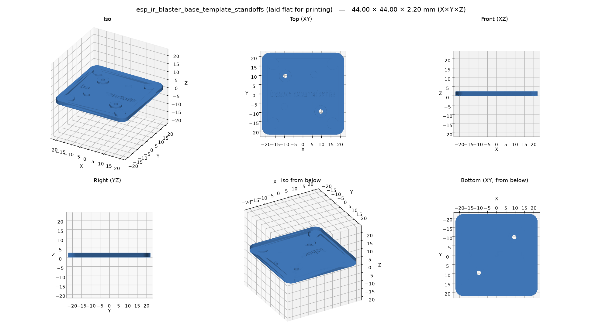
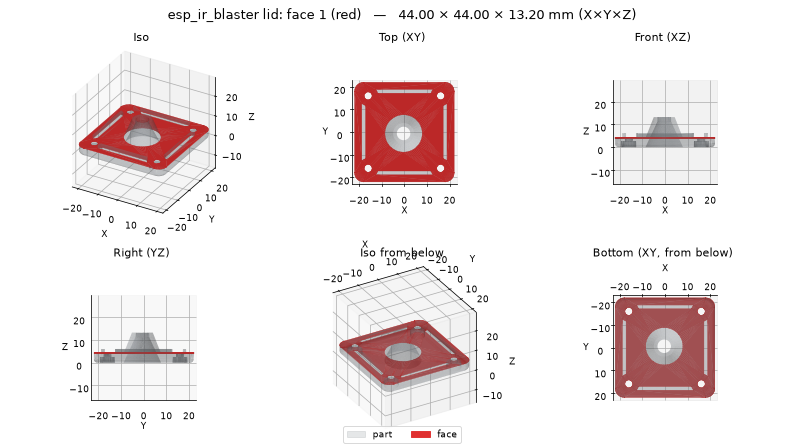

# Fit-test templates

A box that takes four hours to print and misses the board's holes by a millimeter costs you four
hours. A **fit-test template** is a quick, thin print (1.2 mm by default, minutes to print) cut
from the real part. It has the part's holes, hole compensation and clearances exactly, so you
can lay it on the board, the wall or the mating part, try the screws, and only then print the
whole thing.



*The part: the `esp_ir_blaster` base, with the slice the template is cut from in red (the top
of its walls, lid posts and board standoffs).*



*Its template: that slice laid flat, joined by a 1 mm base plate, with its label engraved. Set
the board on it and check the screws line up.*

## Just ask your assistant

Once a part is designed (or while you design it), ask in your own words:

- *"Make a fit-test template of the mounting face so I can check the hole pattern."*
- *"Print a 1.2 mm slice through the dovetail to test the fit."*
- *"Crop the clip so I can test it before printing the whole case."*
- *"Give me something quick to check the board fits on the standoffs."*

The assistant also offers one on its own when a part mates with something or has a hole
pattern. What it does:

1. **Finds the face or region.** It lists the part's flat faces with their holes, or picks a
   slice height or a box around the feature.
2. **Shows it to you and asks.** You get a picture of the part with the face (or the template's
   source) in red, like the ones above, and a question: "this face, with these four holes?"
   Nothing is made until you confirm.
3. **Makes it and checks it** like any part: laid flat for printing, labeled, checked for thin
   walls and overhangs.
4. **Gives you the file** (3MF, STL, ... in your formats), with what the template checks and how to
   use it. On a [remote server](../advanced/index.md) it brings it home with the rest of the part.

The `fit_test` [prompt](tools.md#prompts) walks an assistant through exactly this.

## Using the printed template

- **A hole pattern** (a mounting face, a slice through standoffs): lay it on the device, the
  board or the wall and push the screws (or a drill bit) through. If they line up and slide in,
  the full part's holes will too: same size, same spacing.
- **A slide or snap fit** (a slice through a dovetail, a crop of a clip): slide or snap it onto
  the mating part. Too tight or too loose? Tell the assistant ("the dovetail is too tight"), it
  changes the clearance, and you print the template again, not the whole part.
- **Sizes**: measure the template with calipers (hole diameters, slot widths, outline) and
  compare them with the numbers in the report. A difference in every hole is your printer's
  [hole compensation](hole-compensation.md).
- A template printed **on its side or turned over** (the report says so) checks hole positions
  and spacing; hole sizes only where it prints the way the part does.

## The three kinds

| Kind | What you get | Good for |
| --- | --- | --- |
| **face** | one flat face of the part, with its holes, as a plate | a mounting face and its screw pattern, a lid's inner face |
| **slice** | the part between two planes `thickness` apart, centered on a height: `XY` at a Z, `XZ` at a Y, `YZ` at an X (moved inward at the part's ends, so `XY` at 0 is the bottom 1.2 mm) | standoffs and posts at board height, a dovetail profile, an outline at a given height |
| **crop** | the part inside a box (center, size) | a corner, a snap clip, a boss, a hinge |

Every template:

- **keeps the real geometry**: it is cut from the part as built, so holes come out at the size
  the part's holes come out at, with `HOLE_COMP` and the clearances already in;
- is **laid flat** for printing: template face down on Z=0, centered. A slice or crop stays in
  the part's print orientation when that has enough flat contact; otherwise it goes on its
  flattest side, and the result says so;
- gets a **base plate** (1 mm) when a slice or crop falls apart into separate pieces (it keeps
  them where they are) or a crop has little to stand on; screw holes that reach the bed stay open
  through it;
- gets an **engraved label**, `<part> <id>` (shortened to the id if needed), 5 mm bold, 0.5 mm
  deep, on an upward flat face where it fits with a 1 mm margin: never through a feature, never
  next to a hole or an edge. No room, no label (the result says so);
- is **checked** like a part: valid solid, overhangs, thin features (the floor under the label
  is thin on purpose and skipped), holes, bed edges, separate pieces, build volume.

A plane or box that misses the part is an error that says where the part is.

**Options:** `thickness` (default 1.2 mm; thicker for a stiff snap fit), `label` (`false` for
none, or your own text), `base` (`false`: never add the base plate), `formats`.

## Faces and their ids

`list_faces` lists the flat faces with **ids** (1 = the largest), each with its outward normal and
side (`bottom`, `top`, `front`, `back`, `left`, `right`), area, center, box and **round holes**
(diameter and center) and other openings; curved faces are only counted. The same geometry always
gets the same ids; changed geometry may renumber them. A side (`"bottom"`) means the largest face
facing that way. With `highlight` it draws the part with that face in red:



## The MCP tools

```text
list_faces(name, variant?, part?, highlight?, size?, inline?)
make_template(name, kind, plane?, at?, face?, center?, size?, thickness?, label?, base?, variant?, part?, formats?, inline?)
```

- `kind="face"`: `face` = an id, a side (`"bottom"`) or `"x,y,z"` on the face.
- `kind="slice"`: `plane` (`XY`, `XZ`, `YZ`) and `at` (mm).
- `kind="crop"`: `center` and `size`, each `[x, y, z]` or `"x,y,z"` in mm.

`make_template` writes `parts/<name>/out/<name>[_<variant>][_<part>]_template_<id>.*` in the
`formats` asked for (default: your `formats` setting), plus the template's render and the
`_where` picture, and returns the size, label, notes, the check findings and, over HTTP, a
[download link](../getting-started/http.md#get-the-files) for each file. On a remote server
`download_part` brings them home with the rest of the part.

## From the command line

```bash
b123d-print faces bracket --highlight bottom
```

```bash
b123d-print template bracket --face bottom --formats 3mf,png
```

```bash
b123d-print template box --part base --slice XY:6.4 --name standoffs
```

```bash
b123d-print template clip --crop 10,0,5:12,12,10 --no-label
```

`--thickness`, `--no-label`, `--no-base`, `--name`, `--variant`, `--part` and `--formats` as in
the [CLI reference](../getting-started/cli.md#commands). The exit code is 1 when the template
fails a check.

## In the part script: `templates(d)`

Fit tests you will want for every variant go in the script, like `views(d)`; `export` (and
`b123d-print build`, and running the script) writes them for each variant:

```python
from b123d_print import Template

def templates(d):
    return [
        Template.slice("XY", d.PCB_Z - 0.6, part="base", name="standoffs"),
        Template.face_of("top", part="lid", name="screws"),
    ]
```

In a script, prefer a side, a point or a `name` over a face id: ids can change when a variant
changes the geometry. The arguments are in the [Checks API](../scripts/checks-api.md#template).

## In Python

```python
from b123d_print import crop_template, face_template, list_faces, slice_template

made = slice_template(part, "XY", 3.0, label="box xy3")   # also face_template(part, "bottom"),
made.part                                                 # crop_template(part, (x, y, z), (sx, sy, sz))
made.info                                                 # what was done: range, orientation, base, label, notes
```

`made.part` is laid flat for printing; `made.where` is the same piece where it sits in the part.
