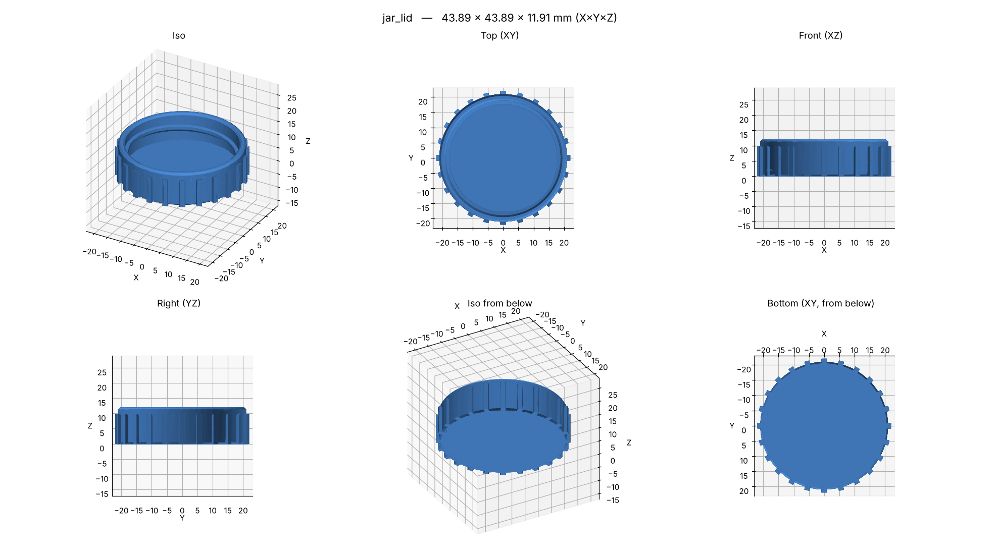
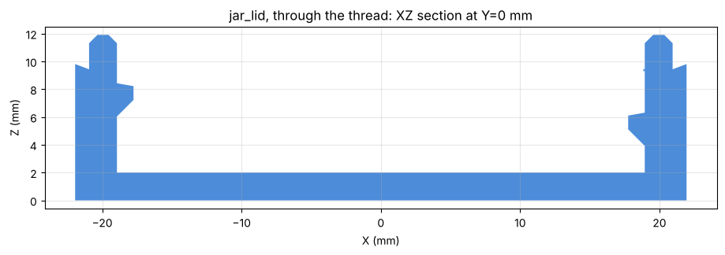
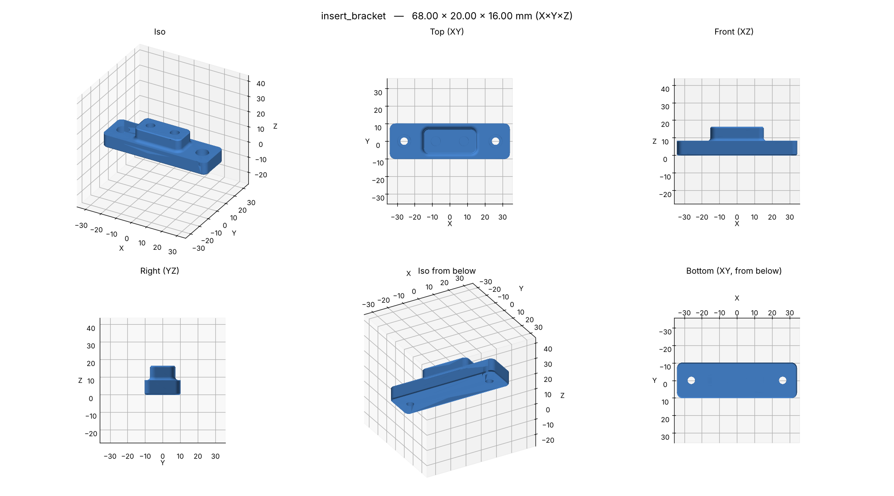
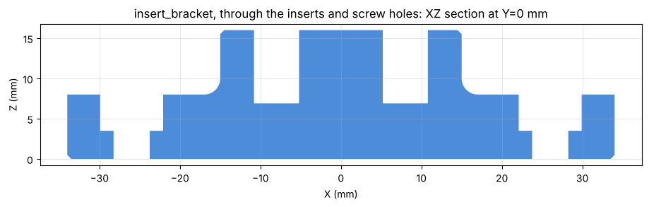
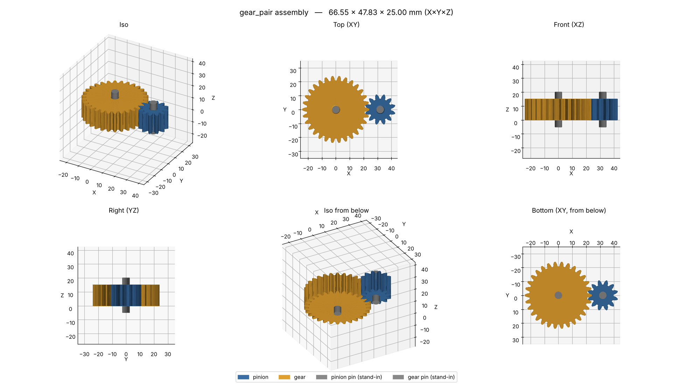
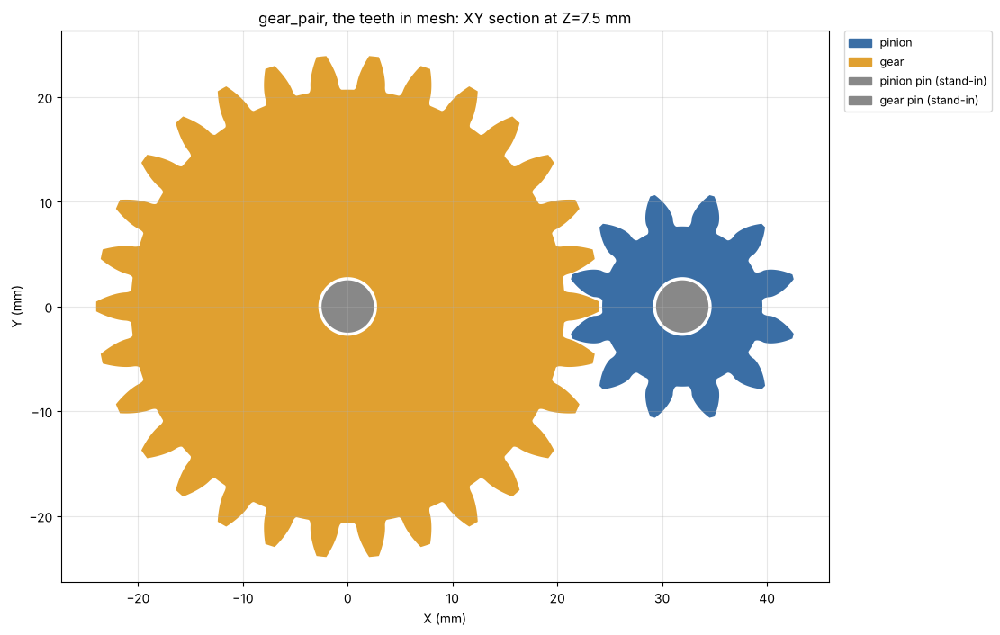
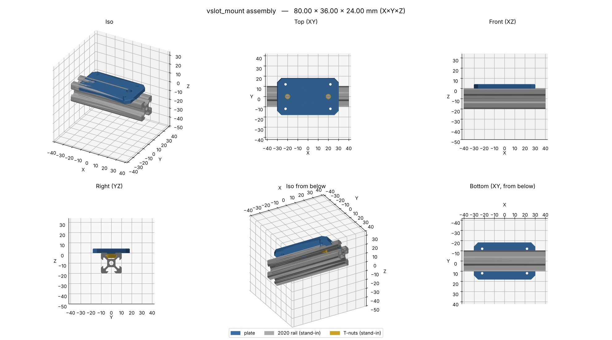
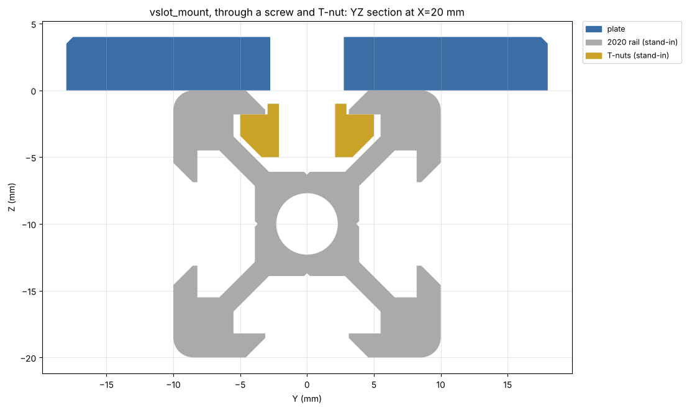

# Threads, fasteners and gears

Part scripts can import two [build123d part libraries](https://build123d.readthedocs.io/en/latest/external.html)
besides build123d itself. Both are installed with b123d-print and work inside the
[sandbox](sandbox.md):

| Library | For | Import |
| --- | --- | --- |
| [bd_warehouse](https://github.com/gumyr/bd_warehouse) 0.4.0 | threads (ISO, trapezoidal, Acme, Whitworth, plastic bottle), screws, nuts, washers, heat-set inserts, clearance and tap holes, bearings, gears and worms, sprockets, pipes, flanges, O-rings, OpenBuilds V-slot parts | `from bd_warehouse.thread import IsoThread, PlasticBottleThread`<br>`from bd_warehouse.fastener import SocketHeadCapScrew, HexNut, HeatSetNut`<br>`from bd_warehouse.open_builds import VSlotLinearRail, TNut` |
| [py_gearworks](https://github.com/GarryBGoode/py_gearworks) 0.0.24 | involute spur, helical, herringbone, bevel, ring and cycloid gears and racks, with meshing (`mesh_to`), profile shift and backlash | `import py_gearworks as gw` |

These libraries model the standard parts. Whether a part prints is a separate question, and the
rest of this page covers it. The AI follows the same rules (the
[workflow rules](../scripts/rules.md), "Threads, fasteners and gears").

!!! note "Why bd_vslot is not included"
    [bd_vslot](https://github.com/keeeal/bd-vslot) 0.0.2 (MIT) fails to build its rails with
    build123d 0.13, the version b123d-print pins: every rail opens an empty location list,
    which 0.13 refuses. `bd_warehouse.open_builds` has the same 2020 rail and T-nut, so use that.

## Threads: model them, or not?

**Model a thread** when it is M6 or larger with a coarse pitch, or a bottle or jar thread.
Two sources put the floor at M6 [JLC][JLC-DG] [Sovol][SOVOL-THR], and Hubs at M5
([BP-T1](../BEST_PRACTICES.md#8-threads-screws-inserts-nuts-bosses)). Below M5 the crests
and roots are close to one extrusion line wide [SOVOL-THR]. Bigger and coarser is easier: M8 and up
prints comfortably. Sovol recommends 2–4 mm pitches with rounded roots for custom threads, and
a layer height of at most 1/6–1/8 of the pitch [SOVOL-THR].

- **Print the thread axis upright (Z)** [SOVOL-THR] [SNAP-THR]. Each turn is then traced in
  the layers; lying on its side, a thread turns into stair steps and sagging roofs.
- **Expect an overhang warning on a 60° thread.** Its flanks are 30° from horizontal, so the
  downward flank is 60° from vertical, past the 45° limit. Snapmaker calls these flanks
  "difficult to print accurately as overhangs" [SNAP-THR]. For an M10 × 1.5, `check` reports
  each turn's underside at 60°. Each flank is short, so a coarse thread still works, but its
  underside comes out rough, and this is why fine threads print poorly. A **buttress** profile
  has a 45° flank and a flat one. With the 45° flank facing down it has no overhang at all, as
  in the bottle thread below.
- **Clearance:** about 0.1–0.2 mm per side (0.2–0.4 mm on the diameter) to start
  [SOVOL-THR]. Use your measured sliding fit (`load_settings(__file__).clearance`, see
  [Settings](settings.md#keys)) and print a test pair. bd_warehouse threads take it as
  `manufacturing_compensation`, which is **radial**: it moves an internal thread outward and an
  external one inward by that much.
- **Ends:** fade or chamfer the start, so the first turn is not a blunt sliver that catches
  and breaks. Sovol suggests a 0.8–1.5 mm chamfer at the entry [SOVOL-THR] [SNAP-THR].
  bd_warehouse: `IsoThread(..., end_finishes=("fade", "chamfer"))`. Bottle threads always
  fade both ends.
- **Walls:** 3–5 perimeters around a thread [SOVOL-THR]. Under constant tension PLA creeps
  and loosens.

```python
from bd_warehouse.thread import IsoThread
from b123d_print import load_settings

CLEARANCE = load_settings(__file__).clearance  # per side
# an M10 x 1.5 external thread, 12 mm long, both ends faded, standing on Z
thread = IsoThread(major_diameter=10, pitch=1.5, length=12, external=True,
                   end_finishes=("fade", "fade"), manufacturing_compensation=CLEARANCE)
```

**Bottle and jar threads** are coarse (4–8 threads per inch) and short, which makes them easy
to print. A finish such as **38-400** names a neck about 38 mm across and a thread style. The
400 finish has about one turn, 410 one and a half, 415 two [REGENT] [PRETIUM]. bd_warehouse
covers ASTM D2911 (`"M38SP400"`: M for the buttress profile of plastic closures, L for the
trapezoidal profile of metal closures) and PCO-1881 (soda bottles, `"28"` with
`bottle_type="pco1881"`). `PlasticBottleThread.identify(...)` finds the finish from measurements
taken off a bottle. Measure the diameter over the thread crests (T) and the neck between the
threads (E) [BERLIN].



*The [`jar_lid`](../scripts/examples.md#jar_lid) example: an internal 38-400 thread, top of
the cap on the bed.*



*In print orientation the steep (45°) flank of the buttress faces down and the flat one faces
up, so the thread prints without supports.*

## Small threads: inserts, nuts, self-tapping

**Below about M6, don't model the thread** [BP-T1](../BEST_PRACTICES.md#8-threads-screws-inserts-nuts-bosses).
Use one of these:

- **Heat-set inserts** for anything opened more than a few times. A screw driven straight into
  plastic holds about as well in pull-out, but strips at about 1 Nm, against 3 Nm for an
  insert [CNCK-HELI]. Use the insert maker's hole size plus `HOLE_COMP`
  (CNC Kitchen: M3 × 5.7 → 4.0 mm, M4 × 8.1 → 5.6 mm, M5 × 9.5 → 6.4 mm) [CNCK-TABLE].
  Make the hole straight and blind, about 1 mm deeper than the insert, with no chamfer needed
  [CNCK-TIPS]. Keep at least the maker's minimum wall around it (M3 1.6, M4 2.1, M5 2.6 mm)
  [CNCK-TABLE], and install at print temperature + 10–20 °C [CNCK-TIPS] [PRUSA-INS].
- **Captive nuts:** a hex pocket across-flats + 0.2 mm in total
  ([BP-T7](../BEST_PRACTICES.md#8-threads-screws-inserts-nuts-bosses)). A pocket that opens
  downward can print over a one-layer sacrificial bridge.
- **Self-tapping screws** into a pilot hole: M3 ≈ 2.6–2.9 mm, depending on material and
  orientation. Print a test pair
  ([BP-T6](../BEST_PRACTICES.md#8-threads-screws-inserts-nuts-bosses)).

### bd_warehouse holes and hole compensation

bd_warehouse has the fastener tables, so take sizes from them instead of typing them in:

```python
from bd_warehouse.fastener import HeatSetNut, SocketHeadCapScrew

screw = SocketHeadCapScrew("M4-0.7", 16)
screw.clearance_hole_diameters   # {'Close': 4.3, 'Normal': 4.5, 'Loose': 4.8}
screw.tap_hole_diameters         # {'Soft': 3.3, 'Hard': 3.5}  (for a tap, not a self-tapping screw)
screw.head_diameter, screw.head_height
insert = HeatSetNut("M4-0.7-8.1", "CNCKitchen")   # also "ruthex", "McMaster-Carr", ...
insert.nut_data["m"], insert.nut_data["material_thickness"]   # 8.1 long, 2.1 minimum wall
```

Its hole objects (`ClearanceHole`, `TapHole`, `ThreadedHole`, `InsertHole`) cut a hole in
place. Mind how they meet [hole compensation](hole-compensation.md), so a hole is compensated
**once**:

| Hole | Compensation | Do this |
| --- | --- | --- |
| `ClearanceHole(screw, fit=...)`, `TapHole(screw, ...)` | none; cut at the table's nominal size | read the size from `screw.clearance_hole_diameters[fit]` and cut it yourself with `+ HOLE_COMP`, like every other hole (the `insert_bracket` example does this) |
| `InsertHole(insert, manufacturing_compensation=...)` | radial, added to the radius | pass `HOLE_COMP / 2` (HOLE_COMP is on the diameter). It cuts the table's **drill** size, which can differ from the maker's hole: 5.79 mm for the CNC Kitchen M4 against the maker's 5.6. Where that matters, cut the maker's size yourself |
| `PlasticBottleThread`, `IsoThread`, ... `manufacturing_compensation` | radial | your clearance per side (above). It is a fit, not hole compensation: don't add HOLE_COMP as well |

`HOLE_COMP` is 0 unless you opted in to build it into the files; then keep the slicer's hole
compensation at 0.





*The [`insert_bracket`](../scripts/examples.md#insert_bracket) example: two CNC Kitchen M4
inserts in blind 5.6 mm holes on top, and two counterbored M4 clearance holes sized from
bd_warehouse.*

## Gears

- **Module ≥ 1, preferably 1.5–2** for a 0.4 mm nozzle. Module 1 suits light duty only, and
  below 1 the teeth are a few lines wide [SOVOL-GEAR]. Bigger modules are stronger [HTM].
- **Face width** about 10 × module [GS-FW], or 3–5 circular pitches [SOVOL-GEAR] (about
  9–16 × module).
- **Backlash:** printed gears need more than metal ones [KHK-PLASTIC]. Thin each gear's flanks by
  0.1–0.2 mm, for 0.2–0.4 mm in total [SOVOL-GEAR]. py_gearworks: `backlash=` on each gear is a
  coefficient of the module along the line of action (0.1 at module 1.5 is 0.15 mm), and
  `mesh_to` sets the center distance to suit. Add a `Gap` check between the meshed gears in
  `assembly(d)` to see what is left.
- **Few teeth:** at a 20° pressure angle a gear with fewer than 17 teeth is undercut at the root.
  A positive profile shift avoids that [KHK-INV] [KHK-GS]: `profile_shift=(17 - z) / 17` in
  py_gearworks, which moves the center distance (`mesh_to` accounts for it).
- **Helical and herringbone** gears run smoother and quieter and carry more load. A herringbone's
  two halves cancel each other's axial thrust [TEC-HB] [HTM]. They are harder to line up
  [SOVOL-GEAR]. A herringbone must be meshed before it goes onto its shafts [HTM].
  py_gearworks: `HelicalGear(..., helix_angle=..., herringbone=True)`.
- **Print flat** on the bed for the most accurate tooth profile. Standing on edge, the flanks
  come out rough and the bore needs support [SOVOL-GEAR]. 4–6 walls make the teeth solid
  perimeters. Chamfer only the bore's **top** edge: a chamfer at the bed widens the hole
  downward, which is an overhang.
- **Material:** PLA is stiff and strong but softens at 55–60 °C. PETG gives (75–80 °C) instead
  of snapping. ASA is 95–100 °C [SOVOL-GEAR]. Plastic gears change size with temperature and
  moisture and lose strength as they warm [KHK-PLASTIC]. Industrial plastic gears are nylon or
  acetal (POM).





*The [`gear_pair`](../scripts/examples.md#gear_pair) example: a 12-tooth pinion with profile
shift and a 30-tooth gear, module 1.5, with 0.15 mm between the teeth.*

bd_warehouse also has `SpurGear`, `HelicalGear`, `RackGear` and a worm drive (`Worm`,
`WormWheel`). py_gearworks has no worms.

## 2020 V-slot extrusion

- **The slot:** 6 mm across the opening, an M5 tapped bore in the middle (4.2 mm drilled)
  [SYSTEAL] [EKIT]. On V-slot the slot opens into a 45° V groove at the face. Suppliers differ
  in detail (some bores are 5 or 6 mm), so measure yours.
- **Fasteners:** M5 screws into T-nuts. A drop-in or sliding T-nut has a narrow neck that sits
  in the lips' opening and a flange under the lips. Screw length = plate + a few mm into the nut,
  short of the slot's floor. M5 × 8 is the common pairing for a 3–4 mm plate *(retailer and
  forum advice, not fetched)*.
- **Locating:** a key that drops into the slot keeps a bracket square to the rail. Shape it as a
  **V** with 45° sides to match the groove: it centers itself, and it prints without support
  with its sides facing up. The T-nut's neck fills the slot about 1 mm below the face, so the key
  can only be shallow. Use your sliding fit (`clearance`) normal to the flanks; there is no
  published value for this.
- **Stand-ins:** put the rail and the T-nuts in `assembly(d)` from `bd_warehouse.open_builds`
  (`VSlotLinearRail("20x20", length)`, `TNut()` turned across the slot), and the overlap and
  `Gap` checks prove the key fits.





*The [`vslot_mount`](../scripts/examples.md#vslot_mount) example: a V key 0.2 mm off the
groove's flanks and 0.3 mm above the T-nut's neck.*

## Sources

Fetched in October 2026 unless marked. Values from a single vendor blog (Sovol) are starting
points: print a test.

| Claim | Source |
| --- | --- |
| Smallest modeled thread M6 | <span id="JLC-DG"></span>JLC3DP, [3D printing design guideline](https://jlc3dp.com/help/article/3D-Printing-Design-Guideline) |
| M6+ for a 0.4 mm nozzle; pitch ≥ 1 mm, custom 2–4 mm; layer ≤ pitch/6–1/8; 0.10–0.20 mm radial clearance; vertical axis; 0.8–1.5 mm entry chamfer; 3–5 walls; PLA creep | <span id="SOVOL-THR"></span>Sovol, [3D printing threads and screws](https://www.sovol3d.com/blogs/news/3d-printing-threads-and-screws-how-to-design-reliable-fdm-fasteners) (vendor blog) |
| Threads standing up; chamfer as a guide; 60° flanks hard as overhangs | <span id="SNAP-THR"></span>Snapmaker, [3D printing threads](https://www.snapmaker.com/blog/3d-printing-threads) |
| 38-400: neck diameter and finish; 400 one turn, 410 one and a half, 415 two | <span id="REGENT"></span>Regent Plast, [neck finishes](https://regentplast.com/?p=8189); <span id="PRETIUM"></span>Pretium, [Neck know-how](https://www.pretiumpkg.com/neck-knowhow/) |
| T, E, H, S finish dimensions | <span id="BERLIN"></span>Berlin Packaging, [Neck finish guide](https://www.berlinpackaging.com/neck-finish-guide/) |
| Direct screw ~1 Nm, insert 3 Nm (PETG, M3) | <span id="CNCK-HELI"></span>CNC Kitchen, [Helicoils, inserts and nuts in 3D prints](https://www.cnckitchen.com/blog/helicoils-threaded-insets-and-embedded-nuts-in-3d-prints-strength-amp-strength-assessment) |
| Insert holes and minimum walls (M3 4.0/1.6, M4 5.6/2.1, M5 6.4/2.6) | <span id="CNCK-TABLE"></span>CNC Kitchen datasheet, as copied by [3DJake](https://www.3djake.ch/de-CH/cnc-kitchen/gewindeeinsatz-m4-standard) (the CNC Kitchen store returned HTTP 429) |
| Blind hole ~1 mm deeper; straight; no chamfer needed; iron at print temperature + 10–20 °C | <span id="CNCK-TIPS"></span>CNC Kitchen, [Tips and tricks for heat-set inserts](https://www.cnckitchen.com/blog/tips-and-tricks-for-heat-set-inserts) |
| Insert at print temperature + 10 °C | <span id="PRUSA-INS"></span>Prusa, [Heat-set inserts M3](https://www.prusa3d.com/product/heat-set-inserts-m3-standard-100-pcs/) |
| Module 1.5–2 for 0.4 mm, 1 the lower limit; backlash 0.1–0.2 mm per gear; face 3–5 circular pitches; print flat; materials | <span id="SOVOL-GEAR"></span>Sovol, [3D printing gears that actually work](https://www.sovol3d.com/blogs/news/3d-printing-gears-that-actually-work-backlash-orientation-and-material-tips) (vendor blog) |
| Bigger module stronger; helical smoother; herringbone meshed before mounting | <span id="HTM"></span>How To Mechatronics, [How to 3D print gears](https://howtomechatronics.com/how-it-works/how-to-3d-print-gears-the-ultimate-guide/) |
| Face width 10 × module | <span id="GS-FW"></span>Gear Solutions, [Face width in gear design](https://gearsolutions.com/departments/tooth-tips/the-importance-of-face-width-in-gear-design/) |
| Undercut below 17 teeth at 20°; positive profile shift | <span id="KHK-INV"></span>KHK, [Involute gear profile](https://khkgears.net/new/gear_knowledge/gear_technical_reference/involute_gear_profile.html); <span id="KHK-GS"></span>Gear Solutions (KHK USA), [Addendum modification and undercut](https://gearsolutions.com/departments/tooth-tips/addendum-modification-and-undercut/) |
| Plastic gears: more backlash; thermal and moisture change; nylon and acetal | <span id="KHK-PLASTIC"></span>KHK, [Design of plastic gears](https://khkgears.net/new/gear_knowledge/gear_technical_reference/design-of-plastic-gears.html) |
| Herringbone halves cancel axial thrust; more load, less noise | <span id="TEC-HB"></span>tec-science, [Herringbone gears](https://www.tec-science.com/?p=28489) |
| V-slot 2020: 6 mm slot, 4.2 mm bore for M5 | <span id="SYSTEAL"></span>Systeal, [V-slot 20×20](https://www.systeal.com/en/profiles-20-series/1221-v-slot-aluminium-profile-20x20-6mm-slot.html); <span id="EKIT"></span>Electrokit, [V-slot 2020](https://www.electrokit.com/en/product/v-slot-2020-natural-anodized-500mm/) |
| M5 × 8 for a 3 mm plate on T-nuts | Makerstore, [Screw guide](https://www.makerstore.com.au/blog/screw-guide/) (*not fetched*: HTTP 403) |

[JLC-DG]: #JLC-DG
[SOVOL-THR]: #SOVOL-THR
[SNAP-THR]: #SNAP-THR
[REGENT]: #REGENT
[PRETIUM]: #PRETIUM
[BERLIN]: #BERLIN
[CNCK-HELI]: #CNCK-HELI
[CNCK-TABLE]: #CNCK-TABLE
[CNCK-TIPS]: #CNCK-TIPS
[PRUSA-INS]: #PRUSA-INS
[SOVOL-GEAR]: #SOVOL-GEAR
[HTM]: #HTM
[GS-FW]: #GS-FW
[KHK-INV]: #KHK-INV
[KHK-GS]: #KHK-GS
[KHK-PLASTIC]: #KHK-PLASTIC
[TEC-HB]: #TEC-HB
[SYSTEAL]: #SYSTEAL
[EKIT]: #EKIT
