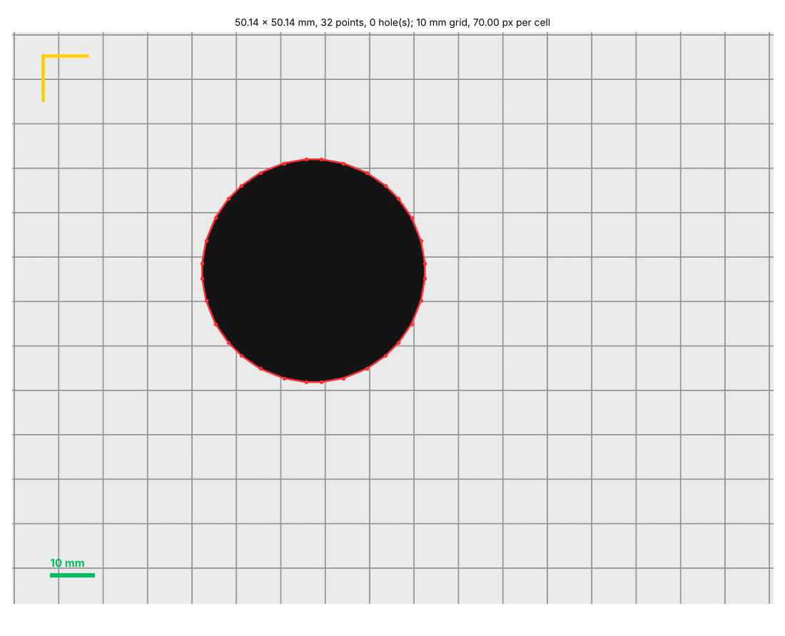

# Tracing an outline

For a flat object with an irregular outline (a gasket, a cover plate, a tool shadow, a broken
part to replace), a picture beats measuring it point by point. `trace_outline` (MCP) or
`b123d-print trace` (CLI) turns a **flatbed scan** or a **photo on a grid** into a 2D outline in
mm, with its holes, ready to paste into a part script. See
[Measuring for the AI](measuring.md) for how to take the picture.

## How accurate it is

Be honest with yourself about the source:

| Source | Accuracy | Why |
| --- | --- | --- |
| flatbed scan at a known DPI | about one pixel (0.08 mm at 300 dpi) | no lens and no perspective: the best source |
| photo square-on, object flat on a grid or beside a card | roughly 0.5–1 % of the size, more near the frame edges | lens distortion bends straight edges; any tilt is perspective; the scale only holds in the plane of the grid or card |
| photo at an angle | not usable for size | perspective changes the scale across the picture |

The tool reports the scale it used, the pixel size in mm and warnings it can see (grid cells
that are not square, a reference whose sides disagree). **Check one known dimension** (a hole
spacing, the overall length with calipers) against the trace before trusting it, and keep the
values it gives as estimates in the script's comments.

## Scale sources (give one)

| Source | Argument | How |
| --- | --- | --- |
| scan resolution | `dpi=600`, or nothing | a scanner writes its DPI into the PNG/TIFF/JPEG; without a value the tool reads it from the file (it refuses 72/96 dpi: a screen default, not a scan) |
| a grid or cutting mat | `grid=10` (cell size in mm) | the grid's repeat is measured over the whole picture; grid lines are cleaned away before tracing |
| a reference object | `reference="card"` or `reference="100,50"` | a credit card (ISO/IEC 7810 ID-1, 85.60 × 53.98 mm) or any rectangle of known sides, lying beside the object |
| two points | `points="x1,y1,x2,y2"`, `distance=100` | two pixels a known distance apart, e.g. ruler marks; pixel coordinates from the top left, as image viewers show them |

## The pipeline

1. Gray image, automatic (Otsu) threshold; the object is whichever side the image border is not
   (`threshold=` and `invert=` override). Images over 4000 px are scaled down first.
2. An opening removes thin grid lines and specks; the largest object (not the reference card)
   is traced, or the one under `pick="x,y"`.
3. Its contour at sub-pixel precision, with the inner contours as holes (smaller than 1 mm² are
   dust).
4. Simplified (Ramer–Douglas–Peucker) to `tolerance` mm (0.2 by default): few points, because
   dense polylines make slow builds. `smooth=True` gives through-points for a periodic spline
   instead, for organic outlines (it rounds sharp corners).

## What it writes

In the part's `out/` folder (CLI: next to the image, or `--out`):

- `<image>_trace.png` — the outline (red) and holes (blue) on the picture, the scale reference in
  yellow and a mm scale bar. **Show it to the user and confirm** before modeling.
- `<image>_outline.json` — the points (`outline`, `holes`), the scale and its source, size and area.
- `<image>_outline.py` — a snippet for the part script:

```python
# traced: scan at 300 dpi (from the file), 0.08467 mm/px, tolerance 0.2 mm;
# size 80.09 x 50.04 mm, 4 points, 1 hole(s).
# Check a known dimension against the object before trusting it (photo scale is an estimate).
from build123d import Polyline, make_face

OUTLINE = [  # mm, +Y up, centered on the bounding box
    (39.92, 25.004), (-40.033, 24.892), (-39.92, -25.004), (40.033, -24.892),
]
OUTLINE_HOLES = [
    [
        (-11.472, -9.948), (-13.504, -9.426), (-16.674, -7.535), (-18.782, -4.911),
        ...
    ],
]


def outline_face():
    """The traced outline as a face on XY, holes cut; extrude(face, amount=...) for a part."""
    def loop(pts):
        return make_face(Polyline(*pts, close=True))
    face = loop(OUTLINE)
    for h in OUTLINE_HOLES:
        face -= loop(h)
    return face
```

The corners of that 80 × 50 mm rectangle land within about a pixel (0.1 mm) of where they
were drawn: the accuracy of the scan, not of the CAD.

Paste the points into the script (they are measurements, so name them and say where they came
from), then `extrude(outline_face(), amount=d.THICKNESS)`.

## Example

```text
$ b123d-print trace scan.png
traced 80.09 x 50.04 mm, area 3691.9 mm^2; scan at 300 dpi (from the file), 0.08467 mm/px (about +-0.085 mm from the pixels alone)
outline 4 points, 1 hole(s) [24]; 4024 points before simplifying to 0.2 mm
```



## The sandbox

Tracing runs in the [sandbox](sandbox.md) like every other job that parses an uploaded file,
and reads only the part's own reference files (`parts/<part>/ref/`, uploaded with
`upload_reference`). Images over 120 megapixels are refused.
